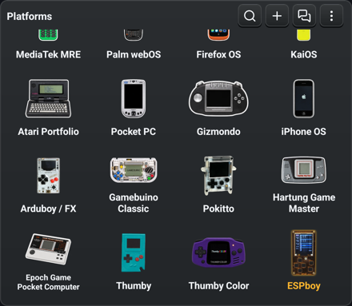
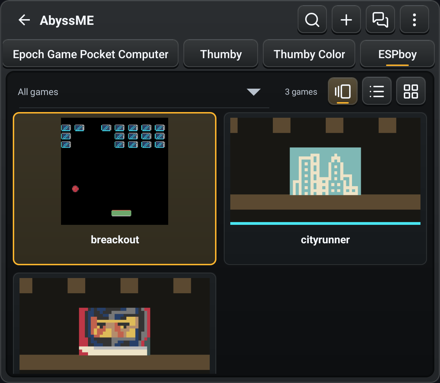

# AbyssME

### An Interactive Archive of Pocket Gaming History.

*Old phones. Forgotten handhelds. Little screens. Entire worlds.*

Some games lived behind twelve phone keys. Others belonged to a PDA with a stylus, a strange handheld you only saw in a magazine, or a tiny console built by someone who simply loved making games.

The devices aged. The stores closed. The formats were forgotten.

**The games deserve another chance to be played.**

**AbyssME** is an open-source Android home for those little worlds: a growing, interactive collection of games from old mobile phones, pocket computers, unusual handhelds and maker-built consoles. Explore the devices, bring your own game files, and play with touch or a controller—all from one library.

It began as an independent [J2ME Loader](https://github.com/nikita36078/J2ME-Loader) fork. Today, the idea is bigger than any single emulator:

> **Not just remembering the games. Playing them again.**

[**Download**](https://github.com/EriArk/JavaEmulator/releases) · [**Project website**](https://abysstail.art/en/projects/abyssme) · [**Getting started**](docs/FAQ.md) · [**Discord**](https://discord.gg/xBN9DXt8Q) · [**GitHub issues**](https://github.com/EriArk/JavaEmulator/issues)

---

> [!IMPORTANT]
> **What's available right now — November 22, 2026**
>
> **Public release:** **AbyssME 0.7.0 Beta 10**, for Android 10+. It includes **Java ME, Mophun, Symbian and N-Gage** (Symbian/N-Gage require ARM64).
>
> **Development builds:** **32 platform shelves** have been integrated into the shared Android library and exercised in private Retroid Pocket Classic tests. **These new platforms are not included in the public Beta 10 APK.** Integration and short gameplay checks are not a promise of complete game compatibility.
>
> See [current development and test status](docs/PROJECT_STATUS.md) for dated evidence. Public downloads live on the [Releases page](https://github.com/EriArk/JavaEmulator/releases), not in private test-build reports.

## Walk into the archive

Don't start with a list of emulator cores. Start with the devices themselves.

AbyssME's developing platform gallery is made of illustrated phones, handhelds and pocket computers. Select one and its game shelf opens. When using a controller, the device in focus lights up. By default, the gallery shows platforms that already have games; choose **Show platforms without games** to discover the empty shelves and add games or required system files. Or skip the gallery and return directly to the last library tab.

**A glimpse of the archive — private development build, not the public download:**

 

**The public beta's familiar library and in-game menu:**

 

*The public UI images are older signed 0.6 Beta 1 captures; the gallery images are newer private Retroid tests. Games and proprietary firmware are not included in AbyssME.*

## More than a collection of launch buttons

Every device has its own story—and its own quirks. AbyssME tries to preserve those differences without making you relearn the entire app each time.

- **One home for your games.** Browse in Gallery, List or Grid; search, sort, keep favorites, revisit recently played games, manage collections and choose your own artwork.
- **Controls that understand the device.** Use touch, a phone keypad or a physical controller. Set per-game bindings, edit the on-screen layout and reuse independent control profiles. Development builds also expose platform-specific buttons—from PDA shortcuts to peculiar handheld keys—rather than pretending everything is a modern gamepad.
- **Make the old picture feel right.** Change orientation, screen size and scaling. On supported Java/Mophun paths, choose sharp pixels, smoothing, FSR, xBRZ, CRT or LCD treatments. Try supported changes in the game, then **Keep** or **Undo** them. Rendering options vary by engine.
- **Pick up where you left off.** Back up your library, controls and saves. Engines that support guest saves or states keep their own storage model; private integrations include writable flash, virtual SD cards, firmware selection and cold-session restoration.
- **Play without signing in.** The single-player archive works offline. Social features and limited experimental multiplayer are optional.
- **Less setup, more playing.** Java ME can suggest an initial game configuration. If an old game needs special treatment, its detailed settings are still there.

This is a living project, not a claim that every device is perfectly emulated. The ambition is **a small number of familiar actions for a lot of very unfamiliar hardware**.

## 32 windows into pocket gaming history

The archive's experimental platform count describes **library entries in development**, not the number of public, fully compatible emulator releases. Related models may share a shelf, and some newer mobile-OS integrations run *packaged games*, not the entire original operating system.

### The four platforms you can download today

| Platform | What it brings back | What to know |
| --- | --- | --- |
| **Java ME / J2ME** | The era of JAR/JAD phone games, original screen sizes, numeric keypads and early mobile 3D | Automatic initial setup and per-game compatibility controls; vendor APIs differ between releases |
| **Mophun** | Games from another mostly forgotten feature-phone runtime | Experimental Wolphun-derived engine; Beta 10 improves sound and approximate execution pacing |
| **Symbian / S60** | Native smartphone applications and games through integrated EKA2L1 | ARM64 only; compatible user-provided phone system files required |
| **N-Gage / N-Gage 2.0** | Two generations of Nokia's mobile gaming experiments | ARM64 only; original N-Gage and N-Gage 2.0 need different compatible phone/platform setups |

### The other 28 shelves in the workshop

These are **real development integrations with limited on-device tests**, not features promised in Beta 10.

| Part of the archive | Platform shelves |
| --- | --- |
| **Phones, PDAs & pocket computers (10)** | WIPI / SKVM · MediaTek MRE · Flash Lite · Palm OS · Palm webOS · Firefox OS · KaiOS · Pocket PC / Windows CE · Early iPhone OS · Atari Portfolio |
| **Unusual commercial handhelds (12)** | Dingoo A320 · Gemei A330 · Aquaplus P/ECE · GamePark GP32 · Watara Supervision · Mega Duck / Cougar Boy · Cybiko Classic / Xtreme · Gamate · TimeTop GameKing / GameKing 3 · Gizmondo · Hartung Game Master · Epoch Game Pocket Computer |
| **Tiny maker-built worlds (6)** | Arduboy / FX · Gamebuino Classic · Pokitto · Original Thumby · Thumby Color · ESPboy |

**Nokia Asha / Series 40 touch games** are also being improved inside **Java ME**, with gesture APIs, canvas text entry and phone-keyboard behavior. Asha is not counted as a separate platform shelf.

Want to see what's planned after these? The [platform roadmap](docs/PLATFORM_ISSUES.md) tracks candidates, upstream engines, constraints and next steps. The project focuses on **obscure, underpreserved pocket gaming ecosystems**, not duplicating every mainstream home console.

## Not just boot screens. Games with stories to tell.

The most exciting part of the archive is seeing an old game actually respond: an on-screen button moves a character, a piece of music plays again, a save survives after closing the app.

Here are a few moments recorded in **private Android builds on Retroid Pocket Classic**:

| A little world rediscovered | What was observed |
| --- | --- |
| **Age of Empires — Pocket PC** | A native Windows CE ARM game reached a playable map; units could be selected, music played and a saved match reopened. [Device check](docs/checks/2026-11-21-pocketpc.md) |
| **Carmageddon — Gizmondo** | A Main Street race became playable, with steering, a speedometer and restored digital audio. [Device check](docs/checks/2026-11-21-gizmondo.md) |
| **Castle Smasher — early iPhone OS** | The original IPA ran through touchHLE with landscape graphics, game audio and a controller-driven touch cursor. [Device check](docs/checks/2026-11-21-iphone.md) |
| **Bejeweled — Palm Tungsten E2** | Native ARM64 integration reached the title in about five seconds with prepared firmware; gameplay audio and a cold save restore were exercised. [Device check](docs/checks/2026-11-21-palm.md#integrated-native-palm-os-5) |
| **Inotia and Metal Slug — WIPI / SKVM** | Korean phone games entered gameplay using shared touch and controller mappings, with digital audio captures. [Device check](docs/checks/2026-11-20-wipi-games.md) |
| **MicroCity — Pokitto** | A road and game date were saved to the virtual SD card, then loaded again after restarting. [Device check](docs/checks/2026-11-22-pokitto.md) |
| **Donut Clicker — Thumby** | The tiniest sort of game kept its donut counter after a cold restart. [Device check](docs/checks/2026-11-22-thumby.md) |
| **Astro Bomber — Epoch Game Pocket Computer** | A retail cartridge reached level one, accepted game controls, produced digital audio and restored a checkpoint. [Device check](docs/checks/2026-11-22-epoch.md) |
| **NinjaEscape — ESPboy** | An LGE game reached its scrolling stage with controller input and captured sound. [Device check](docs/checks/2026-11-22-espboy.md) |

These are deliberately bounded observations. Some controller events were injected on the Retroid, some audio was measured from Android digital capture, and full-game playthroughs remain largely unverified. **A tested game is not a guarantee about an entire platform's catalog.**

For the full picture, including original GameKing, Gamate, GP32, Cybiko, MRE, webOS, Firefox OS, KaiOS, Arduboy, Gamebuino, Thumby Color and more, see the dated [development status and game reports](docs/PROJECT_STATUS.md).

## Take a game out of the archive

The currently downloadable release is **AbyssME 0.7.0 Beta 10**. It needs **Android 10 or newer**; touch works without a controller.

| Download | Android architecture | Included engines |
| --- | --- | --- |
| **[ARM64 APK](https://github.com/EriArk/JavaEmulator/releases/download/v0.7.0-beta.10/AbyssME-0.7.0-beta.10.apk)** | 64-bit ARM | Java ME, Mophun, experimental Symbian and N-Gage |
| **[ARMv7 APK](https://github.com/EriArk/JavaEmulator/releases/download/v0.7.0-beta.10/AbyssME-0.7.0-beta.10-armv7.apk)** | 32-bit ARM | Java ME and Mophun only |

Choose ARM64 when supported. ARMv7 does not run on every ARM64-only device. Both official APKs share the package ID `io.github.eriark.abyssme` and can update a compatible installation.

1. **Install AbyssME** using an official APK and open your library.
2. **Add your own game** with **+ / Add game**, or index a folder. Java ME usually uses `.jar` / `.jad` and Mophun uses `.mpn`; supported archives work as well.
3. **Launch and play.** Java ME prepares an initial compatibility configuration from the game where possible.
4. **Make it yours.** Open **Display**, **Controls** or **Compatibility** to adjust the game; preview and save supported changes.

**Symbian and N-Gage need more than a game file.** You must supply a compatible virtual phone system; N-Gage 2.0 also requires its matching platform installation. The [setup and firmware guide](docs/FAQ.md#3-symbian-and-n-gage-understand-the-three-pieces) explains the difference.

**Upgrading or moving from another app?** Back up your games and saves first. The former separate AbyssME Phone package (`io.github.eriark.abyssme.phone`) uses a [migration flow](docs/LIBRARY_TRANSFER.md); don't uninstall it until you've checked the transfer. J2ME Loader has its own import workflow.

For the history of public builds, see the [changelog](CHANGELOG.md) and [Beta 10 notes](docs/releases/v0.7.0-beta.10.md).

## Some worlds can be shared

AbyssME also has optional Fluxer social features: sign-in, friends, messages and lobbies. **Play Together** is an early, low-compatibility experiment for **some Java games that use Bluetooth APIs**. Players need matching editions and their own copies of the game.

It is **not** universal Java multiplayer, and it does **not** make Mophun, Symbian, N-Gage or the other experimental engines multiplayer-capable. Some network connections fail; there is no universal relay fallback. Single-player games do not need an account.

[Multiplayer setup, architecture and limitations](docs/MULTIPLAYER.md)

## Help keep the little worlds alive

The most helpful thing you can do is **try real games and tell us exactly what happened**.

If an old game starts, freezes, shows the wrong picture, loses audio or refuses a button, share its **title and edition**, device/Android version, file type, the screen or action where it happened, and a screenshot or short clip if possible. Please don't upload commercial game files or proprietary firmware.

[**Discuss on Discord**](https://discord.gg/xBN9DXt8Q) · [**Report a bug or request a platform**](https://github.com/EriArk/JavaEmulator/issues) · [**Contribute**](CONTRIBUTING.md)

Known boundaries matter: old vendor APIs, original firmware formats, game-specific quirks, device-specific controller layouts and save behavior are not all solved. A private debug APK, a successful import, a brief core test and a signed public release are **different milestones**. The [status report](docs/PROJECT_STATUS.md) keeps their evidence separate.

External launcher workflows are documented for Beacon, Pegasus and Daijisho, with [ES-DE setup examples](docs/LAUNCHER_INTEGRATION.md); ES-DE device verification remains incomplete.

### Building AbyssME

The standard debug build covers Java ME and Mophun:

```sh
./gradlew :app:assembleFdroidDebug
```

Use `gradlew.bat` on Windows. A combined Symbian/N-Gage ARM64 build needs separately restored pinned sources and `-PsymbianRelease=true`. The additional experimental engines have independent native dependencies, build flags and distribution considerations. **Building a module does not make it a supported public release.**

See [contributor setup](CONTRIBUTING.md), [build workflow](docs/REMOTE_BUILDS.md), [Symbian prerequisites](engines/symbian/DISTRIBUTION.md) and [component licensing](docs/LICENSING.md).

## The people and projects behind the archive

AbyssME began with [J2ME Loader](https://github.com/nikita36078/J2ME-Loader) by **Nikita Shakarun** and contributors, and includes open-source work originating in [JL-Mod](https://github.com/woesss/JL-Mod). Its Java 3D and Mophun support build on FreeJ2ME-derived work and Wolphun respectively. The growing archive also depends on many other emulator and preservation communities. The [license and source inventory](docs/LICENSING.md) and [device art credits](design-concepts/platform-stickers/README.md) document their contributions and the requirements for distributing them.

The combined application is released under **[GNU GPL version 3](LICENSE)**, with original component notices and licenses retained. Proprietary games, device ROMs, firmware, BIOS files and other commercial materials are **not bundled or relicensed** by AbyssME. Bring files you have the right to use.

---

### AbyssME — An Interactive Archive of Pocket Gaming History.

*Not just remembering the games. Playing them again.*
