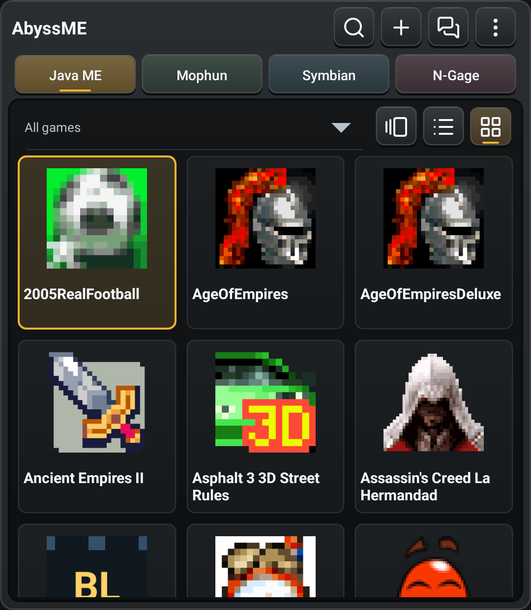
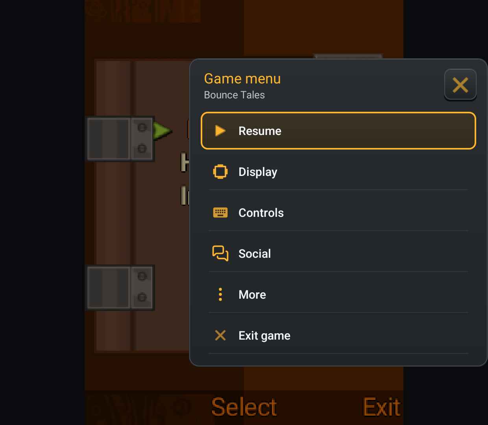

# AbyssME

**An Interactive Archive of Pocket Gaming History.**

*Old phones. Forgotten handhelds. Games worth bringing back.*

AbyssME is an open-source Android app for rediscovering games from mobile phones, PDAs and unusual pocket gaming devices. Pick a platform, add your own game, and play with touch controls or a physical controller—without juggling a different interface for every emulator.

What began as an independent fork of [J2ME Loader](https://github.com/nikita36078/J2ME-Loader) has grown into a multi-engine project. Java ME, Mophun, Symbian and N-Gage share one library in the public beta. Development builds are expanding that idea to obscure phone runtimes and handhelds that rarely get a place in mainstream emulation.

The goal isn't to collect emulator logos. **It's to make forgotten games playable again, while preserving the character of the devices they came from.**

**[Download the public beta](https://github.com/EriArk/JavaEmulator/releases)** · **[Project website](https://abysstail.art/en/projects/abyssme)** · **[Setup & FAQ](docs/FAQ.md)** · **[Discord](https://discord.gg/xBN9DXt8Q)** · **[Report an issue](https://github.com/EriArk/JavaEmulator/issues)**

> **Release status — November 21, 2026**
>
> - **Public:** `0.7.0 Beta 10` for Android 10+. The official APK offers **Java ME, Mophun, Symbian and N-Gage** (Symbian/N-Gage on ARM64 only).
> - **In development:** a **16-platform** experimental Android build, tested on Retroid Pocket Classic, with additional phone, PDA and handheld engines. **These additions are not in the public Beta 10 download.**
>
> This is beta software, not a guarantee that every game or handset image will work. [Current verified status](docs/PROJECT_STATUS.md) · [Release notes](docs/releases/v0.7.0-beta.10.md)

## A pocket gaming museum you can actually play

The expanding platform launcher uses illustrations of the original devices, rather than a wall of generic emulator icons. Choose a device to open its game library. On a handheld, controller focus highlights the selected device; the launcher can also be disabled for quicker access to the last library tab.

**Development preview — private Android test build, not included in Beta 10:**


**Existing public interface — library, artwork and in-game controls:**

 

The lower screenshots are from the older signed 0.6 beta on Retroid Pocket Classic. See the [public screenshot collection](screenshots/releases/v0.6.0-beta.1/README.md) and [current device-test evidence](docs/PROJECT_STATUS.md) for build-specific details.

## What you can do in the public beta

- **Build a personal game library.** Gallery, List and Grid views; folders, search, favorites, recently played games, sorting and editable game artwork.
- **Play on a phone or a handheld.** One APK layout adapts to portrait and landscape screens, touchscreen play and physical controllers. A controller is optional.
- **Make old controls comfortable.** Phone keypad or virtual gamepad; movable and resizable touch layouts; extra buttons; remapping for individual games; physical buttons, D-pad and both analog sticks.
- **Reuse your favorite setups.** Independent graphics, touch-control and physical-controller profile catalogs, with global defaults, named presets and per-game overrides.
- **Adjust the picture without losing your settings.** Live display sizing, orientation, LCD effects and, on supported Java/Mophun rendering paths, Pixel sharp, Smooth, FSR, xBRZ and CRT presets. Try a change in-game, then **Keep** or **Undo** it.
- **Spend less time preparing games.** Java ME first-launch preparation proposes display and compatibility settings from game metadata and APIs. You can always override the result.
- **Keep your collection portable.** Library backup/restore, saved mappings and profiles, plus separate virtual-phone backups for Symbian/N-Gage. Import an existing J2ME Loader collection or migrate from the former AbyssME Phone app.
- **Stay offline if you want.** Ordinary single-player play does not require an account. Optional Fluxer social features and early multiplayer are described [below](#experimental-multiplayer).

Features vary by engine and game. Advanced rendering effects are **not** universal Symbian/N-Gage shaders. See [profiles](docs/SHARED_PROFILES.md), [display enhancements](docs/EXPERIMENTAL_ENHANCEMENTS.md) and [fast-forward](docs/FAST_FORWARD.md).

### Platforms in the official `0.7.0 Beta 10` release

| Platform | What is available | Important detail |
| --- | --- | --- |
| **Java ME / J2ME** | JAR/JAD games, automatic initial setup, MIDP touch and controller mapping, M3G support | Compatibility depends on the game's APIs, device edition and original screen profile. |
| **Mophun** | MPN games with a Wolphun-derived engine, common library and controls | Still experimental. Beta 10 improves general sound, BEEP effects and approximate phone-model pacing. |
| **Symbian / S60** | Integrated EKA2L1-based virtual-phone setup and SIS/SISX installation | **ARM64 only.** Requires compatible user-supplied phone system files; support is incomplete. |
| **N-Gage / N-Gage 2.0** | Original N-Gage and later N-Gage platform games through the Symbian phone system | **ARM64 only.** The two generations need different compatible phone/platform setups. Some games remain unreliable. |

The game list is **not** preloaded. AbyssME does not bundle commercial games, copyrighted phone firmware, BIOS dumps or proprietary platform installers.

## Beyond the public beta: what's already running in development

This is where AbyssME has expanded dramatically. As of **November 21, 2026**, the source tree and local/private ARM64 builds include **12 additional platform entries**, bringing the experimental library to **16**. These are actual integration and device-test results—not twelve new public releases, and not blanket compatibility claims.

| Development platform | Examples exercised on Retroid Pocket Classic |
| --- | --- |
| **WIPI / SKVM** | Korean phone games **Inotia** and **Metal Slug** reached gameplay with captured audio. |
| **Dingoo A320** | **Digger** reached its playable maze; settings and cold-state restoration were exercised. |
| **Gemei A330** | **7 Days Salvation** reached its first 3D room; other tested titles still showed black screens. |
| **Aquaplus P/ECE** | **P.K.O.** reached combat using a writable flash image, with sound and retained game data. |
| **GamePark GP32** | **Tomak** and **GP Fight** reached gameplay, with audio and restored states. |
| **Watara Supervision** | **Crystball** and **Challenger Tank** reached gameplay; cartridge core checks cover a wider sample. |
| **Mega Duck / Cougar Boy** | **Arctic Zone** and **The Brick Wall** reached gameplay, with audio and a retained checkpoint. |
| **Cybiko Classic / Xtreme** | **Maze Dweller** reached a level on Classic; **Homerun Derby** played on Xtreme. |
| **Flash Lite** | **MicroInvaders** and **Balloonatroid** reached gameplay, including companion SWF loading. |
| **Gamate** | **XGomoku**, **X-T-Rex** and games from a multi-game cartridge reached gameplay. |
| **TimeTop GameKing / GameKing 3** | **Drifter** and the color **Adventure** cartridge ran through the shared library. |
| **Palm OS** | **Space Trader** retained its cargo on m515; **Bejeweled** ran on Tungsten E2 with native ARM64 execution, audio and cold-save recovery. |

The development build also expands **Java ME itself** with Nokia **Asha / Series 40** touch APIs: taps, flicks, long presses, double-taps, pinch gestures, keypad switching and canvas text entry. **TouchMare**, **Bubblet** and **Bounce Tales** were exercised. Asha is **not** counted as a separate seventeenth platform.

What makes these integrations interesting is the shared host around them: game cards, firmware selection where needed, artwork, display and controller profiles, library import, backups and save/state handling. Not every engine supports every capability yet, but the experience is being built as **one app**, not a bundle of unrelated launchers.

A few other development-only usability changes are already exercised: moving libraries to an SD card, choosing menu orientation independently of gameplay, adjusting portrait menu margins and calibrating usable game-screen areas.

**Evidence, caveats and build scope:** [Current project status](docs/PROJECT_STATUS.md) · [Platform integration roadmap](docs/PLATFORM_ISSUES.md) · [Palm OS checks](docs/checks/2026-11-21-palm.md) · [Handheld library audit](docs/checks/2026-11-20-platform-lifecycle.md)

## Download and get started

**Android 10 or newer is required.** Choose the version matching your device:

| Download | Architecture | Engines in the official APK |
| --- | --- | --- |
| **[AbyssME Beta 10 — ARM64](https://github.com/EriArk/JavaEmulator/releases/download/v0.7.0-beta.10/AbyssME-0.7.0-beta.10.apk)** | 64-bit ARM (arm64-v8a) | Java ME, Mophun, experimental Symbian and N-Gage |
| **[AbyssME Beta 10 — ARMv7](https://github.com/EriArk/JavaEmulator/releases/download/v0.7.0-beta.10/AbyssME-0.7.0-beta.10-armv7.apk)** | 32-bit ARM (armeabi-v7a) | Java ME and Mophun only |

Prefer ARM64 if your Android device supports it. An ARM64-only device cannot necessarily install the ARMv7 package. Both official packages use `io.github.eriark.abyssme` and can update a compatible existing installation in place.

1. **Install the APK** from the official release link and open AbyssME.
2. **Add a game:** select **+ / Add game** or index a folder. Java ME usually uses `.jar`/`.jad`; Mophun uses `.mpn`. Supported archives can also be imported.
3. **Launch it.** AbyssME prepares initial Java ME settings, then saves your configuration.
4. **Adjust as needed:** use the game's **Display**, **Controls**, or **Compatibility** options. Preview supported settings and keep or undo them.

Symbian and N-Gage first require suitable phone-system files, and N-Gage 2.0 additionally needs its matching platform installation. Start with the [setup and file guide](docs/FAQ.md#3-symbian-and-n-gage-understand-the-three-pieces) instead of guessing which ROM or installer belongs to which phone.

**Updating or migrating?** Back up important games, saves and virtual phones before switching architectures or installing a new beta. The old `io.github.eriark.abyssme.phone` installation is separate; use **Settings → Library → Library transfer → Move from AbyssME Phone**, then confirm your saves before uninstalling it. [Migration details](docs/LIBRARY_TRANSFER.md).

### What's new in public Beta 10?

- Global and named **physical-controller profiles** independent of graphics and touch profiles, including both sticks.
- Mophun **general audio**, synthesized BEEP effects and improved PCM behavior.
- Approximate per-phone execution pacing for CPU-dependent Mophun games.

Earlier 0.7 betas introduced independent graphics/control profiles, right-stick directions and diagonals, extra touch buttons and fixes for M3G rendering. For dated release notes and test coverage, see the [changelog](CHANGELOG.md) and [Beta 10 verification](docs/releases/v0.7.0-beta.10-checks.md).

## Experimental multiplayer

AbyssME has optional **Fluxer** sign-in, friends, private chats and compatible game lobbies. An early **Play Together** path exists for **some Java games using Bluetooth APIs**. Both players need their own matching game version, and the connection is peer-to-peer.

This is **not universal online multiplayer** for Java ME, and it does **not** enable arbitrary Mophun, Symbian, N-Gage or experimental handheld multiplayer. Compatibility is low, some network combinations fail, and there is no universal relay fallback. Playing offline needs no account.

[Multiplayer behavior, setup and limits](docs/MULTIPLAYER.md)

## Compatibility, known limits and the roadmap

AbyssME prioritizes a fast, understandable route from **your game file to actual gameplay**, but a successful import or boot screen does not prove that an entire game works.

- Different editions of the same old mobile game may require different phone APIs, screen resolutions or firmware.
- Automatic preparation is a **best guess**, not a game-by-game compatibility database. Use per-game settings or **Fix game** when needed.
- Mophun and Symbian/N-Gage are experimental in the official beta; some titles have audio, startup, graphics or save limitations.
- The expanded platforms are **development-only** until they receive public builds and broader acceptance testing.
- Emulator rendering, physical controllers, Android versions and external launchers need testing across more devices. Existing frontend integrations include Beacon, Pegasus and Daijisho development checks; **ES-DE is not yet device-verified**. [Launcher guide](docs/LAUNCHER_INTEGRATION.md).

The roadmap focuses on **underpreserved phone software, PDAs and unusual handhelds**, rather than duplicating mainstream retro-console emulators. New candidates are evaluated for actual games, reusable open-source cores, legal provenance and the effort to deliver a usable Android experience. [Platform roadmap](docs/PLATFORM_ISSUES.md) · [Issue tracker](https://github.com/EriArk/JavaEmulator/issues)

**Found a game that misbehaves?** [Open an issue](https://github.com/EriArk/JavaEmulator/issues) or [tell us on Discord](https://discord.gg/xBN9DXt8Q). Include the game title and exact edition, file type, Android/device model, what happened and (if possible) a screenshot or short recording. Please don't attach copyrighted commercial game or firmware files.

## Build and contribute

Bug reports, compatibility tests, translations, documentation and focused pull requests are welcome. The normal debug build covers **Java ME and Mophun**:

```sh
./gradlew :app:assembleFdroidDebug
```

On Windows, use `gradlew.bat`. The full combined ARM64 Symbian build needs the separate, pinned engine source materials and `-PsymbianRelease=true`; optional development engines have their own prerequisites. A local debug build is **not** the same as a tested, signed public release.

See [Contributing](CONTRIBUTING.md), [build instructions](docs/REMOTE_BUILDS.md), [Symbian distribution requirements](engines/symbian/DISTRIBUTION.md) and [current development status](docs/PROJECT_STATUS.md).

## Origins, credits and licenses

AbyssME began as an independent fork of [J2ME Loader](https://github.com/nikita36078/J2ME-Loader) by **Nikita Shakarun** and contributors. It also uses open-source work originating in [JL-Mod](https://github.com/woesss/JL-Mod), FreeJ2ME-derived rendering and Wolphun-derived Mophun support. Experimental engines incorporate or adapt additional upstream projects; their source revisions, notices and distribution constraints are tracked individually.

The combined application uses **[GNU GPL version 3](LICENSE)**. Included components keep their original copyright notices and applicable licenses. A new engine present in the repository is **not automatically cleared or published as a distributable APK**. See [component licenses and provenance](docs/LICENSING.md) and [device-illustration references and credits](design-concepts/platform-stickers/README.md).

**AbyssME provides the environment, not the games.** Bring game files, firmware and other system materials you are entitled to use. Commercial games and proprietary device files are not bundled.

---

**AbyssME — An Interactive Archive of Pocket Gaming History.**

*Not just remembering the games. Playing them again.*
