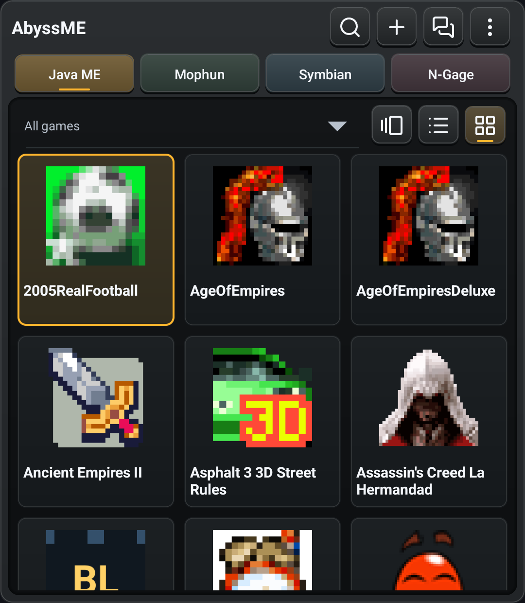
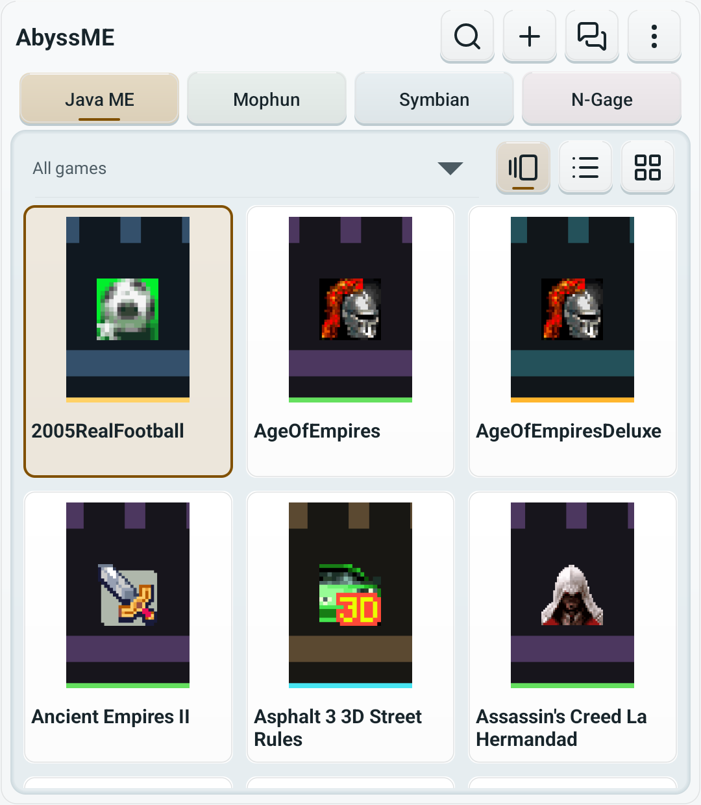
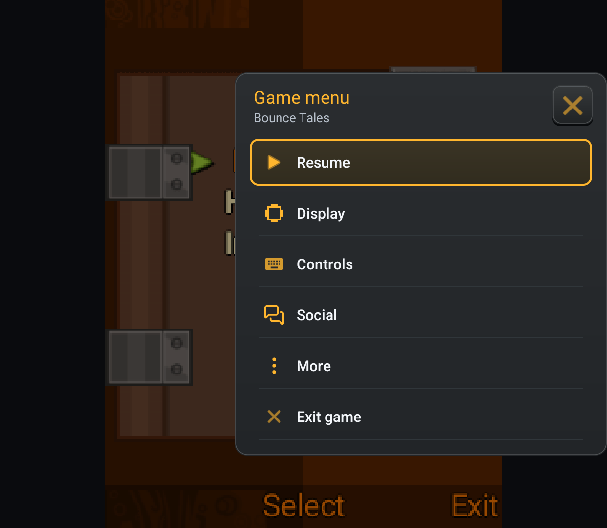
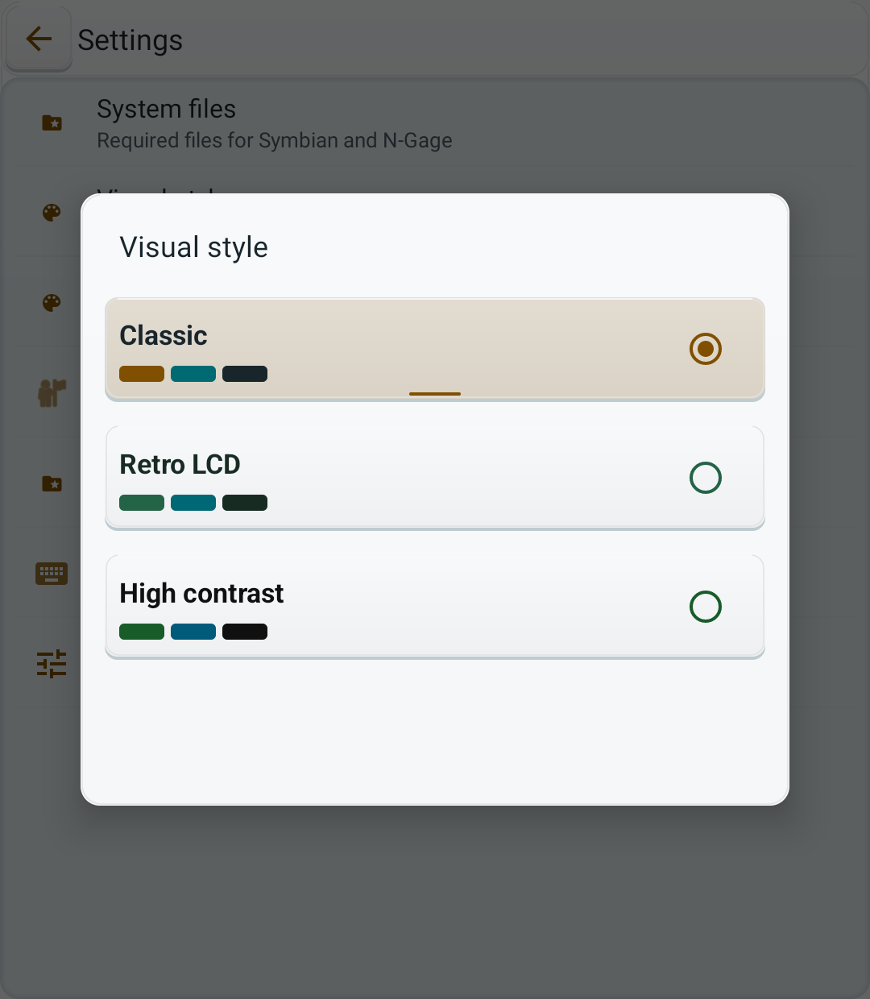

# AbyssME

**Old mobile games on Android handhelds and phones.**

AbyssME is an independent fork of
[J2ME Loader](https://github.com/nikita36078/J2ME-Loader), focused on making
old mobile Java games feel at home on modern landscape handhelds. It builds on
the J2ME Loader runtime while replacing the setup-heavy workflow with a game
library, automatic first-launch preparation, and fast per-game controller
mapping. Mophun and experimental Symbian / N-Gage support share the same
library, display controls and in-game menu.

**0.6.0 Beta 1 uses one APK for phones and handhelds**, with automatic controller
detection and optional touch buttons. Existing Handheld installs update in place;
users of the former Phone app can use the menu-based
[migration workflow](docs/LIBRARY_TRANSFER.md#moving-from-abyssme-phone).

> **Project status:** Beta. AbyssME is usable, but compatibility automation and
> launcher integration still need testing across more games and devices.

[Download 0.6.0 Beta 1](https://github.com/EriArk/JavaEmulator/releases/download/v0.6.0-beta.1/AbyssME-0.6.0-beta.1.apk)

Use the **0.6.0-beta.1** APK. It updates the official unified app in place;
older releases remain available for reference.

## Current Beta

For website copy, progress posts and handoffs, start with the
[current product/development status](docs/PROJECT_STATUS.md) and
[dated changelog](CHANGELOG.md). They also describe local/private experiments,
explicitly separated from public downloads. The
[0.6.0 Beta 1 notes](docs/releases/v0.6.0-beta.1.md) include the combined-engine scope,
verification limits and source downloads.

**A refreshed game library and menus:** four platform tabs, remembered browsing
state, contextual game actions instead of a permanent detail sidebar, and a
shared Soft Console appearance in light and dark themes. Supported display
presets preview immediately with Keep/Undo. Phone keypad placement can be
Separate or Overlay without changing existing controller mappings.

**Multiplayer is early experimental, with low compatibility.** Social provides
Fluxer sign-in, friends, chats and AbyssME-compatible lobbies. Play Together is
available for supported Java Bluetooth games; both players need the same game
version and their own copy. It is not multiplayer for every Java game, Mophun
or Symbian/N-Gage. Some networks cannot connect; there is no relay fallback.
Offline play does not need an account. [Setup and limits](docs/MULTIPLAYER.md).

After this feature beta, development is focused on usability, stability and game
compatibility rather than another round of major features.

**Image presets** for Java and Mophun now include Pixel sharp, Smooth,
Enhanced (FSR), xBRZ and CRT EasyMode. Open **Game menu > Display > Enhancements**
and try a preset before keeping it. xBRZ and CRT are standalone effects, without
extra filtering or interpolation. **Integer** picture size enlarges by whole
pixel multiples. Optional frame interpolation and Mophun CPU budget remain
experimental and off/original by default; they do not guarantee 60 FPS.
Symbian/N-Gage does not use these new GPU effects.
[Options and limits](docs/EXPERIMENTAL_ENHANCEMENTS.md),
[0.5 effect comparisons](screenshots/releases/v0.5.0-beta.1/README.md).

[Fresh 0.6 signed-app screenshots](screenshots/releases/v0.6.0-beta.1/README.md)
show the updated library, settings, Social and game menus in light and dark themes.

This beta also improves Java frame pacing, short button taps and interrupted
imports. Mophun screenshots can use the enhanced image or original pixels.

**Fast-forward** offers per-game 1.5x, 2x, 3x and 4x targets across all three
engines. Use the game menu, optional on-screen shortcut, or assign a controller
button/trigger with Hold or Toggle behavior. Open **Game menu > More >
Fast-forward settings**, then Try/Keep your changes. Stopping restores the prior
speed and frame cap. Actual acceleration depends on the game and hardware;
audio pitch changes with speed. [Details and limits](docs/FAST_FORWARD.md).

Filter All games, Recent or Favorites by platform, return to your previous scroll
position, or use **Play last**. **Edit card** groups title and artwork actions.
Optional **LCD Soft / LCD Classic** effects follow the game's pixels, with
adjustable intensity and per-game preview. Screenshots can be exported clean or
with the LCD effect, without emulator controls. Effects remain Off by default.

Choose **Classic, Retro LCD or High contrast** independently of light/dark
brightness. **Controls > Edit touch layout** offers a visual editor for moving
and resizing control blocks, with separate portrait and landscape placements
per game. Try the result before keeping it. Symbian / N-Gage cards now support
custom covers, icons and titles; these travel with whole-phone backups. New
format-3 phone backups require Beta 3 or newer to restore; older backups remain
supported. Favorites and recent-play history are not transferred in phone backups.

The unified app supports portrait and landscape, controller navigation, and
numeric-keypad or gamepad touch layouts. Per-game **Control mode** and
**On-screen buttons** offer automatic behavior or explicit overrides. Disconnecting
a controller releases held input and pauses; reconnecting does not resume play
without user action. Saved game orientation and mappings are preserved.

Earlier 0.4 updates improved Java display changes and screenshots, added Mophun
ZIP/7z import and more reliable folder discovery, and made the Keep/Undo preview
panel compact. Separate per-game **Emulation speed** (50-200%) and **Frame rate
limit** controls remain available for all three engines. Audio now follows speed
where supported; tempo and pitch change together, without pitch-preserving time
stretching. Speed is experimental, not a universal CPU/frame pacing override.
Use 100% for normal play. Native Asphalt cold relaunch remains unreliable.

The earlier 0.3.0 Beta 5 fixed a shared Java startup deadlock reproduced with **Age of Empires II
Deluxe**, improves live display changes and transfer recovery, and adds a
per-game **Button theme** for Phone controls. The refreshed numeric keypad can
stay dark with light app menus. Phone shortcuts overlay the game and hide after
five idle seconds, without reserving a top row.

It retains **Automatic / Wide / Portrait** Gallery cover formats without
cropping, a compact library for square and near-square screens, and **Restart
game** in the shared in-game menu. Restart uses saved settings and discards
unconfirmed previews; it is a recovery shortcut, not a general black-screen fix.

The release retains Light/Dark/System appearance, hideable Phone shortcuts, touch-key
feedback, per-game FPS presets and safer duplicate Java imports. It improves
Java screen startup and filename-based setup hints, external-launcher return
paths, system-file import and guarded SIS/SISX removal. N-Gage cards remain
visible alongside ordinary SIS games on the same virtual phone.

The 0.3 beta adds embedded Symbian / N-Gage, reusable system-file setup,
SIS/SISX and native-game archive import, and whole-phone backup/restore.
Games from all three engines appear in the library. Their common in-game menu
provides **Resume, Display, Controls, Screenshot, More, Restart game and Exit game**.
Symbian compatibility remains experimental; games and firmware are not included.
See [what to provide for Symbian](docs/releases/v0.3.0-beta.1.md#getting-started-with-symbian).

The release retains the graphical controller mapper with diagonal bindings, two Phone touch
layouts, live Java game-image rotation, quick display settings, J2ME Loader
library import, menu-based backup/restore, a hideable screenshot button and
non-destructive database migrations. Saved Phone orientation and settings-field
contrast with Android's Light theme are also fixed.

Use **Settings > Library > Library transfer** to import from J2ME Loader or move installed
games and saves between AbyssME installations. See the
[workflow and limitations](docs/LIBRARY_TRANSFER.md).

All three engines share **Display** and **Controls** pages between the library's
per-game settings and the in-game menu. For touch controls, choose **Controls > Touch layout >
Phone / Gamepad**. Use **Try changes** (or **Try in game** from the library), then
**Keep** or **Undo**; unconfirmed changes revert after about 20 seconds of preview.
Quick screen-size and phone-profile presets are under **More** while playing;
the full compatibility editor remains under **Advanced**.
The old expert editor still saves ordinary edits directly; its **Fix game** action
now offers a trial instead. See [settings trials](docs/SETTINGS_TRIALS.md).

Short landscape screens and Phone portrait now use a [compact library](docs/COMPACT_LIBRARY.md):
one header, larger game area and an on-demand library menu. Menus keep Close/Back
visible while their contents scroll; short landscape also uses compact mapper pages.
Handheld hides Android system bars; Gallery, List and Grid remain available.
General Settings is split into **Library**, **Playing** and **Support**. Library
transfer separates the operation chooser, game selection and results, leaving
more room for the game list on small screens.
The installer keeps its actions reachable while details and archive choices
scroll. Installation errors stay visible until closed; deletion confirmations
start on Cancel when using a controller.
ZIP collections selected through Android's file picker now reach archive selection
instead of being mistaken for a single JAR.
Continuing past a mismatched JAD/JAR description now keeps the selected game and
its original import identity, so reusing the same source URI finds the existing
entry. Identical Java imports through another URI offer reuse of an installed
game or an intentional separate copy; confirmed reuse preserves saves and is
remembered. Existing duplicates are not automatically merged.
Automatic artwork now favors declared icons and identifiable title art over
arbitrary textures. **Game actions > Artwork** offers custom icons/covers and
an explicit refresh for older libraries. See [artwork behavior](docs/ARTWORK.md).

This beta includes a FreeJ2ME-derived replacement M3G renderer
and experimental Wolphun-based Mophun support. The legacy EPL M3G/tone engine
has been removed. The combined application uses GPLv3 while retaining component
notices; see [licensing](docs/LICENSING.md). Historical release assets are unchanged.

## Screenshots

 

 

Unretouched captures from the signed 0.6.0 Beta 1 APK on a Retroid Pocket Classic
(Android 14). These are app screenshots,
not photographs. Games were installed separately and are not bundled.
See the [sixteen fresh screenshots and captions](screenshots/releases/v0.6.0-beta.1/README.md).

Earlier 0.4 Beta 3 evidence: [LCD pictures and game-only exports](screenshots/development/2026-10-19-lcd-export/README.md),
[library menus](screenshots/development/2026-10-19-library-session/README.md) and
[signed-candidate collection / debug restore preview](screenshots/development/2026-10-19-beta3-preparation/README.md).
Each pack identifies its build and test environment.

## Highlights

- Adaptive portrait/landscape interface with Gallery, List, and Grid views
- Controller navigation, direct touch input, and optional virtual keys in one APK
- Recent games, favorites, folders, search, sorting, and local artwork
- Automatic compatibility preparation the first time a game is launched
- Per-game named control profiles and a quick mapping overlay
- Live in-game controls for display preset and virtual screen size
- Android intent entry point for external launchers; ES-DE and Beacon setup notes
- JAR, JAD, ZIP, and 7Z sources through Android's Storage Access Framework
- Local-only library and diagnostics; no account, cloud service, or telemetry

## Requirements

- Android 10 or newer (API 29+)
- 64-bit ARM device (arm64-v8a) for the combined 0.4 APK; the Java/Mophun-only
  [0.2 beta](https://github.com/EriArk/JavaEmulator/releases/tag/v0.2.0-beta.1)
  remains available for other architectures
- A controller is optional; touch layouts are included

The unified app has a rotatable library, a compact portrait layout, direct MIDP
touch events, and configurable virtual controls. Per-game orientation is preserved;
broader device acceptance remains tracked in [#3](https://github.com/EriArk/JavaEmulator/issues/3).

## Install

1. Open [Releases](https://github.com/EriArk/JavaEmulator/releases).
2. Download `AbyssME-0.4.0-beta.3.apk` for either a phone or a handheld.
3. Allow installation from your browser or file manager when Android asks.
4. Install the APK and open AbyssME.

The package ID remains `io.github.eriark.abyssme`, so the APK updates the old
Handheld app without uninstalling it. The old `io.github.eriark.abyssme.phone`
app remains separate: back up and restore through **Settings > Library > Library
transfer > Move from AbyssME Phone**. Symbian virtual phones use separate backups.
Keep the old app until your games and saves have been checked. App-wide preferences
and external-launcher shortcuts do not transfer. J2ME Loader is also a separate app.

## Quick Start

1. Choose **Add game** for one file, or **Folders** to index a collection.
2. Select a JAR, JAD, ZIP, or 7Z file using Android's file picker. Experimental
   Mophun uses a direct `.mpn` file; Mophun archive/folder indexing is not included.
3. Start the Java game. On first launch, AbyssME analyzes metadata, resources and API
   hints to select initial display and compatibility settings, then saves them.
4. Open the in-game menu for **Display** and **Controls**, or hold **Select**
   for per-game mapping. Java also retains tap-to-show quick display actions.
5. On Phone, open **Controls > Touch layout** and choose **Phone** or **Gamepad**.
   Try display/control changes in the game, then **Keep** or **Undo** them.

In the library, **Y** toggles the selected game as a favorite and **L1/R1**
cycles Gallery, List, and Grid views.

For Symbian / N-Gage, add a compatible phone dump in **System files**, then add
the game from the library. Setup asks for missing system/component installers
and retains the selected game while you provide them. See the
[Symbian setup notes](docs/releases/v0.3.0-beta.1.md#getting-started-with-symbian).

## External Launchers

AbyssME accepts read-only `content://` game URIs through Android `ACTION_VIEW`.
The intended flow is to prepare a new source once, launch prepared games
directly, and return to the frontend on exit. End-to-end cold/warm launch and
return behavior was exercised with Beacon, Pegasus and Daijisho on Retroid
during development. **ES-DE remains unverified**; see
[#7](https://github.com/EriArk/JavaEmulator/issues/7).
Installed Symbian/N-Gage games can export an `.abyssme` launch file from their
game actions; the exact virtual phone and game remain bound to that entry.

- Handheld package: `io.github.eriark.abyssme`
- Phone package: `io.github.eriark.abyssme.phone`
- Activity: `ru.playsoftware.j2meloader.MainActivity` (both variants)
- Action: `android.intent.action.VIEW`
- Supported files: JAR, JAD, ZIP, 7Z, MPN and exported `.abyssme` launch files

ES-DE rule examples and Beacon setup details are in
[Launcher integration](docs/LAUNCHER_INTEGRATION.md).

## Compatibility and Fixes

Automatic preparation is heuristic: it does not run the game under several
phone profiles or verify that gameplay is correct. If a title has problems, open its
settings and use **Fix game** to describe the symptom: wrong size/cropping,
black screen/flicker, crash, or incorrect controls. The full expert settings
remain available per game without cluttering the normal flow.

Game behavior varies between phone releases. When possible, start with the
original build made for a common 176x220, 240x320, or 320x240 device profile.

## Build

See [Contributing](CONTRIBUTING.md) for JDK/SDK versions, signing and verification.
Debug builds use the normal Android debug key without a private signing file.
The M3G and Mophun sources are included; no private engine checkout is required:

```shell
./gradlew :app:assembleFdroidDebug :app:assemblePhoneDebug
```

On Windows, use `gradlew.bat`. APK output is written under
`app/build/outputs/apk/`.
These commands build Java/Mophun only. For the complete 0.3 build, restore the
separate Symbian source bundle, follow its [build prerequisites](engines/symbian/DISTRIBUTION.md),
and pass `-PsymbianRelease=true`. Combined outputs are under
`app/build/symbian-release/outputs/apk/`.
GitHub Actions is intentionally disabled. Builds and checks are run locally,
and release assets are uploaded manually.

## Known Limitations

- Beta builds have not yet been validated on every controller layout or Android
  phone/handheld combination.
- Automatic phone-profile detection is heuristic and can choose the wrong
  display size for unusual game releases.
- Archives containing several JAR files require a one-time game selection.
- Some vendor-specific J2ME APIs remain limited by the upstream emulation core.
- Back up libraries and saves before updating. Storage-provider restrictions and
  URI-alias duplicate imports are not universally resolved.
- Mophun is experimental; broad compatibility and audio are not established.
- Symbian/N-Gage is experimental and needs user-supplied system files. Some
  games still fail or require specific phone/component versions; installation
  success does not guarantee gameplay. See the [current limits](docs/releases/v0.3.0-beta.1.md#known-limits).

Please report reproducible problems through
[GitHub Issues](https://github.com/EriArk/JavaEmulator/issues) and include the
device model, Android version, game filename, and the symptom shown in AbyssME.
Do not upload commercial game files.

Current work and unresolved decisions are tracked in
[Issues](https://github.com/EriArk/JavaEmulator/issues). Contribution instructions
and the project layout are in [CONTRIBUTING.md](CONTRIBUTING.md).

## Credits

AbyssME is built on
[J2ME Loader](https://github.com/nikita36078/J2ME-Loader) by Nikita Shakarun and
its contributors. It also includes open-source Mascot Capsule work originating
from [JL-Mod](https://github.com/woesss/JL-Mod) by woesss.

## License

The combined application uses [GNU GPL version 3](LICENSE). Individual components
retain their original licenses and copyright notices, including Apache-2.0,
GPL-3.0-or-later, MPL and LGPL components. The old EPL M3G/tone implementation
was removed, not relicensed. M3G now uses the FreeJ2ME-derived replacement;
experimental Mophun support derives from Wolphun. See [licensing](docs/LICENSING.md)
for pinned sources, attribution and matching release-source materials. Historical
versions retain their original terms.

Third-party games and artwork are not relicensed by this notice. The provenance
and licenses of current test fixtures, plus the disposition of legacy files,
are documented separately in [test-games](test-games/README.md).
