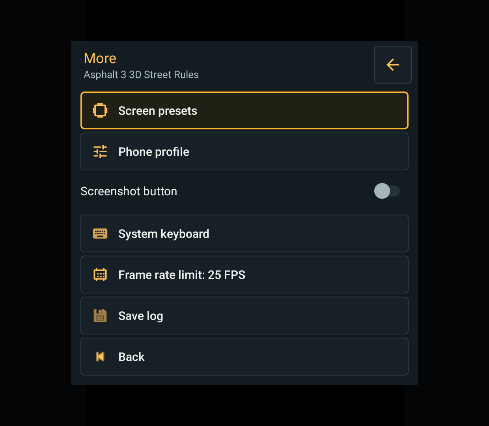
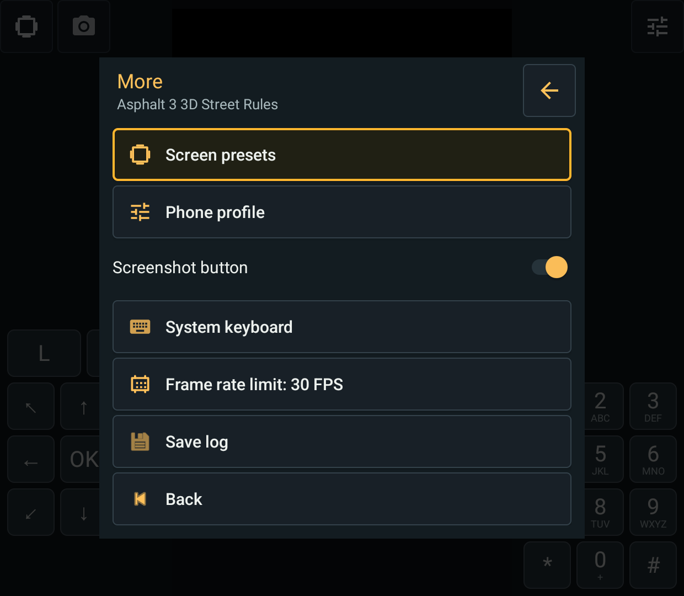

# Java frame-rate limit: 2026-10-15

Unreleased source and locally installed combined debug builds, issue #22.
Public 0.3.0-beta.1 APKs were not replaced. No test APK distribution in this batch.

## Using the setting

Open **Game menu > More > Frame rate limit**. More shows the current value.
The same setting is available under **Display**, including per-game settings
in the library. Choose Unlimited, 15, 20, 25, 30, 50 or 60 FPS. Existing custom
values remain selectable; arbitrary values can still be entered in Advanced.
Use **Try changes**, then **Keep** to save for this game or **Undo** to revert.
Unconfirmed changes use the existing timed settings trial and recovery rules.

For a game running too fast, try 30 FPS, then 20 or 15 if needed. This is a
frame-submission limiter, not a universal game-speed control. A game with an
independent simulation timer may retain its speed while looking less smooth.
Unlimited does not force a game to run faster than its own logic permits.

## Fixes

- The former in-game numeric dialog changed only the Canvas static limit,
  not the per-game profile. It opened blank and dismissed the paused menu.
  The replacement stays in the shared menu and uses the existing draft/trial
  persistence path. Keep, Undo and runtime preview now apply the same limit.
- Pacing uses System.nanoTime rather than wall-clock milliseconds and avoids
  integer-millisecond truncation (the former 60 FPS interval was 16 ms).
- Each Canvas owns a synchronized frame budget. Concurrent producers recheck
  it after waking; slow frames and show/hide transitions do not accumulate
  catch-up credit. Live limit changes are rechecked at most every 20 ms of wait.
- Interrupted waits preserve the interrupt flag. Empty GameCanvas region
  flushes return without spending a frame interval.

Pacing remains at guest repaint/flush submissions, not Android presentation.
Repaint coalescing and the legacy asynchronous-mode Unlimited safeguard
(effective 1000 FPS / approximately 1 ms yield) are retained. The FPS overlay
counts presentation, so it need not equal the selected submission limit.
Multiple repaint regions per logical frame can still slow a game more than
expected. No guest clock replacement or M3G renderer change is included.

## Verification

- JDK 21 combined Handheld/Phone debug and instrumentation builds passed.
  JVM checks: 25 per variant, including six deterministic pacing regressions.
- Retroid Pocket Classic, Android 14, 1240x1080: 31 focused Android checks per
  variant passed (pacing, presets, settings trials, compact settings, game menu).
  The compact-settings tests were corrected to use the existing combined-build
  backup labels; their earlier failures were stale test expectations.
- Handheld real-clock check: 20 submissions shared by two threads at 20 FPS
  took 954 ms (19 intervals). Twenty serial intervals took 1003 ms while an
  independent 10 ms timer advanced 101 times. These are pacing fixtures, not
  measurements of a commercial game's simulation or presentation FPS.
- Actual Asphalt 3 3D Street Rules 1.1.5: Handheld Try/Keep at 25 FPS,
  Try 30/Undo back to 25, exit and relaunch retained 25. Phone Try/Keep at
  30 FPS and exit/relaunch retained 30. Both reached the language screen;
  no race performance, full-game, audio or save compatibility claim.
- The report's exact game/JAR is unknown. #22 remains open for game-specific
  reproduction; no extra tester work is requested. The emulator, other devices,
  all graphics modes and signed-release upgrade behavior were not checked here.

Reproduce with the combined build command from
[stage-one checks](2026-10-15-import-launchers.md), then AndroidJUnitRunner classes
`FramePacerDeviceTest`, `GamePresetsUiTest`, `SettingsTrialTest`,
`CompactSettingsTest` and `GameMenuLayoutTest` (see their source package names).
Ignored local evidence: `build/fps-final-build.log`, `build/fps-fdroid-final.log`,
`build/fps-phone-final.log`, `build/fps-*.png`, and JVM XML reports under
`app/build/symbian-experiment/test-results/`. Selected actual-device images:

Technical references: [System.nanoTime](https://docs.oracle.com/en/java/javase/21/docs/api/java.base/java/lang/System.html#nanoTime())
and [MIDP Canvas repaint semantics](https://docs.oracle.com/javame/config/cldc/ref-impl/midp2.0/jsr118/javax/microedition/lcdui/Canvas.html).
