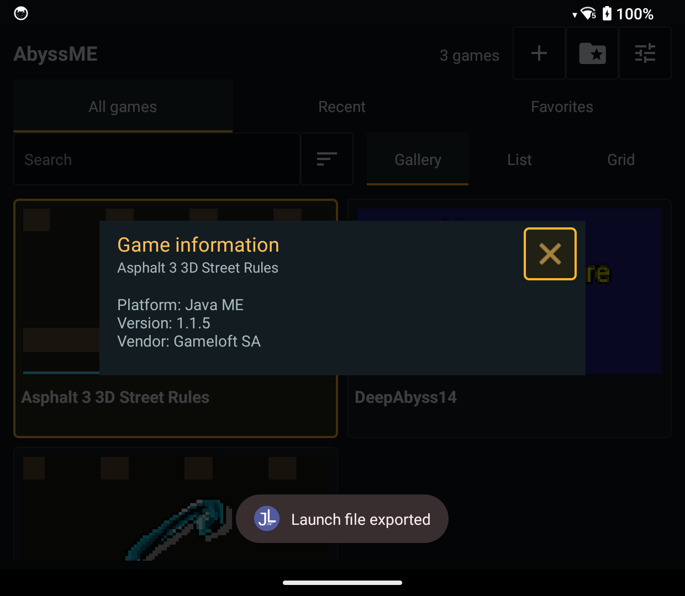
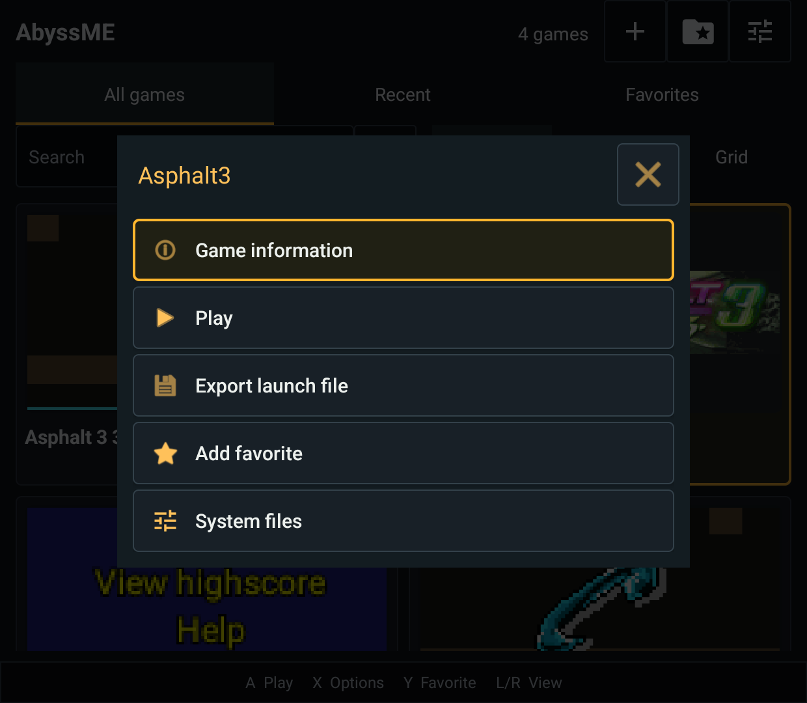
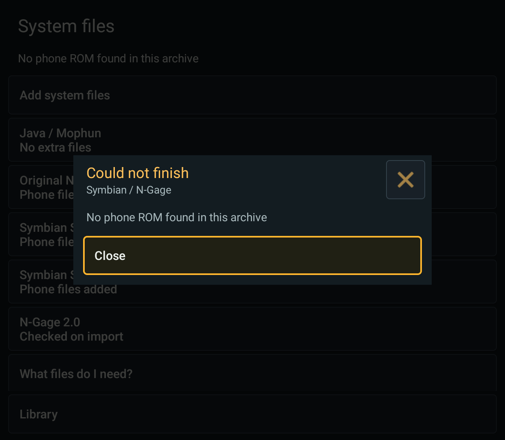

# Import, launcher and game information checks

Date: **2026-10-15**. Scope: #23, #7 and #21. These changes are unreleased
development source after 0.3.0-beta.1, not a replacement for its published APKs.
The release list was checked today; 0.3.0-beta.1 remains the newest prerelease.
Release asset hashes were not rechecked in this session.

## Environment

- Retroid Pocket Classic, Android 14, arm64. Actual device checks, not an AVD.
- Isolated Handheld `io.github.eriark.abyssme.symbian.debug` and Phone
  `io.github.eriark.abyssme.symbian.phone.debug`; production apps/data untouched.
- EKA2L1 sources restored at pinned revision
  `11f5b6cd141c0884a130ee45743f1f5e17bb1783` in ignored
  `build/symbian-source-check`.
- Pegasus `alpha16-82-gc3462e68`, official
  [weekly_2024w38 Android64 APK](https://github.com/mmatyas/pegasus-frontend/releases/tag/weekly_2024w38).
- Daijisho 1.5.0 (code 416), official
  [v1.5.0 APK](https://github.com/TapiocaFox/Daijishou/releases/tag/v1.5.0).
  Neither frontend was made the default Android home app.

## Implemented

### Raw phone archives (#23)

ZIP and 7z can contain one ROM and its matching RPKG, including nested folders
and uppercase extensions. Raw 7z uses the existing bounded native decoder,
then the same phone-file validation as ZIP. Prepared phone collections keep
their separate importer. Game files, multiple phones, ambiguous/colliding or
unsafe paths, invalid sizes and damaged archives are rejected. Temporary
decoded/copied files are cleaned after failure/cancellation; existing phone
data is not merged or replaced by an archive's writable directories.

Native task failures now show a persistent, dismissible explanation instead
of relying only on transient status text. Setup guidance describes the raw
ROM/RPKG archive format and warns against mixing games/multiple phones.

### External launchers (#7, partial)

Installed Symbian/N-Gage games have **Game actions > Export launch file**.
The small `.abyssme` document identifies an installed phone/game and app variant;
it contains no firmware, executable, private path or save. Opening it resolves
against the installed library and launches the existing game without importing
its installer. Unknown, malformed and wrong-variant files report an error.

Mophun now preserves external-launch origin on exit instead of forcibly
opening the AbyssME library. MainActivity retains its newest external intent.
The guide contains full Handheld/Phone components, explicit VIEW/read grants,
a Daijisho custom platform and Pegasus metadata. ES-DE examples now distinguish
the two variants and explain its selected data directory/override merging.

### Installed game version (#21)

**Game actions > Game information** shows the installed Java descriptor's
original MIDlet-Version and vendor. It follows the installer's already-resolved
JAD/JAR merge, not a newly downloaded source or guessed release. If the installed
descriptor is absent, legacy cached fields are used; missing metadata says
Not provided and unreadable metadata says Unavailable. Rename, RMS and game
files are not modified. Native phone labels are not misrepresented as versions.

## Automated results

| Check | Handheld | Phone |
| --- | --- | --- |
| JVM: GameInformation (5), SourceIdentity (2), ControllerInput (12) | 19 passed | 19 passed |
| Retroid: RawPhoneArchive (3), SystemFileCatalog (7), LauncherLink (3), CompressedGameArchive (8, including 2 optional skips) | 19 passed, 2 skipped | 19 passed, 2 skipped |
| Retroid: actual ROM/RPKG public import UI, ZIP/7z/reimport/error | 1 passed | 1 passed |
| Retroid: library information and launch-file export callback/readback | 2 passed | 2 passed |
| Combined debug APK build | passed | passed |

The real phone fixture was an owner-supplied **N95**, not the reporter's N70.
The raw archive test generated nested uppercase ZIP/7z inputs, checked the
installed phone count after reimport, and kept a missing-ROM error visible for
more than five seconds. Core fixtures cover saves remaining intact, temporary
cleanup, cancellation, truncated archives, duplicate/conflicting paths and mixed
game/system archives. These are import guarantees, not universal firmware or
game compatibility. The two optional decoder-fixture skips are not passes.

The automated export UI test intercepts ACTION_CREATE_DOCUMENT and supplies a
local destination to verify the callback payload. A separate manual Phone test
below covers the real Android document picker and a frontend opening its output.

## Actual frontend results

| Frontend / variant | Observed result |
| --- | --- |
| Pegasus / Handheld | New Asphalt 3D JAR imported/prepared and reached its language screen; prepared relaunch worked. Mophun fixture reached its menu. Both returned to Pegasus through Exit game. |
| Pegasus / Phone | Asphalt 3D reached its language screen with touch controls; Mophun fixture reached its menu. Both returned to Pegasus. Snakes was exported through Android DocumentsUI to Downloads, opened from that exact file, reached its game menu without an installer, and returned to Pegasus. |
| Daijisho / Handheld | Asphalt 3D JAR, Mophun fixture and installed Snakes launch file opened; Exit game returned to Daijisho. Snakes reached a rendered game screen. A ZIP with Asphalt and Sudoku presented game selection; choosing Sudoku reached its board and returned to Daijisho. |
| Daijisho / Handheld, warm MainActivity | Opened the AbyssME library, brought Daijisho forward, launched prepared Asphalt. Android logged delivery to the existing MainActivity (`result code=2`), the game opened and exit returned to Daijisho. |

Logs show actual frontend UIDs passing `content://` URIs with flags `0x10000001`
(including read permission), not shell file-URI launches presented as frontend
evidence. Pegasus uses its own file provider; Daijisho used Android's external
storage document provider. Its imported custom-platform filename regex was
corrected to capture the title rather than the extension. A newly scanned
`Java-selection.zip` displayed `Java-selection`; previously cached item names
were retained by Daijisho even after resync.

The private Mophun fixture is named `DeepAbyss14.mpn`; this check concerns its
launch/menu/return path, not a new Deep Abyss gameplay qualification. No games,
ROMs, imported phone state or third-party launcher APKs are included here.

## Remaining boundaries

- ES-DE is unavailable. Its detection/configuration and the reported failure
  are **not verified** by success in Pegasus/Daijisho; #7 stays open.
- Beacon is installed but was not exercised in this session. Daijisho's Phone
  player definition is provided, but only Pegasus exercised Phone end to end.
- Signed-release variants, broader device/Android combinations, save checksum
  comparisons around frontend launches and every warm/cold/engine permutation
  remain outside this checkpoint. Phone emulator tests were not run this session.
- URI-alias duplicates remain #20. Different providers can still install the
  same JAR as separate library entries; this patch does not claim to fix that.
- No new public/private APK distribution, release signing or automated
  publication. GitHub Actions remains disabled.

## Reproduction and local evidence

Build with JDK 21 and the configured SDK/NDK:

```powershell
.\gradlew.bat -PsymbianExperiment=true -PsymbianSourceDir=build/symbian-source-check `
  :app:testFdroidDebugUnitTest :app:testPhoneDebugUnitTest `
  :app:assembleFdroidDebug :app:assemblePhoneDebug `
  :app:assembleFdroidDebugAndroidTest :app:assemblePhoneDebugAndroidTest
```

Run the named Android test classes using AndroidJUnitRunner. RawPhoneArchiveUiTest
requires `-e rawPhoneUi true` and private `symbian-input/n95.rom` plus `n95.rpkg`
in the target app's external files directory. LibraryInformationUiTest requires
`-e libraryInfoUi true`, one installed Java game and one native game. Ordinary
test invocations skip these opt-in real-input scenarios.

Ignored local evidence: `build/launcher-fixtures/final-checks.log`,
`handheld-tests.log`, `phone-tests.log`, `raw-phone-ui.log`,
`raw-phone-phone-ui.log`, `library-ui-handheld.log`, `library-ui-phone.log`,
and the frontend/UI PNGs in the same directory. JVM XML reports are under
`app/build/symbian-experiment/test-results/`. These paths are local maintainer
evidence, not downloadable public artifacts. Selected UI screenshots follow.




