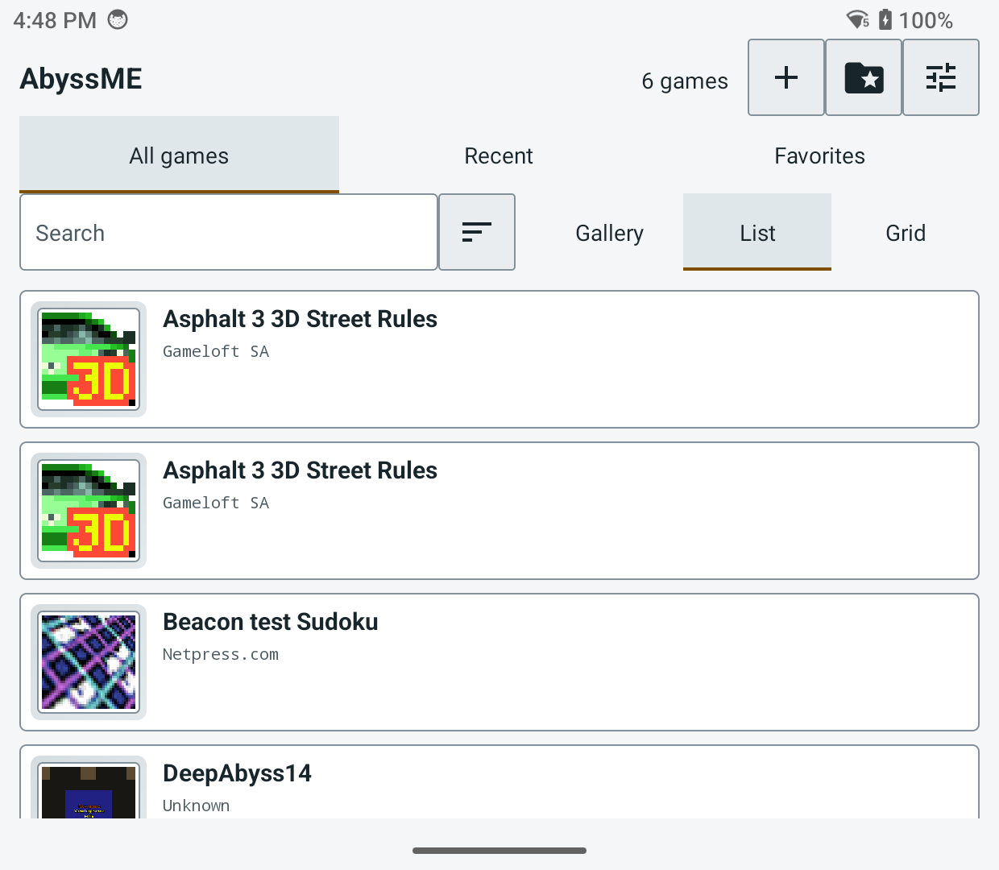
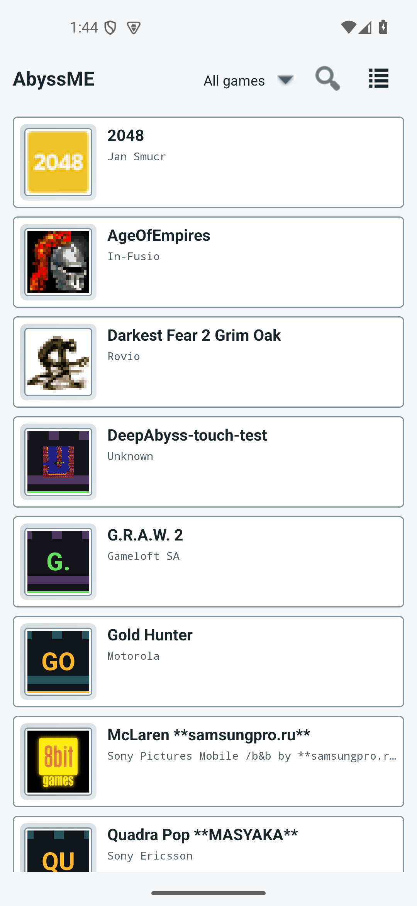
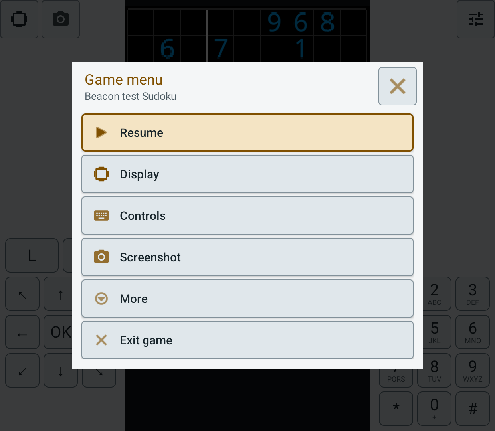
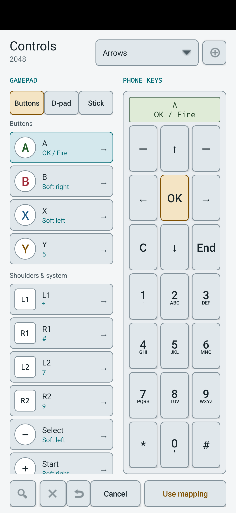
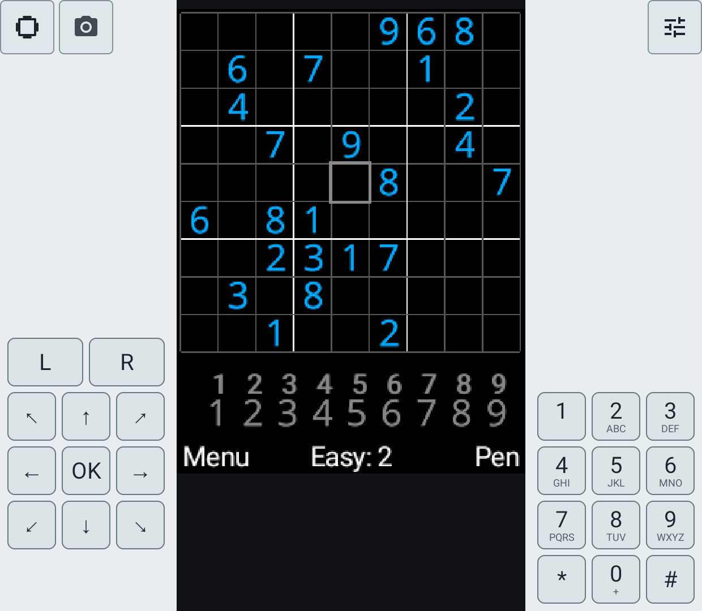
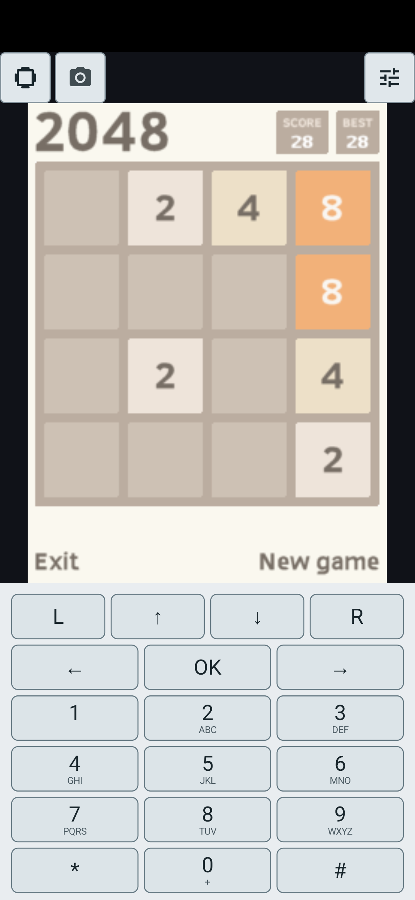
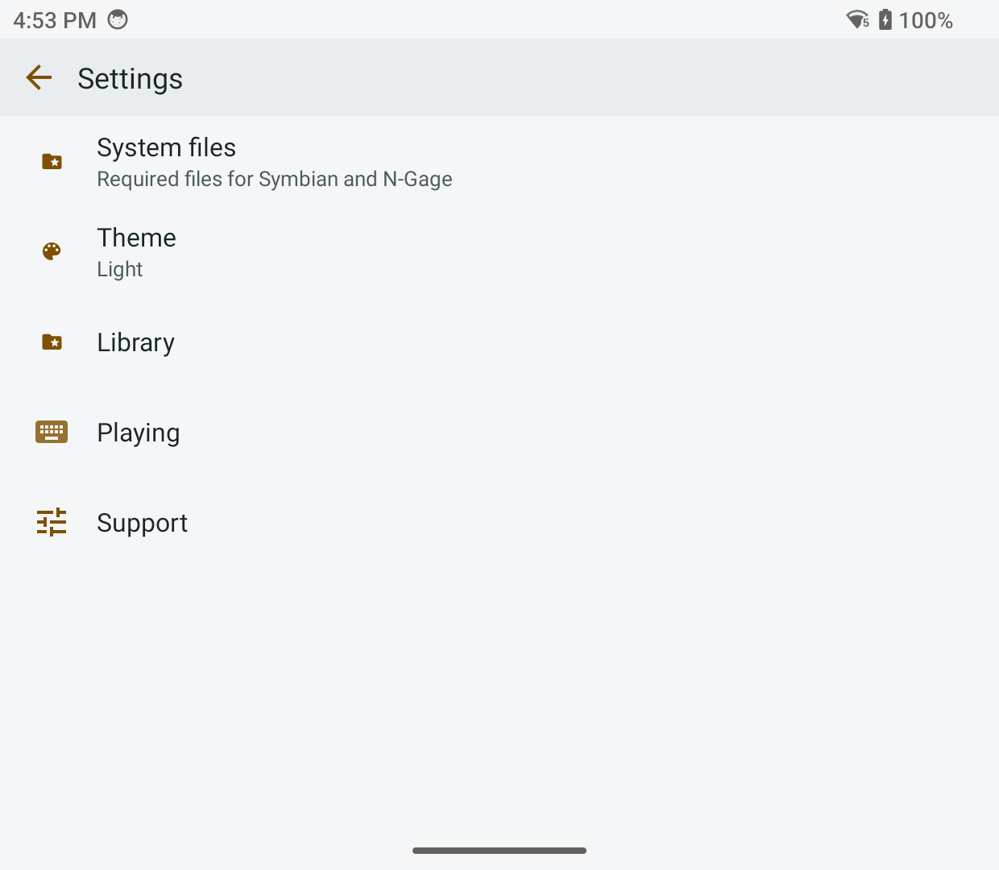
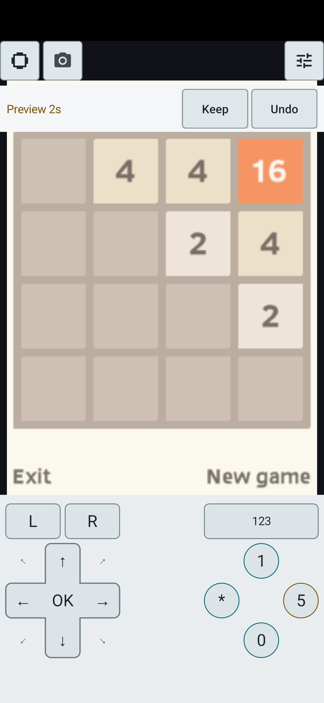
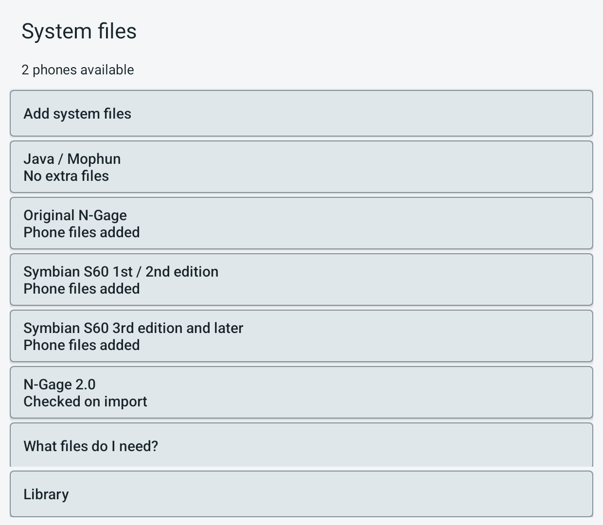
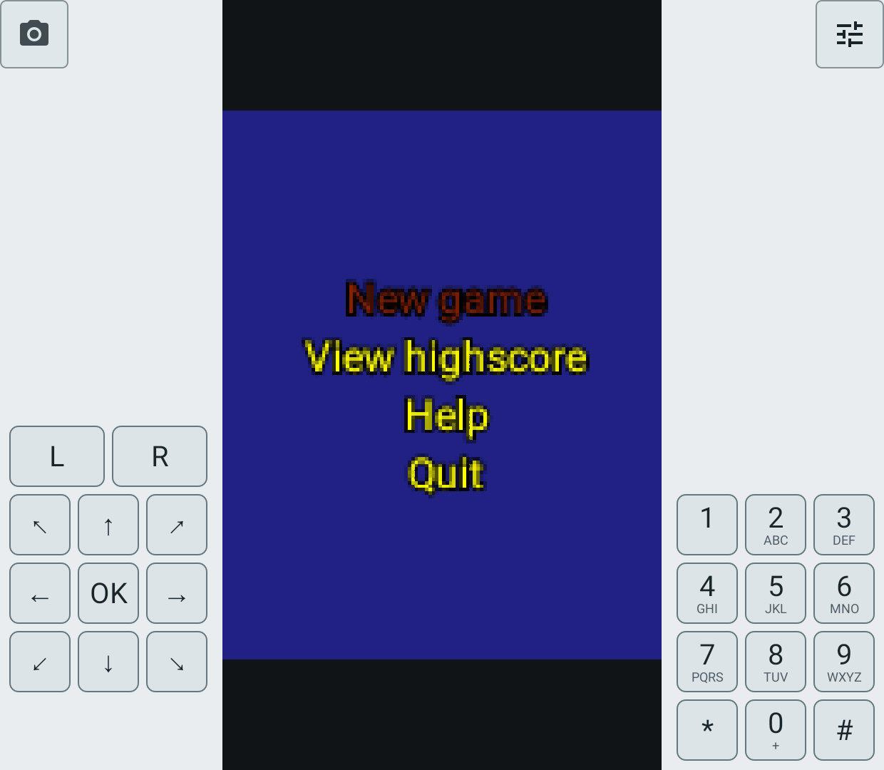

# Light appearance

Date: **2026-10-15**. Issue: [#12](https://github.com/EriArk/JavaEmulator/issues/12).
Source follows `a832199f`. These changes are not in a public release APK.
GitHub Releases was checked today: `v0.3.0-beta.1`, published October 14,
remains the newest prerelease. Release asset hashes were not rechecked.

## User-visible changes

- **Settings > Theme:** Follow system, Light or Dark. The default follows
  Android; an explicit choice survives activity recreation and subsequent launches.
- Light is an actual light surface/dark text palette, not Android force-dark
  inversion or the earlier dark-only contrast workaround. Amber and teal accents
  have darker Light counterparts; focus/selection stays visible.
- Library cards, fields, dialogs, installer, transfer screens, shared game menu,
  preview controls and graphical mapper use shared color roles.
- Phone keypad and virtual gamepad adapt in portrait and landscape. Game pixels,
  cover art, fallback artwork and the legacy customizable keyboard are not recolored.
- Symbian system/import pages and Mophun/Symbian game chrome use the same roles.
  A small context override applies the saved appearance to non-AppCompat engine
  activities and the Java restart screen without changing their superclass or
  engine lifecycle. Only night mode is overridden, not density or orientation.
- The mapper's Identify action is now a fixed-size icon with an accessible name,
  tooltip and selected listening state. Its former label overflowed a narrow
  portrait footer. Capture, Undo and Save semantics are unchanged.

## Checks

Built combined `assembleFdroidDebug`, `assemblePhoneDebug` and both instrumented
test APKs using the existing Symbian source setup. Also built the ordinary Phone
debug APK and its tests for the x86_64 emulator. Installed with replacement,
without clearing app data or changing production packages.

| Target | Result |
| --- | --- |
| Retroid Pocket Classic, Android 14, combined Handheld debug | 28 passed; Phone-only rotation test skipped |
| Same Retroid, combined Phone debug | 29 focused Android tests passed |
| Android 15 emulator, portrait 1080 x 2340, ordinary Phone debug | 29 focused Android tests passed |

Classes: `ThemeContrastTest`, `ControllerMapperTest`, `GameMenuLayoutTest`,
`TouchDeckTest`, `InstallerDialogTest`. The five appearance checks cover
native fields/buttons, text contrast >= 4.5 across normal/focus/selected surfaces,
both touch layouts at 360 x 640 and 640 x 360 without painting over the guest,
and saved theme selection/recreation including the plain-engine context override.
Mapper geometry assertions now also reject vertically clipped button labels.
These are instrumented checks, not 29 separate complete-game compatibility runs.

Manual inspection used ADB-injected input. Retroid Phone library/settings,
Sudoku touch controls and the game menu were viewed in Light while Android
itself remained Dark. Symbian's System files page and Deep Abyss's Mophun
title menu/touch deck were also verified with the explicit Light override.
The emulator covered Light/Dark settings, library,
2048 with both touch layouts, live Try/Undo and the corrected mapper footer.
Screenshots below are actual captures, not mockups.

Local reproducibility logs (ignored `build/`, not distributed):
`light-combined-final-build.log`, `light-avd-final-build.log`,
`light-retroid-handheld-tests.txt`, `light-retroid-phone-tests.txt`,
`light-avd-phone-tests.txt`.

## Screenshots

| Retroid Phone, Android 14 | Android 15 Phone emulator |
| --- | --- |
|  |  |
|  |  |
|  |  |
|  |  |

Additional Retroid Phone captures:

## Limits

The reporter's Galaxy A24 on Android 16 was not available. No claim is made
about medical suitability, all accessibility/font-scale settings or every OEM.
This is not a skin editor and does not complete the broader customization #11.
No game compatibility or rendering-performance improvement is claimed.
Debug APKs were installed locally only; public release downloads are unchanged.
