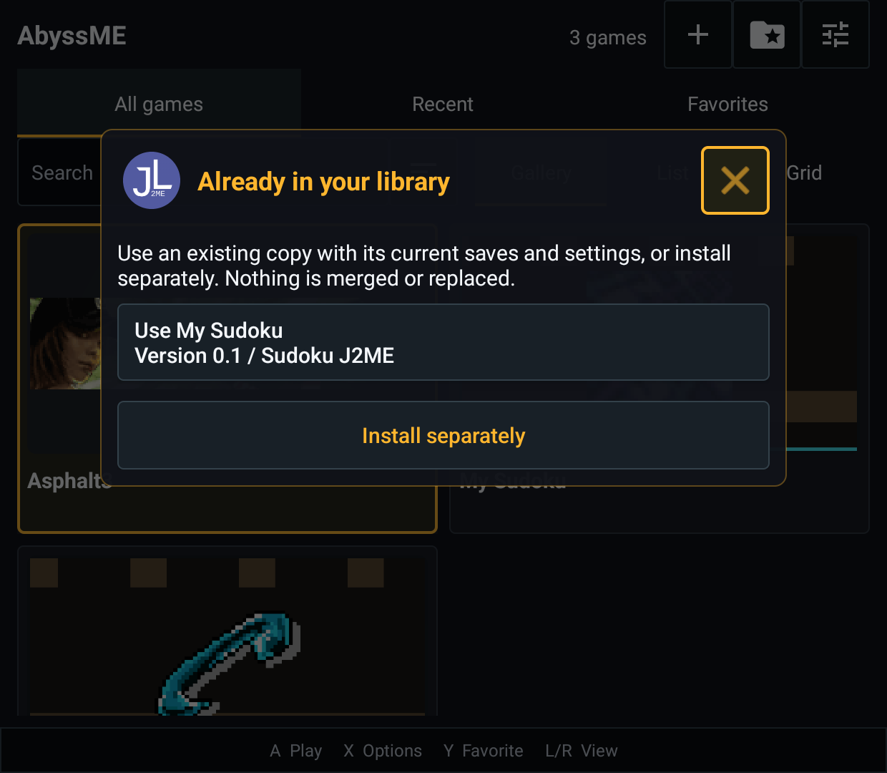
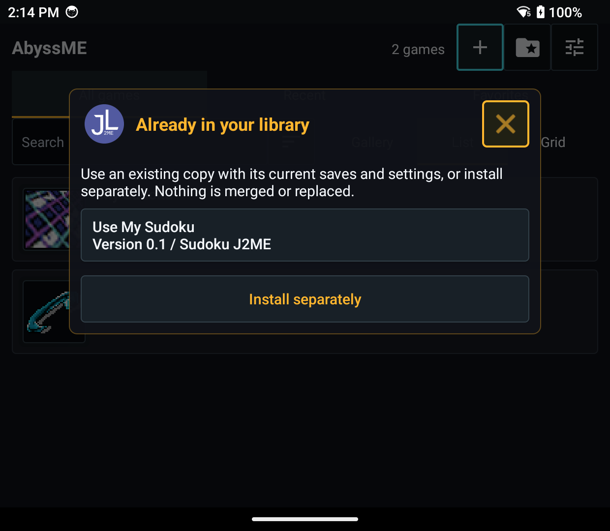
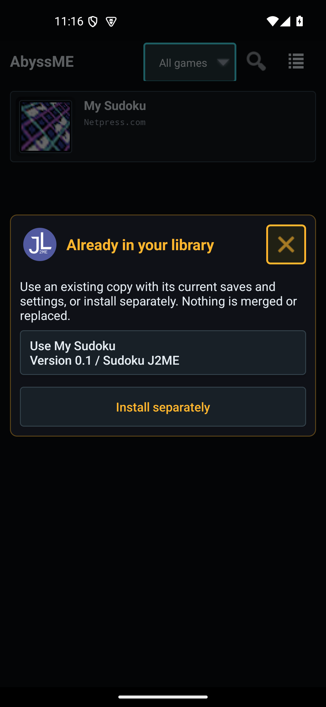

# Duplicate Java imports: explicit reuse

Date: **2026-10-15**. Issue: [#20](https://github.com/EriArk/JavaEmulator/issues/20).
Unreleased source after 0.3.0-beta.1; no APK distribution or release replacement.
The release list was checked today: v0.3.0-beta.1 remains the newest prerelease.
Its asset hashes were not rechecked in this session.

## User-visible behavior

When a new source URI contains an already installed JAR, the installer offers
**Use [existing game]** and **Install separately**. Cancel/Back remains available
and is the initial controller focus. Multiple matching installations are listed
individually with their version and library folder, including renamed games.

Reuse opens the existing installation rather than reinstalling or merging it.
Its saves, settings, title, favorite state, play count, ID, folder and original
source URI/key are retained. The new URI's choice is remembered. A new URI,
changed JAR or changed effective JAD properties cannot silently inherit that
choice. An external auto-start request also stops at an unresolved choice.

Choosing a separate copy creates its own row and game folder. Existing copies
and save directories are not removed. Matching names/vendors/versions alone
never combine games. Existing duplicate rows are not automatically merged.

## Implementation boundary

- The existing canonical source-key algorithm is unchanged. A separate Room v4
  table stores explicit URI-to-installation choices, including archive-entry
  identity. The association fingerprints JAR bytes and effective descriptor
  attributes, with deterministic ordering and length-prefixed values.
- Candidates require a stored matching SHA-256 and revalidation of the actual
  installed JAR. Reuse also checks that the incoming staged JAR and selected row
  have not changed since the choice was offered. Missing or changed targets are
  not silently reused.
- JAR, local/content JAD and archive entries converge on the same installer
  resolution. Downloaded JARs are resolved after download/descriptor validation,
  before conversion. The network download route was reviewed but not exercised
  with a live HTTP fixture in this batch; ZIP was exercised, not 7z/KJX anew.
- Reinstall updates a row rather than replacing it, retaining its aliases.
  Installation success now waits for its database write. This is not a new
  filesystem/database rollback mechanism.
- Room migrations 1/2/3 -> 4 retain catalog metadata and do not alter save files.
  Deleting a row removes its aliases; reusing an ID cannot revive them.

## Checks performed

| Check | Retroid Handheld | Retroid Phone | Android 15 Phone AVD |
| --- | --- | --- | --- |
| InstallerSourceAliasTest | 7 passed | 7 passed | 7 passed |
| InstallerJadTest | 4 passed | 4 passed | 4 passed |
| InstallerSourceTest | 3 passed | 3 passed | 3 passed |
| InstallerDialogTest | 5 passed | 5 passed | 5 passed |
| DatabaseMigrationTest | 5 passed | 5 passed | 5 passed |
| LauncherLinkTest | 3 passed | 3 passed | 3 passed |
| LibraryImporterTest | 15 passed | 15 passed | 15 passed |
| Total | **42 passed** | **42 passed** | **42 passed** |

Both combined variants also passed **25 JVM tests each**. Combined arm64 debug
APKs and ordinary Phone x86_64 debug/test APKs built and installed successfully.
Retroid Pocket Classic runs Android 14; the AVD runs Android 15. Production apps
were not upgraded. Tests use isolated temporary Java libraries and the existing
MIT Sudoku fixture, not private games. The combined Retroid library can also
show existing native entries in the background of these screenshots.

The new seven scenarios cover cancellation and retry; remembered reuse after
reopening the installer; canonical reinstall retaining aliases and byte-identical
save/settings markers; title/favorite/play-count/source preservation; separate
copies and multiple candidates; changed JAD properties; two content JAD URIs
after JAR selection; ZIP reuse versus different bytes with the same metadata;
changed-target rejection; and unresolved external auto-start. Selection was
exercised with both direct clicks and controller A, with controller B cancelling.
Database close/reopen checks establish persistence independently of a live
installer instance.

## Honest limits

- The originally observed Downloads `raw:` -> `msf:` transition was not forced
  again. This batch verifies the common resolution path using distinct file
  and FileProvider content URIs, including two content JAD URIs. It does not
  certify every Android provider or the cause of that provider transition.
- There is no global library deduplication or scan-time content hashing. Legacy
  rows without a source hash and existing indexed-only placeholders retain their
  prior behavior. Existing canonical rows are not silently redirected.
- Remembered aliases are local to this catalog. The current portable backup
  format retains original game identities but does not export the alias table;
  another device may ask again. Saves are not merged between devices/copies.
- Actual Beacon/ES-DE cold/warm acceptance remains #7. Automated installer
  auto-start checks are not a new real-frontend or complete-game acceptance.
- No release signing, APK publishing, firmware/game publication or GitHub
  Actions changes occurred.

## Screenshots

Actual settled UI, not concepts. Handheld/Phone landscape captures are from
Retroid; portrait is from the Android emulator.

## Local evidence

Ignored logs: `build/source-alias-final-build.log`,
`build/source-alias-retroid-handheld-final.log`,
`build/source-alias-retroid-phone-final.log`,
`build/source-alias-emulator-build.log`, `build/source-alias-emulator-phone.log`.
JVM XML: `app/build/symbian-experiment/test-results/test*DebugUnitTest/`.

Combined builds use JDK 21, `-PsymbianExperiment=true` and
`-PsymbianSourceDir=build/symbian-source-check`. The ordinary Phone AVD build
omits those properties. Instrumentation classes are checked in under
`app/src/androidTest`; no external commercial fixture is needed for this suite.
