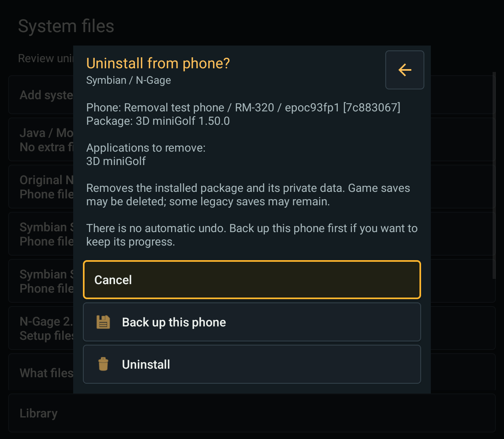
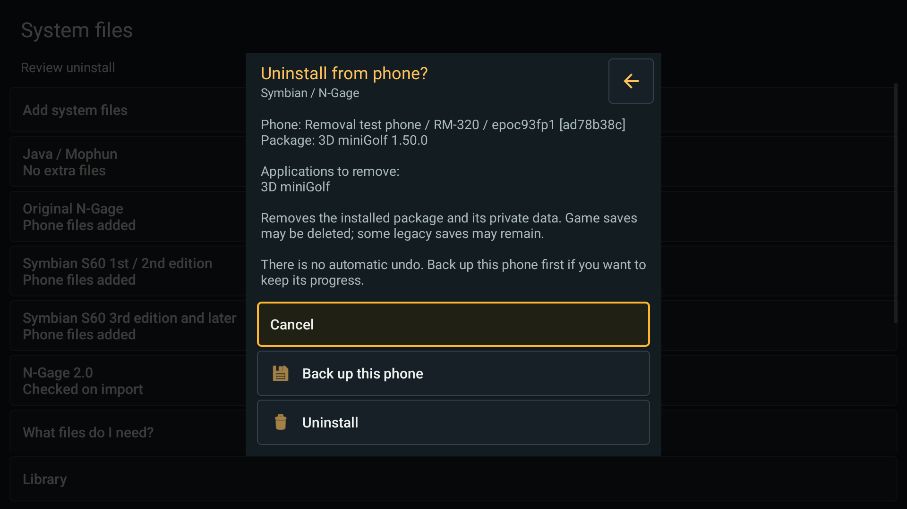
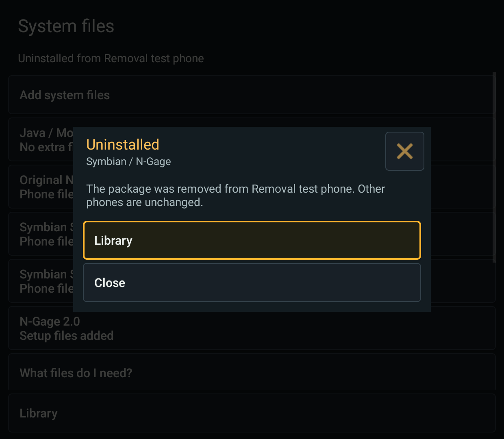

# Symbian game uninstall: 2026-10-15

Issue [#25](https://github.com/EriArk/JavaEmulator/issues/25). Unreleased source
and local combined debug builds; public 0.3.0-beta.1 APKs are unchanged.

## User workflow

In the shared library, open a Symbian game's actions and choose **Uninstall from
phone**. The review names the exact virtual phone, owning package and every
application that would be removed. **Cancel** is the default controller action.
**Back up this phone** opens the existing backup flow for that exact phone.
Only **Uninstall** removes the installed package; this is not a hide-entry action.

Games must be closed. Private game data may be deleted; some legacy save files
can remain. There is no automatic undo. A phone backup is optional, not created
silently, and restore creates a separate virtual phone rather than overwriting
the original. Keep backups private because they include firmware and games.

## Safety and supported scope

- Resolve application UID to its owning SIS package on the selected phone.
  Package UID and application UID are not assumed to be identical. Recheck the
  complete plan immediately before removal; display all apps owned by a package.
- Reject ROM/protected/patch packages, ambiguous ownership, embedded-package
  bundles, upgrades/add-ons, shared system libraries, shared files/private data,
  required dependencies and paths outside the selected phone's writable drives.
  Canonical host paths are checked as well as guest paths.
- The pinned installer's registry does not reliably retain SIS prerequisites.
  Read its saved size-prefixed controller bodies with a bounded metadata parser,
  verify package identity and include embedded prerequisites. Do not feed those
  bodies to the upstream full-SIS-field reader. Accept both direct host-import
  bodies and the extra descriptor-length prefix written by guest SisRegistry
  (observed with an existing Asphalt 3 installation). Unreadable/missing dependency
  inventories fail closed, including other installed legacy packages without
  controllers. This deliberately limits removal on some populated old phones.
- SIS-installed games can be labelled N-Gage and still have a valid package
  owner. Card-only installations without a SIS owner and N-Gage 2.0 platform
  games are explicitly unsupported by this action. No platform installer is
  removed as a shortcut. This is not universal native-game uninstall support.
- Persist a per-phone recovery record before native removal. Reopen the phone,
  verify package/files/private directories are gone, enumerate apps, and check
  that unrelated app identities remain before replacing the library snapshot.
  Prune only the removed games' icon/cover files on that phone.
- A partial native failure retains the previous library reference and recovery
  record. Opening the phone reconciles a completed operation without deleting
  again. An unchanged plan permits an explicit retry; unresolved removal blocks
  ordinary snapshot replacement and further setup/launch through that phone.
  Restore a prior backup when recovery cannot be verified; no rollback is claimed.

The implementation wraps the pinned core's real package uninstaller. It does
not replace it with recursive Android-side deletion or reuse Java's Delete game.

## Verification

- Combined arm64 Handheld/Phone debug and instrumentation APKs built with JDK 21.
  JVM suites rerun: **25 passed per variant**.
- Retroid Pocket Classic, Android 14: focused Android suites report 41 cases
  per variant: **39 passed, 2 optional skips** (the separate existing-library
  indexing and private platform-installer fixture checks were not requested).
  Coverage includes removal/recovery, stale confirmation, multi-app plans,
  partial failure, failed publication, exact-phone artwork pruning, bounded
  dependency parsing, component installation and phone backup regressions.
- Real native/UI scenario on copied RH-29 and RM-320 phones: **Lock N Load 2**
  (legacy SIS), **3D miniGolf** (modern SIS), and **Frozen Bubble** (SISX).
  Cancel, uninstall, verified library update and reinstall passed in both variants.
  A synthetic installed dependent package prevented removal of its prerequisite.
  Wrong-phone requests were rejected. Original phones' drive hashes were unchanged.
- Screenshots were inspected for text/button overlap and visible Cancel focus.
  Handheld was checked at 1240x1080. Phone was checked at 1240x1080 and
  1920x1080: the attempted portrait override still produced landscape under the
  device's sensor orientation, so these images are not portrait-layout evidence.
  Display size and rotation settings were restored after the checks.
- Copy-local unrelated files and a sentinel save were compared before/after.
  The upstream SMS service rewrites `System/Data/sms_settings.dat` during normal
  teardown, so that one file is excluded from copy-local comparisons, not from
  the original-phone hash check. No gameplay/save-format compatibility is implied.
- The test's early dependency-reader attempt crashed on a controller format
  mismatch. It was replaced with the bounded reader above. Its two temporary
  test phones were removed, and a non-test phone was selected; the exact
  pre-crash selection was not recoverable. The harness now persists selection
  before creating copies, restores it on completion/retry, and only cleans
  test-owned phones. Original game/save data was not used for destructive tests.

The native multi-application/shared-file failure matrix, forced process death at
every filesystem operation, signed-release upgrades, and other devices/firmware
have not been exhaustively tested. Phone portrait is not accepted by this run.
Multi-app and failure recovery checks use a
fake backend; the three real games exercise the actual core and Android dialogs.
No user game/ROM archives or APKs are included in this change.

## Reproduction and evidence

Use the combined build setup from [stage-one checks](2026-10-15-import-launchers.md).
AndroidJUnitRunner classes: `GameRemovalTest`, `PackageDependenciesTest`,
`SymbianLibraryTest`, `SisComponentsTest`, `PhoneBackupTest` in
`io.github.eriark.abyssme.symbian`.

`GameRemovalNativeTest` requires explicit `-e removalNative true`, provisioned
RH-29/RM-320 phones and the private three-game fixture at the app's external
`files/symbian-input/removal-games.zip`. It operates only on temporary copies.
Do not enable it against an actively running game. Controller confirmation uses
injected Android gamepad-A events, not a person pressing the physical button.

Ignored local evidence: `build/removal-build.log`, `build/removal-unit-retroid*.log`,
`build/removal-native-retroid*.log`, `build/removal-screens/` and JVM XML reports
under `app/build/symbian-experiment/test-results/`.

