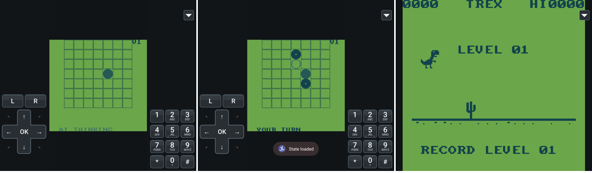
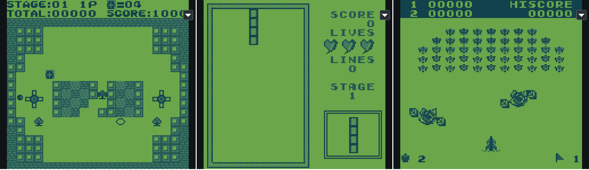

# Gamate on Retroid Pocket Classic

The optional ARM64 debug build adds Gamate as the fourteenth platform. The launcher tile opens a single-row library tab with import, search, artwork and per-game settings. The combined APK was updated in place on a Retroid Pocket Classic running Android 14. Games and BIOS were used locally. The public source contains the integration and build instructions.

## Installation and games

The UMC 4 KiB boot ROM was imported through a BIOS ZIP. The app selected the BIOS automatically. XGomoku was opened through a ZIP containing a single cartridge, and X-T-Rex through a raw binary. Both original homebrew images were obtained from their author. Each booted through the emulated cartridge handshake into gameplay. [XGomoku release](https://github.com/Fabrizio-Caruso/CROSS-LIB/releases/tag/gomokuBETA) · [X-T-Rex release](https://github.com/Fabrizio-Caruso/CROSS-LIB/releases/tag/trex_1.0)

| Retroid check | Observation |
| --- | --- |
| XGomoku | A controller fire event started the board. On the touch deck, direction and OK moved the cursor and placed stones. The AI replied. |
| X-T-Rex | Reached level 1. A controller button event made the dinosaur jump above an obstacle. |
| Audio | Captured actual Android playback with scrcpy as 48 kHz stereo FLAC. The XGomoku capture peaked at −12.1 dBFS, as did X-T-Rex. |
| Controls and state | Selected **Controls → On-screen buttons → Always**, saved the preview and verified the deck on relaunch. Saved the board through **More → Save state**, stopped the app, reopened the game and loaded the position. |
| Library | Five library navigation tests and two import/backup tests passed. The populated library was exported and restored to an isolated directory on the device. The existing production data stayed in place. |

The touch actions were injected through Android input. Controller events went through the Retroid gamepad’s Linux input device. These checks covered both host input paths. A person holding the handheld, the headphone jack and full playthroughs were outside the test.

## Core checks

The host ran each cartridge for 1,000 LCD frames with scripted controls. XGomoku produced 163 frame changes and X-T-Rex produced 264. Both generated nonzero audio. Saving each machine, closing the core, reopening with the same BIOS and restoring reproduced the next frame and audio buffer byte for byte. An altered cartridge identity in the state was rejected. A separate 128 KiB mapper fixture checked independent switching of both 16 KiB windows. The homebrew checks used the UMC BIOS. Serial link play remains unverified.

The [build instructions and license notices](../../engines/gamate/README.md) identify the CPU, PSG, LCD and cartridge references. No release APK was published for this check.

## Supplied retail collection

The outer collection contains 58 individual cartridge ZIPs. All 58 unpacked images match SHA-1 entries in the [MAME Gamate software list](https://github.com/mamedev/mame/blob/ce8812e6a1dcafc97fbafc6d48b0c8184984845f/hash/gamate.xml). The supplied BIOS ZIP contains both known 4 KiB variants. On Retroid, selecting that ZIP installed UMC as the default. Importing the separate BIT image also made it selectable. The Gamate tab indexed all 58 game ZIPs from **Download/Gamate** in one folder scan.

The host ran each cartridge with each BIOS for 780 frames and applied the same scripted Start, fire and direction inputs. All 116 runs unlocked the cartridge, sampled a program counter in cartridge ROM, produced a nonblank changing display and emitted nonzero PCM. Frame and audio counts cover the final 480 frames. This is boot and short-run coverage. [Per-cartridge measurements](2026-11-21-gamate-cartridges.tsv).

On Retroid Classic the **4-in-1** menu booted with the BIT BIOS. Selecting Mini Golf reached the first course. Selecting Cube Up reached stage one with falling pieces and music (Android playback peak −7.3 dBFS). With UMC selected, the separate **Galaxy Invaders** cartridge entered its first wave. Its title/menu recording peaked at −7.1 dBFS. The screenshots below show gameplay on the device.

The initial thumbnail sometimes captured the BIOS splash. The Gamate host now waits for the CPU to fetch a cartridge instruction and lets the game draw before capturing artwork. Verified the 4-in-1 library preview shows its game selector. The private APK update preserved 9,049 inventoried files and 141 primary catalog rows.
