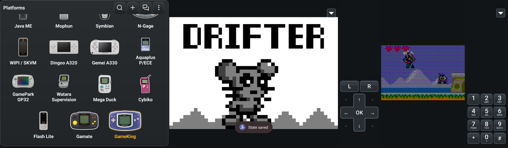

# TimeTop GameKing on Retroid Pocket Classic

The ARM64 combined debug build uses two drivers from the same pinned libretro/MAME core. The original GameKing uses the 48 × 32 GM-218 raster. The color GM-220 uses a 160 × 160 color-filter raster displayed at its physical 3:2 aspect ratio. Both models share the GameKing tab, physical mapping profiles, touch deck, game-area settings and graphics controls. [Engine, build instructions and notices](../../engines/gameking/README.md).

## Library and firmware

The supplied ZIPs contain the expected 512 KiB GM-218 and GM-220 BIOS files. The GM-220 copies in the two 7z uploads match the ZIP firmware. The separate gkigt43 archive is for an IGT machine. Each handheld BIOS imports into its own system directory and can also launch from a library card. [TimeTop driver and BIOS identifiers](https://github.com/libretro/mame/blob/5f5a07748ce5c239c4118463ce8e6473743d4859/src/mame/handheld/gameking.cpp) · [IGT driver](https://github.com/mamedev/mame/blob/master/src/mame/igt/gkigt.cpp).

The two TOSEC collections contained 18 individual monochrome cartridge ZIPs (including two Dino Adventure Legend dumps) and three color cartridge ZIPs. Adding **Download/GameKing** via the Android folder picker indexed all 23 game and system documents. The app recognized the cartridge manufacturer header and selected the color model from its header version. Seventeen monochrome images and all three color images have SHA-1 entries in the pinned MAME catalogs. The other Dino Adventure Legend dump also ran in the short core test.

## Android checks

| Check | Observation |
| --- | --- |
| GM-218 | The BIOS presented Drifter, 2003 and Miner. Drifter started using events injected through the Retroid controller device. The separate Aries cartridge opened from the indexed folder. Its automatic library preview showed the Aries start menu after the animated boot logo. |
| GM-220 | Adventure reached stage one. Scripted touchscreen and gamepad events started play, jumped and toggled pause. Selected **Always** for the on-screen buttons, saved the change and verified the touch deck on relaunch. |
| Playback | Actual Android playback captured through scrcpy. Mean levels were −9.8 dBFS in the built-in game capture and −14.4 dBFS in Adventure. Peaks reached full scale. Upstream marks sound imperfect on both models. |
| Save state | Saved Drifter via **More → Save state**, restarted the process and restored it through **Load state**. |
| Update and library | The last in-place upgrade retained 9,074 inventoried files and 164 primary database rows. Nine instrumentation tests passed, including single-row platform navigation, file routing and restoring a populated backup into an isolated directory. Firmware, games and APKs remain private. |

## Cartridge sweep

A separate ARM64 runner loaded the same core on the Retroid, selected the appropriate BIOS and issued 600 libretro frame calls per cartridge with scripted button input. All 21 delivered changing, nonuniform video and nonzero PCM. Each serialized and reloaded a state. These measurements cover boot and brief interaction, with individual game progression checked separately in the app. Manual controller feel, analog audio output and complete playthroughs remain unverified. [Per-cartridge measurements](2026-11-21-gameking-cartridges.tsv).
