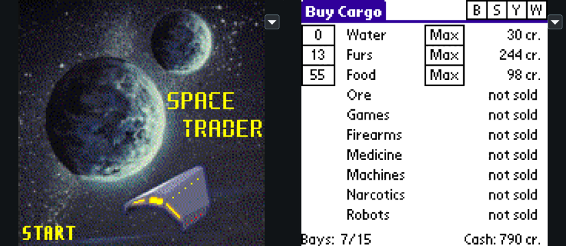

# Palm OS on Retroid Pocket Classic

AbyssME's sixteenth platform opens Palm games from the regular game library. Its Android activity runs the bundled CloudpilotEmu 2.3.0 WASM code using Android System WebView. ROMs, game databases and checkpoints stay local. A short initial check used Chrome. The acceptance checks below used the private AbyssME APK and its own Palm activity after the browser tab was closed and the USB HTTP reverse tunnel removed. [Runtime details and sources](../../engines/palm/README.md).

| Device or file | Result |
| --- | --- |
| Palm m515, Palm OS 4.1 | Completed the digitizer calibration through the AbyssME game screen and saved the prepared Palm device. The Space Trader PRC used this ROM and the prepared device state. |
| Space Trader, color Palm edition | Created a commander, opened Buy Cargo and bought seven units of water at 30 credits each. After saving and force-stopping the Android process, reopening the game showed 7/15 cargo bays occupied and 790 credits. A second purchase filled all 15 bays and left 6 credits. **Save and exit** followed by a cold relaunch restored both values. [Original game](https://spronck.net/spacetrader/STDownload.html). |
| Palm m505 | Reached the first-run setup screen with the supplied ROM. |
| Palm IIIc | The supplied 1,671,168-byte image contains a Palm card header. The pinned core could not identify a supported device from the image. |
| Tungsten E2 | The NOR identifies as an E2 requiring NAND. The first NAND contains 34,545,664 bytes. uARM expects 528 bytes per page × 32 pages per block × 2,048 blocks, or 34,603,008 bytes. The app reports both sizes. The second pair supplied a complete NAND and an 8,388,608-byte NOR. It booted Palm OS 5.4 and opened Date & Time preferences. [Upstream NAND geometry](https://github.com/cloudpilot-emu/cloudpilot-emu/blob/2.3.0/src/uarm/uarm/devicePalmTungstenE2.cpp). |
| Tungsten E and C | Logged the separate files supplied for these devices. Neither model was used to validate the E2. |

The m515 speaker initially produced PWM events while the Android playback recording remained silent. The adapter now streams that PWM signal via an Android game AudioTrack. Date Book's alarm picker produced changing tones in a scrcpy playback capture (peak −10.5 dBFS). The Space Trader market recording was silent. The gamepad A event injected through the Retroid controller input device opened Date Book. With the on-screen buttons set to Always, tapping the virtual OK also opened Date Book from the Palm launcher. Android stylus input activated Palm controls and selected trade quantities. These are short device checks, without a manual playthrough or headphone test.

The private combined APK was installed in place. The update check retained 9,096 library files and 164 catalog entries. All nine Android instrumentation tests in LibraryTabsTest and HandheldCycleTest passed on the Retroid. Firmware, NAND, session files, the game and APKs were excluded from the repository.

## Bejeweled on Tungsten E2

The existing private APK imported the full NAND, the matching NOR and the original **Bejeweled-HiRes-OS5Sound.prc** from the supplied ZIP. The game ran in its trial mode. On a fresh game session using the prepared E2 firmware, launch showed a white screen before the title appeared at about 75 seconds. The emulator reported roughly 8–14 MIPS during observed portions of startup. Animations also progressed slowly.

Touching adjacent gems in Easy mode completed a match and raised the score from 0 to 10. Android output captured during play peaked at −20.9 dBFS. The guest PCM signal was also measurable at the embedded audio graph. Injecting D-pad Up through the Retroid controller device and tapping Up on the virtual deck each paused the game. These checks did not involve a person pressing the physical controls.

After **Save and exit** returned to the library, the Android package was force-stopped. Reopening the PRC restored the same paused board and score of 10 within about four seconds. An earlier force-stop while the session file was still being written did not produce a completed checkpoint. This check covers one game on the E2. The preceding m515 and library tests were not repeated for this follow-up.

