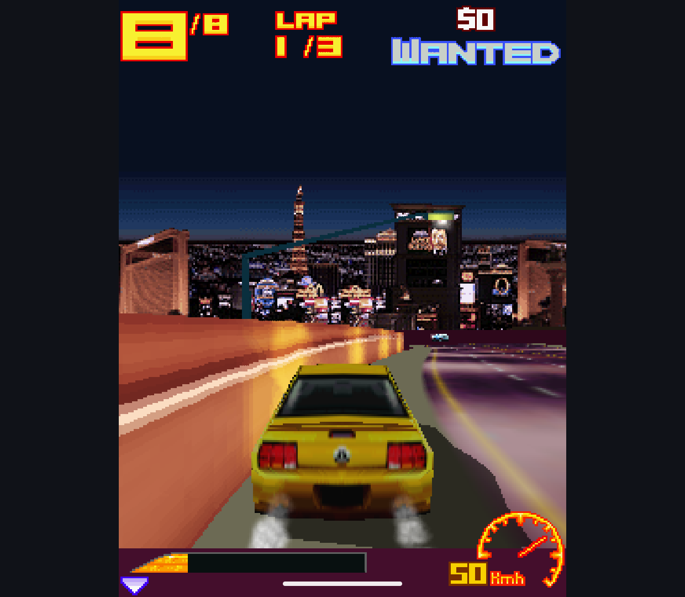

# M3G and Tone Replacement: Beta Readiness

**Later checkpoint, 2026-10-13:** [optimized-build and upgrade rehearsal](../../experiments/m3g-host/release-20261013.md)
adds real separate-process profile trials, R8 fixes, and cross-engine RMS
read/write preservation on Retroid and Phone. The signing identity remains
research-only; final production signing, source/notice inventory and engine
switch are still required. The dated observations below are preserved.

Research branch `codex/m3g-replacement`, 2026-10-11. Rendering checkpoint
`00937d0c`, mainline synchronization `5633e7e9`, tone and sprite fixes
`81a5e3b5`, final resource/lint checkpoint `ff971cac`. These are isolated
research builds, not a new public beta.

The maintainer authorized finishing the replacement, merging when ready and
publishing a beta with appropriate licensing. This replaces the earlier
per-batch approval requirement, not the technical or redistribution checks.
No production-engine switch or root-license transition has occurred here.

### Source-input Update, 2026-10-13

The research build no longer requires the maintainer's FreeJ2ME-Plus checkout.
A committed revision/URL/SHA-256 lock drives verified archive preparation,
allowlisted extraction and source/license assets in the APK. Cached offline
Handheld/Phone assembly and standalone archive-based probe assembly were checked.
Invalid input is rejected before replacing prepared sources. Generated Java
matches the earlier pinned-checkout path after line-ending normalization.
See [build instructions](../../experiments/m3g-probe/README.md).

This advances reproducibility, not production integration or full provenance
clearance. Ordinary builds still use the old engine. Historical dependency and
release gates below remain separate; the atan2 snippet mentioned there has since
been replaced by Java `Math.atan2` in candidate preparation, not relicensed.

## Changes

- A bounded Asphalt render-state trace identified an RGB replacement texture
  discarding incoming fragment alpha. RGB/LUMINANCE replacement and RGB decal
  now retain alpha. RGBA replacement remains separate. Four original fixtures
  reproduced the failure; the native engine passed those same fixtures.
- Color and alpha write masks are now independent for meshes and sprites.
  Two mesh cases failed before the fix. RGBA render targets are sampled back
  through the public API, rather than inspecting renderer internals.
- Sprite origins outside the near/far planes are rejected. Both new cases
  failed in the candidate and passed in the native engine before the fix.
  The earlier sprite-mask fixture incorrectly set only the node transform;
  immediate rendering needs the explicit model transform. Correcting that
  fixture removed its native-engine failures; it was not a native mask bug.
- Six scene checks cover picking, scopes, parent flags, ray parameters,
  camera transforms, independent duplication and relative transforms.
- Candidate phase timing separates bitmap reads, bitmap writes and submesh/
  sprite draw calls. It accumulates totals, not unbounded per-draw samples.
  Tracing and performance measurement cannot be enabled together.
- Mainline UI/storage/settings changes are now included in the experimental
  branch. Opt-in combined builds accept private Mophun inputs and support both
  Handheld and Phone research IDs without replacing normal installations.
- The inherited EPL tone package was another licensing dependency, independent
  of M3G. A new Apache-2.0 ToneControl compiler replaces it in candidate builds.
  Notes, rests, volume, tempo, resolution, repeats and blocks are retained.
  Device and stream tone players now use timed Android MIDI playback; the old
  device path swallowed invalid sequences and never reported completion.

No brightness override, forced filtering or per-game rendering patch was added.
The original upstream engine checkout remains unchanged.

## Verified Checks

| Surface | Result | Boundary |
| --- | --- | --- |
| Candidate Handheld, Retroid Pocket Classic / Android 14 | 61 passed, zero skipped | Host, raster, scene, phase hooks and seven tone-player cases |
| Candidate Phone, Android 15 x86_64 emulator | 61 passed, zero skipped | Same focused checks |
| Native baseline, Retroid | 52 passed, two skipped, 54 total | Candidate-only copy/draw hooks intentionally skipped; no replacement tone tests |
| Independent tone compiler, JDK MIDI parser | 14 passed | Notes, durations, blocks, invalid input, long delta and expansion bounds |
| Shared app JVM checks, each variant | 14 passed | Controller input and source identity |
| Combined host package tests, Retroid | 130 passed, two skipped, 132 total | Includes private Mophun fixtures and variant assumptions |
| Combined host package tests, Phone emulator | 131 passed, one skipped, 132 total | Includes private Mophun fixtures and variant assumptions |
| Standalone M3G candidate, emulator | 18 passed | Loader, transforms, scene and existing rendering cases |
| Final combined Handheld/Phone lint | Zero errors; 381 / 388 warnings | Warnings are retained, not globally suppressed |

Exact APK identities and raw Android test results are under `checks/`; native
baseline is not run on the emulator because its earlier runtime failure has not
been diagnosed. Game fixtures are local only, never part of these published
reports or distributable application APKs. The test APKs are not publishable
assets because they include the private game fixtures.

`checks/retroid` and `checks/phone` contain final post-lint-correction APK hashes
and repeated focused/full-host results. The `pre-lint-*` folders identify the
earlier combined APK used for the actual Asphalt screenshots; do not silently
assign those captures to the later resource-only rebuild. `checks/jvm.json`
records fresh JVM execution, without publishing local machine names from XML.

The final combined build also received narrow XML lint corrections: AppCompat
image tint attributes and an explicit horizontal preference-widget container.
No redesign or settings change is intended.

## Real Game Observation

Asphalt 3 3D Street Rules reached an Instant Play race in the combined candidate
on Retroid. Its car, environment and HUD continued changing after the countdown;
the shadow now preserves the road beneath it. Sound was enabled in the game,
but audibility was not independently checked. The host game menu and confirmed
exit were also exercised. This is not a full playthrough or save-upgrade test.

The older `shadow-before.png` and `shadow-fixed.png` are diagnostic captures at
different race moments, not pixel-identical comparison frames. The deterministic
RGB fixtures establish the alpha regression independently of those screenshots.

## Bounded Phase Observation

The `asphalt-phases45` sample predates the final tone/sprite/mainline-sync build;
its own APK hash is preserved in `phases/summary.json`. Do not attribute its
timings to the final APK or compare different scenes as a controlled benchmark.

Across 21 complete windows (42.10 seconds), 4,190 target/paint updates recorded:

| Recorded phase | Total | Mean per recorded update |
| --- | --- | --- |
| Bitmap read | 1.594 seconds | 0.380 ms |
| Bitmap write | 0.328 seconds | 0.078 ms |
| Submesh/sprite draw calls | 30.562 seconds, 79,428 calls | 7.294 ms |

Draw timing includes vertex work and rasterization, but not all scene traversal
or game logic. Target intervals and surface presentation are different metrics.
The approximately 60 Hz surface refresh does not establish 60 game-logic FPS.
No speculative framebuffer-copy optimization was made: in this sample copying
was a small part of observed cost. Earlier slower software-renderer comparisons
remain valid observations, not erased by the visual fixes.

## Licensing and Remaining Release Work

The candidate APK contains neither `libjavam3g.so` nor the EPL Platform binding;
the verifier also rejects ten obsolete EPL tone helper types. Shared API names
ToneSequence/ToneManager/MidiToneConstants now refer to the new implementation.
This class/path inspection is not a complete artifact compliance audit.

The ordinary build still contains both legacy EPL components. Root Apache-2.0
has not been changed to describe a GPL combined distribution. Required next work:

1. Turn the reproducible experimental adaptation into the production source/
   build arrangement, preserving notices and excluding all replaced EPL code.
2. Finish dependency provenance and corresponding-source inventory. In
   particular, the pinned FreeJ2ME math helper references an external atan2
   snippet, and the inherited mobile-ffmpeg dependency ships a prebuilt AAR
   whose POM says only `Other`; verify sources/build options and notices rather
   than treating the POM as permission. This is an incomplete audit, not a
   finding that either component cannot be used.
3. Complete Mophun source/notices publication preparation. It remains an ignored
   local input here; do not force-add a directory containing ROMs or diagnostics.
4. Verify actual signed upgrade paths, saved games and both final variants,
   then select the exact combined-work SPDX expression and publish matching
   source/notices/APKs. A research debug APK is not that release candidate.

No new APKs or ROMs are committed, and no GitHub release is published by this
checkpoint. Keep inherited headers and historical reports unchanged.
