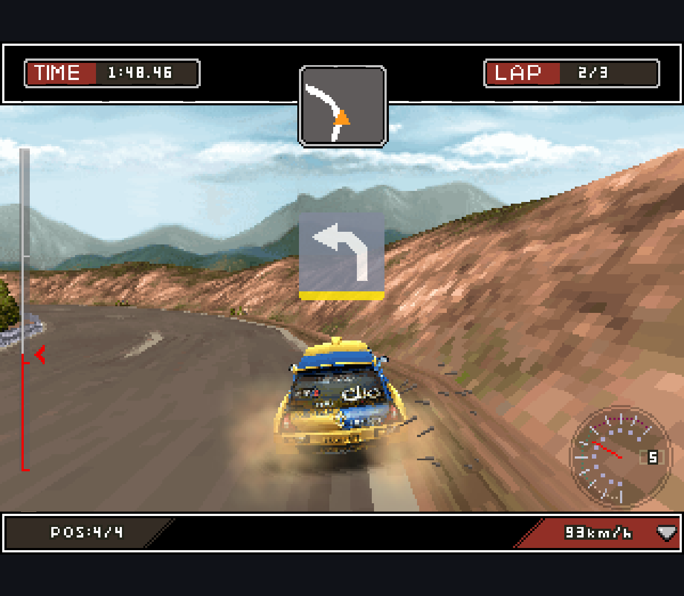
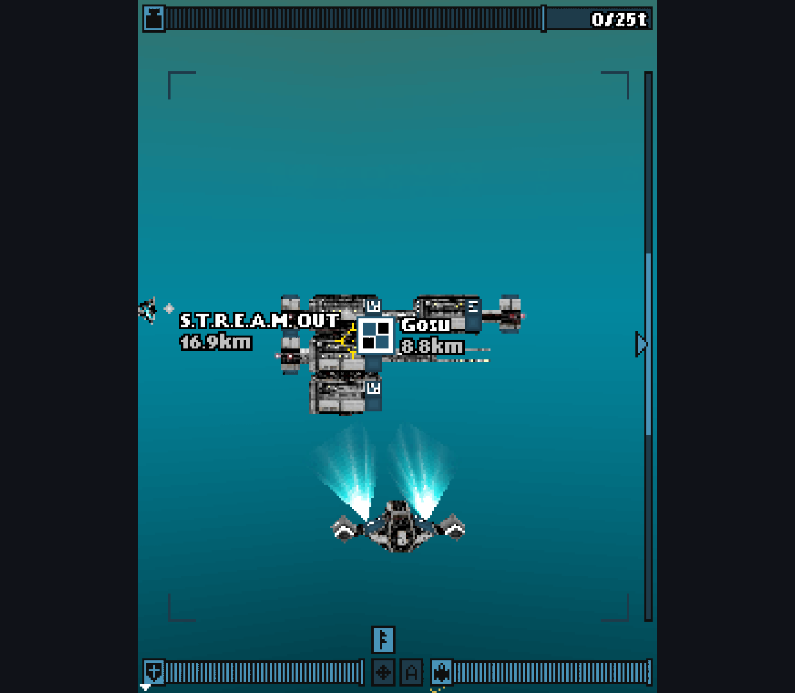
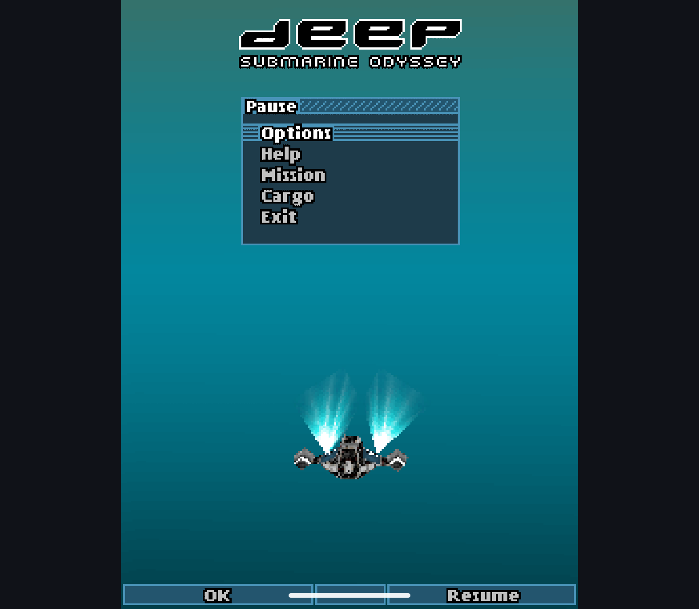

# M3G Filtering Investigation - 2026-10-11

Separate `codex/m3g-replacement` research only. Main's current engine and all
license/release gates are unchanged. No APKs, game archives or upstream engine
sources are included. This follows the [runtime comparison](../m3g-runtime-2026-10-11/README.md).

## Reproduced and Fixed

The candidate's bilinear sampler wrapped/clamped its first integer texel and
then selected a second texel from that adjusted position. Near a clamped left
or top edge, the interpolation fraction still came from the original negative
half-texel coordinate. This mixed the first texel with its neighbor instead of
extending the edge color.

An original 2x2 red/blue texture reproduces this through public M3G APIs: the
sample expected red=255 but returned 96. The candidate failed one of the initial
eight raster cases; the raw failure is retained. Ordinary alpha tests passed,
so this is **not** evidence that the separate Asphalt shadow difference is fixed.

The generated-source patch clamps continuous fixed-point texture coordinates
before choosing neighboring texels and weights. Repeat coordinates are left
unchanged. It is applied to the pinned generated renderer, not to game code,
the upstream checkout or the current Java/native M3G implementation.

Coverage was expanded to eleven raster cases plus the six existing host cases:

- Default color, vertex color, texture and node alpha.
- Multiplication of vertex and texture alpha.
- Bilinear interpolation in the texture center.
- Left, right, top and bottom clamp boundaries.
- Nearest-neighbor boundary and bilinear repeat seam preservation.

These original 64x64 scenes isolate sampling/compositing from moving race frames.
They do not establish full JSR-184 conformance. See
[the test implementation](../../experiments/m3g-host/tests/javax/microedition/shell/M3gRasterTest.java)
and [build/verification commands](../../experiments/m3g-host/README.md).

| Before candidate | Fixed candidate | Current engine |
| --- | --- | --- |
|  |  |  |

## Verified Builds

Both app/test builds succeeded. The current engine passed 17/17 on Retroid
Pocket Classic (Android 14). The corrected candidate passed 17/17 on Retroid
and on the Android 15 x86_64 emulator. Raw reports, artifact hashes and original
scene PNGs are in [checks](checks/) and [scenes](scenes/). The initial candidate
failure and its different eight-test artifact are retained in [before](before/).

- Corrected candidate APK: `31B6EFD2E6E854D0157657F70B00CEC54B74DDB9FAF361A37FE048AA87FE3AC0`.
- Current-engine APK: `0ADF2F1D1B2AF402CD499FEC445CD94ECA450B6B2CD916F4E603877262924DB6`.

The verifier now runs both test classes and rejects any result other than all
17 passing. Six collector parser checks were rerun successfully. The separate
standalone probe, full app suite and lint were not rerun in this batch. No
native-baseline emulator attempt was made because of the earlier unresolved
stall/exit; the current engine was checked on Retroid only.

## Retroid Game Observations

The same archived variants and hashes as the [host smoke report](../m3g-host-2026-10-11/README.md)
were used. Deep is **Deep: Submarine Odyssey (Java)**, not Mophun Deep Abyss.
Graphics mode 1, host filter off and no host FPS limit were used on both engines.
DiRT retains the manual 320x240 profile; Deep uses 240x320. Automatic profile
selection was not changed. Audio was disabled; physical controls were not tested.

DiRT used Career / Pozzo / Clio 1600. Both runs continued the race and displayed
the car, textured track, HUD and effects. Neither received steering input during
the approximately 90-second collection. These are manually started runs on the
same track, not synchronized input replays or matching individual frames.

| DiRT observation | Current engine | Corrected candidate |
| --- | --- | --- |
| Complete host windows | 42 | 43 |
| Canvas updates/s across complete windows | 16.56 | 16.54 |
| Median of window paint-p50 values | 14.38 ms | 9.87 ms |
| Largest window paint-p95 | 17.22 ms | 37.03 ms |
| Sampled process PSS, first / last | 60.72 / 66.21 MiB | 59.49 / 66.61 MiB |
| Surface presentation | Rejected: 2.50 s polling gap | 16.54 Hz |

The baseline surface series is retained but rejected by the collector's
conservative history-overwrite guard. Its separately collected complete host
windows are shown above, not silently promoted into accepted surface timing.
The lower candidate median does not establish an overall speedup: its sampled
tail is higher and these are short, non-deterministic runs.

Deep reached the opening 3D gameplay and HUD. The candidate completed 90.98 s
without a process restart, with 44 complete windows and 60.00 Hz presentation.
Its Canvas update count was 89.49/s; that is neither unique presented frames
nor simulation FPS. All windows have zero measured paint callbacks and -1
paint percentiles, so **paint cost is unavailable**, not zero or negative.
Sampled process PSS went from 68.30 to 69.14 MiB. No input was sent during the
measurement; the vehicle moved away from the starting station.

The baseline also completed the opening-gameplay collection (90.79 s, 44
complete windows, 60.00 Hz presentation, no restart). It recorded 175.18 Canvas
updates/s but likewise zero measured paint callbacks. PSS went from 73.35 to
67.92 MiB. Different update counts behind the same presentation rate are not
a measured renderer-speed ratio; direct-flush timing needs separate coverage.
Both end captures retain the vehicle, animated exhaust and HUD; this is not
visual parity or long-session acceptance.

After Home, Recents and return, the candidate retained PID 16267. The game
showed its own resume prompt, then its pause menu over the retained scene.
The capture proves return to that menu, not a completed second gameplay
measurement, process-death recovery or save persistence. The host was then
exited normally before launching the baseline.

Raw summaries, complete cadence windows, sampled memory and start/end captures
are in [games](games/). Surface dumps and full device logs remain local.
The [PNG manifest](png-sha256.json) records the unmodified capture hashes.

## Interpretation Limits

The game comparisons remain bounded manual observations, not deterministic
replays or full playthroughs. Canvas update frequency is not game-logic FPS;
paint duration includes game drawing and uncalibrated telemetry overhead.
Short PSS series cannot prove leak freedom. See the previous report for method.

The darker Asphalt shadow is still open. Passing ordinary alpha fixtures does
not prove the game's material, fog, depth, texture-combine or draw-order path is
equivalent. No global forced smoothing, shadow brightness override or per-game
workaround was added to conceal it.
