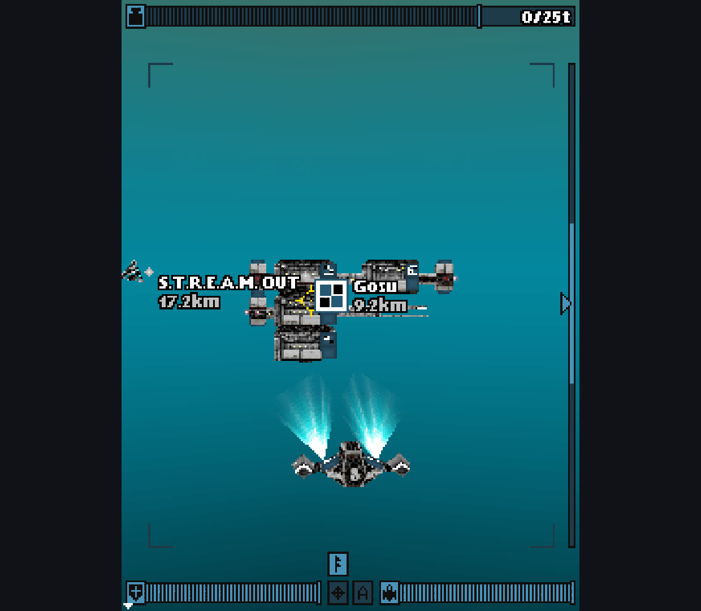
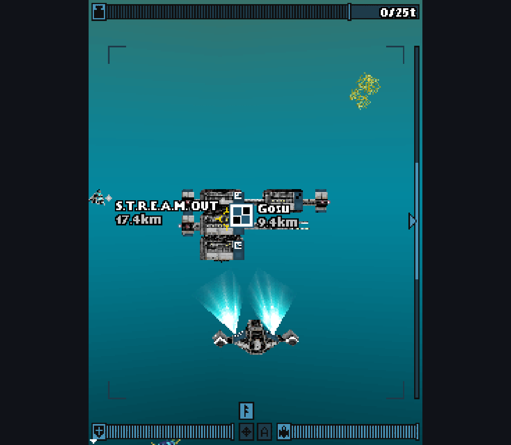
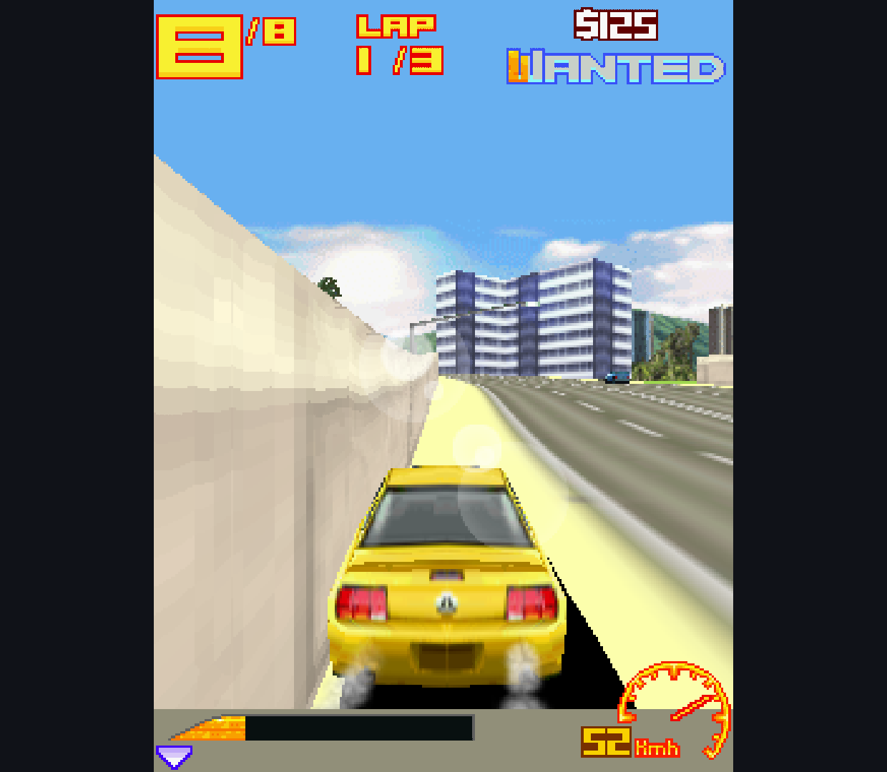
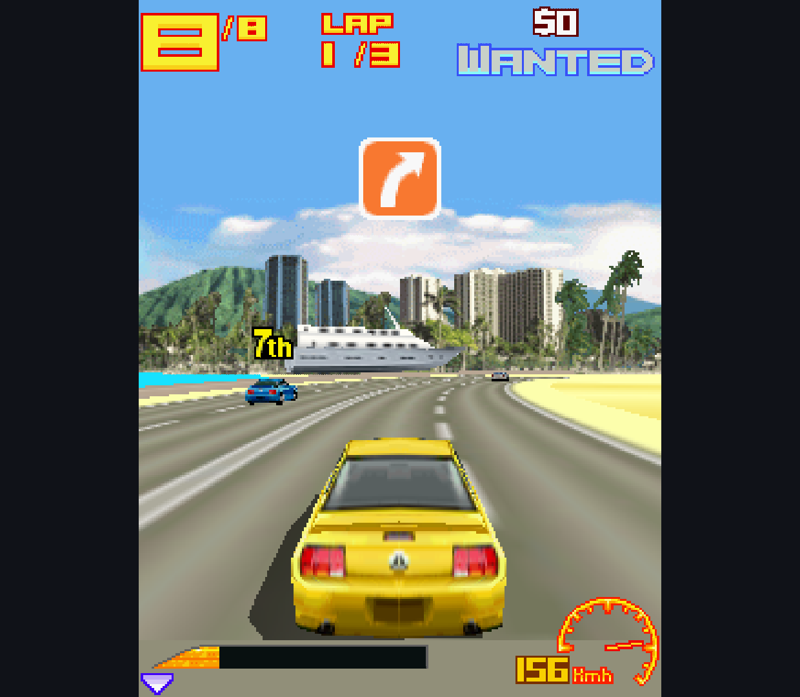
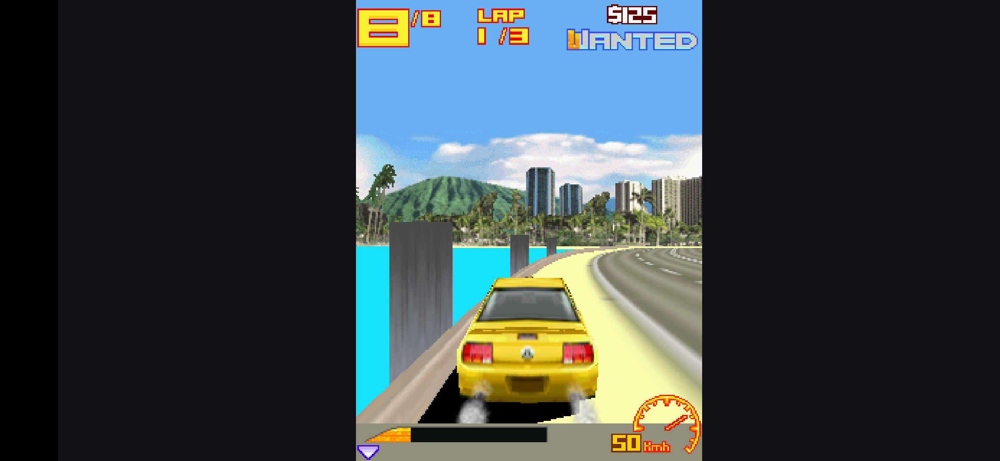
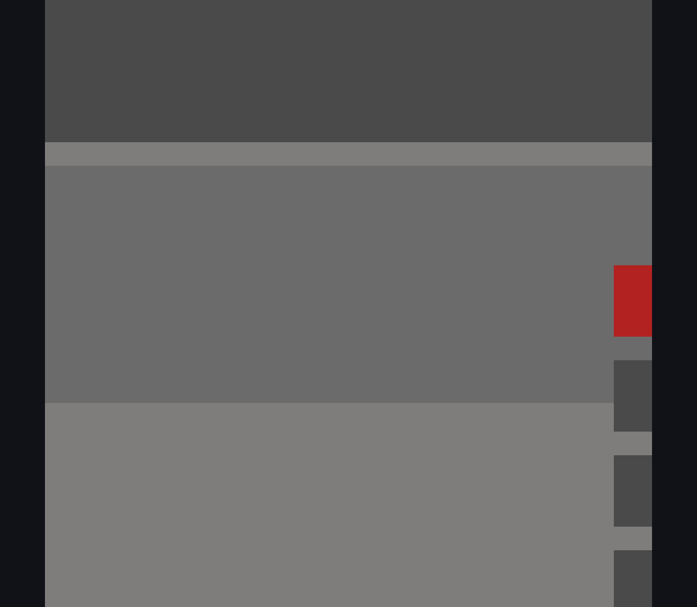
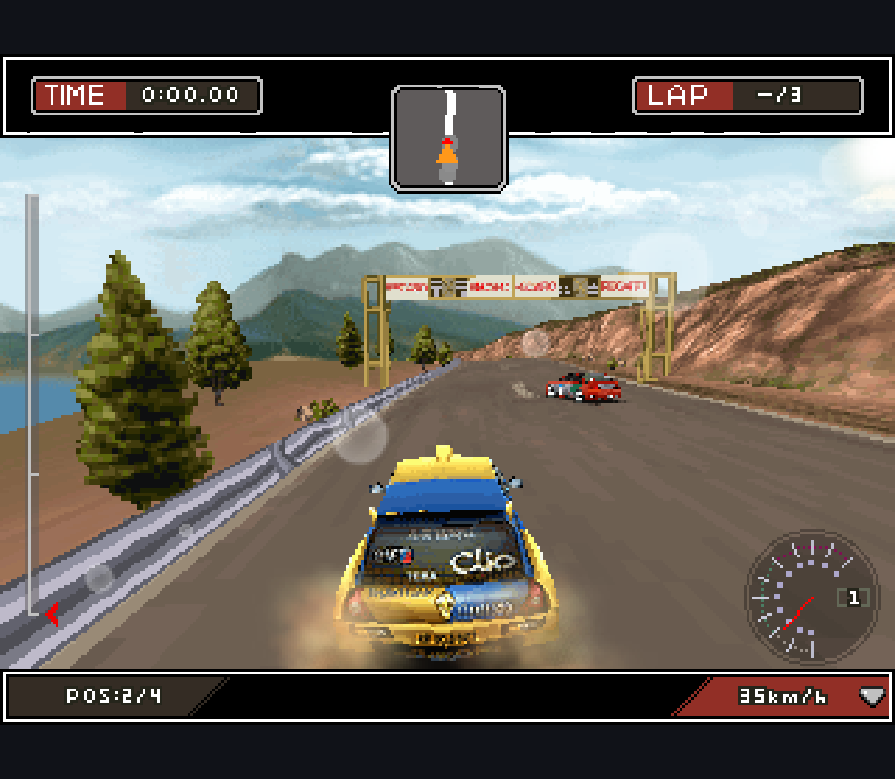
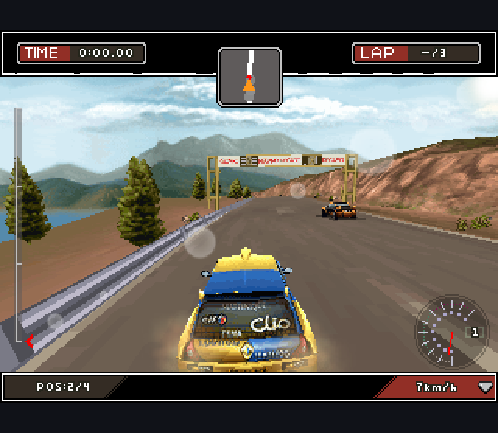

# Real MIDP Host: M3G Research, 2026-10-11

**Branch-only experiment; not a released feature or an approved replacement.**
The existing engine remains in `main`. No game binaries, APKs, optional private
engines or license changes are included in this report.

## What Changed

The FreeJ2ME-Plus candidate now runs inside the real AbyssME MIDP host, not only
the small synthetic probe. Opt-in builds have distinct application IDs and
libraries; candidate and current-engine baseline can coexist with normal apps.
The candidate connects resource loading, session initialization and LCDUI
bitmap rendering without editing the existing MIDP/native engine sources.

A regression test caught an adapter bug: binding a Graphics bitmap after an
equal-sized Image2D target overwrote the texture. A dedicated Android scratch
buffer fixes this. The older adapter fails 1 of 6 tests; the corrected adapter
passes all six. This is a general buffer-ownership correction, not a game patch.

## Verification

| Target | Real-host candidate | Real-host current engine |
| --- | --- | --- |
| Retroid Pocket Classic, Android 14, arm64 | 6/6 host checks | 6/6 host checks |
| Android 15 emulator, x86_64 | 6/6 host checks | Not run in this batch |

Builds: both `assembleFdroidDebug` and `assembleFdroidDebugAndroidTest` succeed
for each engine. APK inspection confirms candidate has no `libjavam3g.so` or
original `Platform` binding; baseline has both native ABIs and no candidate
host class. Candidate includes the upstream GPL notice. These scoped checks
are not a complete dependency/license audit.

After extracting the shared preparation script, the standalone candidate still
builds and passes 18/18 checks on the emulator. Its lint reports 0 errors and
6 warnings (old target API, upstream indentation/boxing, backup metadata, missing
diagnostic icon, diagnostic string). Full-host lint and the entire AbyssME test
suite were not run in this batch. Inherited native compiler warnings remain.

See `retroid-candidate-tests.txt`, `retroid-baseline-tests.txt`,
`emulator-candidate-tests.txt`, corresponding `*-artifact.json` files and
`emulator-before-buffer-fix.txt`. `standalone-after-refactor.json` and
`standalone-after-refactor-apk.json` record the standalone rerun.

The earlier standalone native-baseline emulator stalls/exits remain unresolved.
They were not rerun here; a candidate pass does not clear that failure.

## Fixed Game Sample

The maintainer supplied the local archive. Original files were not modified or
published. All three were checked for actual M3G class references, not chosen
from their titles alone. There are no new per-title source patches.

| Exact variant | Automatic screen | Retroid candidate / baseline observation |
| --- | --- | --- |
| Deep: Submarine Odyssey, Fishlabs 1.0.2, `Deep3D.jar` | 240x320 | Textured animated menu, new character, introduction and first gameplay with HUD on both engines |
| Asphalt 3 3D Street Rules, Gameloft 1.1.5, `asphalt 3 3d.jar` | 240x320 | Instant Play reaches race, car/environment/HUD; candidate also advances in the emulator |
| Colin McRae DiRT 3D, Glu Mobile/BiNPDA 1.0.6, `ColinMcRaeDiRT3D.jar` | 128x128 | Both show the same clipped start screen; manual 320x240 reaches a complete race screen on both |

Deep here is the **Java game, not Mophun Deep Abyss**. Deep and Asphalt use
the automatically selected Nokia6233/05.10, CLDC-1.1/MIDP-2.0 profile. DiRT
selects Nokia6233/05.10, CLDC-1.0/MIDP-1.0 and reports "resources suggest
128x128". Identical manual 240x320 still leaves clipping/stale areas; identical
320x240 renders the whole race layout. Only screen dimensions in each isolated
research profile were changed. The production auto-profile heuristic is not fixed.

SHA-256 of the local game inputs:

```text
89F3A940FF1BE28114B7E63E7644118862C3192367F7B8DAD40E5B2CE084C4AB  Deep3D.jar
1D7D3257A4D27EDD30EAA5F026D30561549D3BF4D36B78E5A809A78FFE55CA5B  asphalt 3 3d.jar
DABF26A91F993A7ECD5A15C79B1FDBF522D9568F72640E7662632A4F20C0223B  ColinMcRaeDiRT3D.jar
```

## Captures and Artifact Scope

Unedited ADB PNG captures are evidence of observed screens, not synchronized
pixel comparisons. Camera position, race time and opponents can differ.
Game artwork belongs to the respective rights holders; it is not project art
or a game download. `captures.json` records each image hash and its source APK.

The final candidate APK hash is
`CF385DDC383AB18D57081739B71D4F8D223391445A0CB0C4D4759C06317971C1`.
The final baseline APK hash is
`3B9A2106EF03102026779FA9BDDB270837291BF7466625F6BC055E4B2A1B9A2B`.
Earlier Deep baseline and Asphalt baseline captures came from the earlier
baseline APK `4A0609DA1822F5C1B9141BB2D104DDA263AFEACD730E23B0F161332EC82D339A`;
the engine sources did not change between these builds.

Deep's first pause/resume and Home/return smoke checks used the earlier
candidate `14B5DB0978FE44200C4D0D62035E3AF4107C8B490B3C785A06F124B0F29AAFD3`.
Do not attribute those lifecycle observations to the final corrected binary.

### Deep




### Asphalt 3





### DiRT





## Boundaries and Next Gate

- Game interaction used ADB key events on real hardware and the emulator, not
  human physical-controller acceptance. Sound was disabled for the race checks;
  audio quality is not verified. No complete playthrough or next-level claim.
- The real-host candidate has two framebuffer copies per bind/release cycle.
  Sustained frame time, memory growth, battery cost and speed parity are unknown.
- Similar screenshots are not complete rendering parity. Fog, transparency,
  lighting, picking, multi-bone animation, repeated lifecycle changes and more
  resource formats still need coverage.
- The unchanged baseline M3G source trees are Java
  `af43b288fbf407f15cb50bb94ee2a405f2376109` and native
  `2a7723dffafbb4699f8da6ab0f675b17a9d3c69f`.

Next proposed batch: performance/memory and repeated pause/resume/game-switch
checks on this **same sample**, plus a separately scoped auto-profile follow-up.
No mainline merge until evidence, provenance and maintainer approval gates pass.

[Reproduce](../../experiments/m3g-host/README.md) |
[Investigation and merge gates](../M3G_REPLACEMENT.md)
