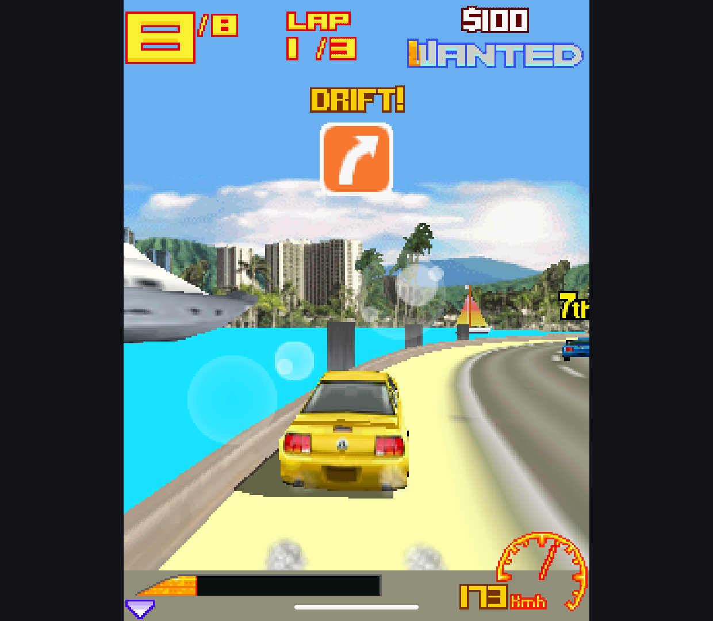

# M3G Compatibility and Controlled Performance Check

Research branch `codex/m3g-replacement`, code checkpoint `f2cecfec`, 2026-10-12.
No production engine, root license or public release changes.

## Fixed

- Using texture unit 1 without unit 0 crashed the candidate. The renderer
  compacted texture objects but not their coordinates, wrapping, transforms
  and mip state. These now use the same dense index, retaining API layer order.
  Two original public-API fixtures failed before the patch and pass afterward;
  the unchanged native engine passes both. One fixture also switches through
  an untextured draw before restoring the second texture unit.
- The external `atan2` approximation is replaced by `(float) Math.atan2(y, x)`.
  Two candidate-only checks cover all quadrants, signed zero, subnormal values,
  infinities and NaN. This removes that snippet from generated candidate source;
  it does not finish the wider dependency/source/notice audit.
- Added an explicitly invoked benchmark and a research-only non-debuggable
  build flag. Neither is enabled in ordinary application builds.

## Verification

| Target | Result | Scope |
| --- | --- | --- |
| Retroid Pocket Classic, Android 14, candidate | 58 passed, zero skipped | Host, raster, scene, tone and math checks |
| Android 15 x86_64 emulator, Phone candidate | 58 passed, zero skipped | Same checks; not physical phone acceptance |
| Retroid, unchanged native baseline | 49 passed, zero skipped | Shared host/raster/scene checks |
| Retroid, final candidate game observation | Asphalt 3 reached a moving Instant Play race | Menu, countdown, car/road/HUD changes and host exit; not a playthrough |

Raw results and APK hashes are in `checks/`. These final builds are Java-only,
without timing hooks, private Mophun fixtures or ROMs. The earlier combined-build
checks remain in the [previous report](../m3g-beta-readiness-2026-10-11/README.md);
they were not rerun or reattributed to these APKs. Sound was selected in Asphalt,
but audibility and physical gamepad handling were not independently verified.



## Reproducible Scenes

`M3gBenchmark` builds an original 128-triangle textured mesh, with four workloads
at each of 240x320 and 320x240: nearest RGB, linear RGB, translucent RGBA, and
ambient lighting plus linear fog. Each case warms 64 frames and measures five
batches of 32 frames, including bind/clear/render/release. It records wall and
thread CPU time, a pixel CRC, thermal status and eight original PNGs. No game
assets are needed. A blank scene fails instead of producing a useful-looking time.

The controlled sequence was candidate A, native B, native C, candidate B.
All four report `debuggable=false` and thermal status 0 at both ends. The final
candidate run repeats the workload after the independent math-helper change;
its hashes match `checks/retroid/artifact.json` and the Asphalt captures.

Mean wall milliseconds per rendered synthetic frame (lower is better):

| Scene | Candidate A | Candidate B | Native B | Native C | Final candidate |
| --- | ---: | ---: | ---: | ---: | ---: |
| RGB nearest, 240x320 | 4.290 | 4.291 | 0.871 | 0.870 | 4.290 |
| RGB linear, 240x320 | 4.752 | 4.747 | 0.863 | 0.866 | 4.764 |
| RGBA alpha, 240x320 | 4.445 | 4.450 | 0.940 | 0.927 | 4.442 |
| Lit + fog, 240x320 | 4.624 | 4.631 | 0.872 | 0.882 | 4.664 |
| RGB nearest, 320x240 | 3.267 | 3.266 | 0.867 | 0.843 | 3.262 |
| RGB linear, 320x240 | 3.646 | 3.640 | 0.849 | 0.866 | 3.643 |
| RGBA alpha, 320x240 | 3.436 | 3.446 | 0.858 | 0.863 | 3.438 |
| Lit + fog, 320x240 | 3.603 | 3.605 | 0.854 | 0.862 | 3.596 |

**This is not game FPS or a complete GPU-completion benchmark.** Native rendering
can queue graphics work; Java thread CPU time is not total GPU cost. Both paths
finish through the same public API into the host bitmap. The measurements still
show a substantial software-path cost, not performance parity. Battery usage,
larger render targets and sustained real-game frame pacing are not established.

An initial debuggable candidate sample cost 5.64-8.24 ms in these scenes. Removing
debug execution brought this to roughly 3.27-4.75 ms; this is a build-mode effect,
not an engine optimization or a speedup promised for existing release APKs.
That initial app hash was
`555561BA8EB63E3D5A0D59F3B537546578FC196570C9D401B48AC83EE5D945A5`.
Its raw data is in `benchmarks/debug-before`; it predates the report's explicit
debuggable field. All eight candidate pixel CRCs match across those builds and
the repeated non-debuggable runs. Native images are not pixel-identical and are
retained separately for visual comparison, not presented as conformance goldens.

A local simpleperf run on the debuggable workload attributed 27.48% of samples
to the scanline renderer and 26.50% to single-unit texturing/nearest/linear
sampling combined. A fused sampler experiment was slower and was discarded;
it is not part of the committed implementation. Profiled timings were not used
in the table. No filtering, fog, alpha or perspective setting was weakened.

## Repeat Locally

Build each engine with `-Pm3gNonDebuggable=true`, without measurement or trace
flags. Use the pinned FreeJ2ME source for the candidate as described in
[the host instructions](../../experiments/m3g-host/README.md). Then:

```powershell
./experiments/m3g-host/benchmark.ps1 -Serial YOUR_DEVICE -Engine candidate -Run candidate-a
```

Use a fresh label for every run. The script validates research package metadata,
installs without clearing data, rejects failed/incomplete test output, and saves
artifact hashes. When alternating builds, snapshot their APK output directories
and pass `-ApkRoot`: Gradle can remove stale test outputs when switching engines.
Do not commit those APK snapshots or local profiler dumps.

## Next Gate

The replacement is usable for continued testing, not yet a no-regression release.
The next performance step is a bounded GPU-rasterization prototype with the same
image fixtures, before committing to a backend change. Keep the software path
as a correctness/fallback reference. Also retain the mobile-ffmpeg provenance,
production packaging/notices, signed upgrade and save-preservation release gates.
