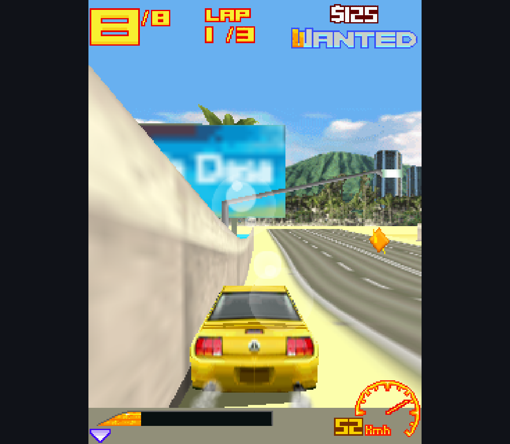
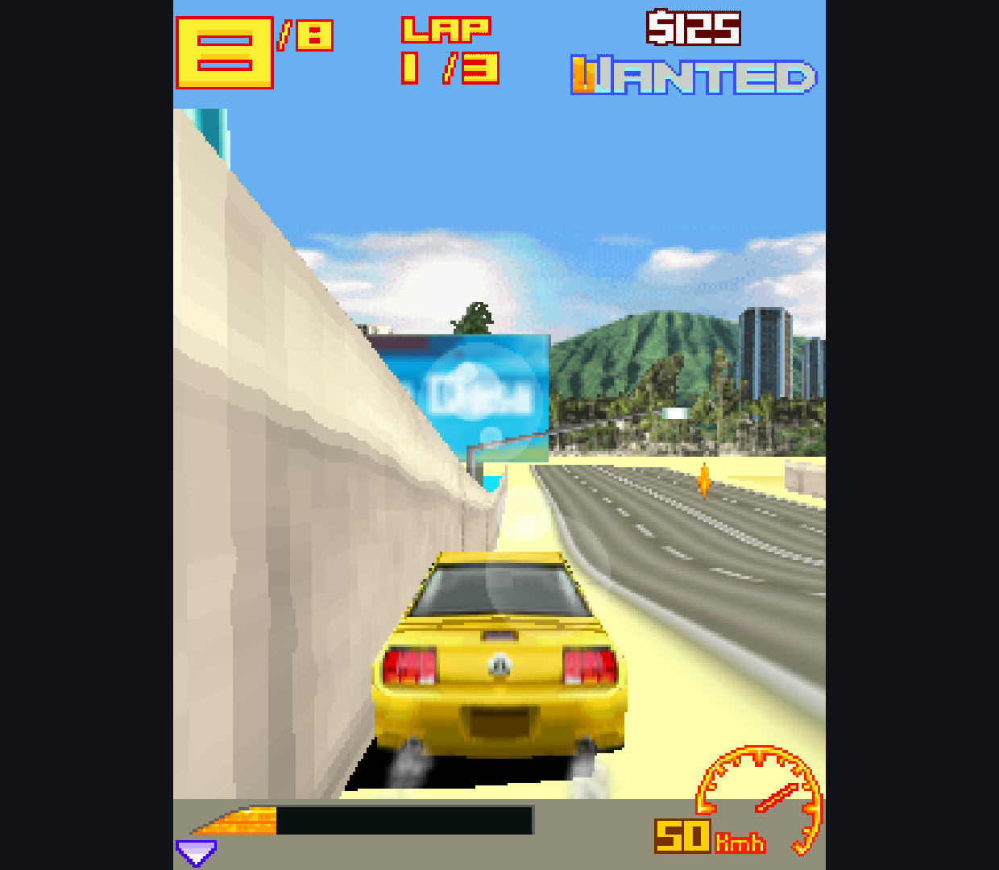
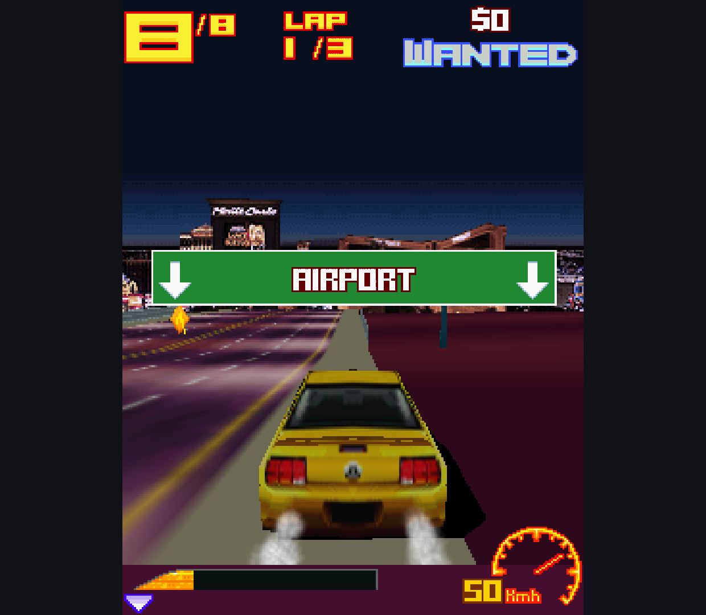
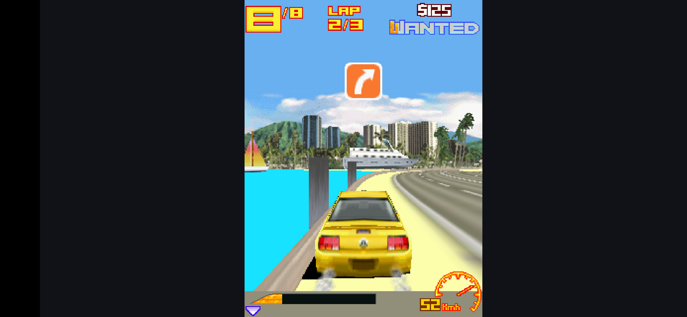
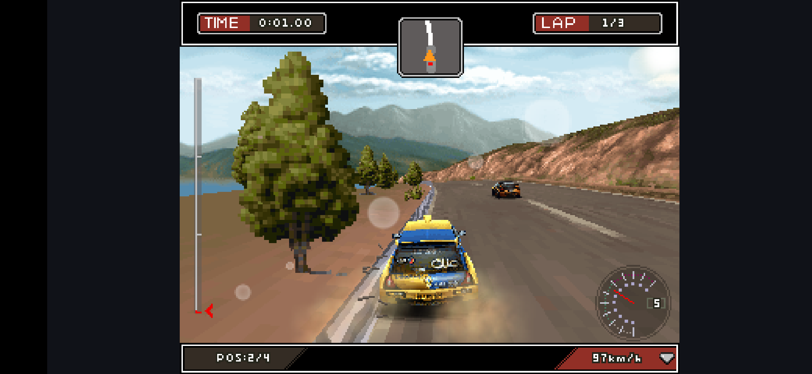

# M3G Runtime Observation - 2026-10-11

Branch-only research on `codex/m3g-replacement`. Main retains the current engine.
No release APK, game archive, upstream engine source or license change is
published by this batch. These are short observations, not replacement approval.

## Build and Checks

Both real-host research builds use the same opt-in Canvas observation hooks:
`-Pm3gMeasure=true`. Original Canvas and current Java/native M3G remain unchanged;
the build generates the measured copy. Candidate upstream revision and exact
game hashes are in the [previous host report](../m3g-host-2026-10-11/README.md).

- Candidate APK SHA-256: `AB9E4BFFC026D3570A37B210C93414FEFDDC98A61EC40C8692C898E55B74B982`.
- Baseline APK SHA-256: `012C98D4585A3969658DD70A3CB4617BFCED6D168B456371ABA7F57AC65C8DD2`.
- Fresh host checks: candidate 6/6 on Retroid Pocket Classic (Android 14) and
  x86_64 emulator (Android 15); baseline 6/6 on Retroid.
- Collector parser checks: 6/6, including invalid timestamps, deduplication,
  insufficient samples and Android 14/15 surface names.
- Both instrumented app/test builds succeeded. No full app suite or new lint
  run in this batch. Native baseline was not rerun on the emulator because
  earlier attempts stalled/exited it.

Raw test results and artifact identities: [checks](checks/).
Screenshots are unchanged PNGs; [image SHA-256 manifest](sha256.json). Raw
instrumentation logs retain their original final blank lines.

## What Is Measured

The collector records two-second windows of Canvas paint/flush updates,
paint-call durations, SurfaceFlinger presentations and per-process PSS.
**Neither Canvas updates nor display refresh are guaranteed logical game FPS.**
Paint timing includes game drawing, not just M3G. Instrumentation adds sorting
and bounded cache-file writes; observer overhead is not calibrated.

The two engines must use the same game, scene, screen dimensions and observation
hooks. These manual runs are not deterministic replays. A single 90-second
sample cannot establish broad performance, battery life or absence of leaks.
See [commands and collection rules](../../experiments/m3g-host/README.md#performance-observation).

## Matched Retroid Scenario

After the owner confirmed that Retroid was available again, both engines ran
Asphalt 3 1.1.5: Arcade -> Honolulu -> Race -> Ford Mustang GT, default yellow,
no tuning. Both profiles use 240x320, GraphicsMode 1, filtering off, no FPS cap.
No steering inputs were sent during either sample. These are matched settings
and route, not frame-identical playback; AI, warm-up and exact start positions
can differ. Baseline ran first, candidate second; this is one pair, not repeated
or randomized benchmarking. The unused menu-only pilot was stopped and excluded.

| Observation | Current engine | Candidate |
| --- | ---: | ---: |
| Sample duration | 91.05 s | 91.03 s |
| Complete host windows | 44 | 44 |
| Canvas updates/second, weighted by window duration | 252.16 | 109.41 |
| Median of per-window paint p50 | 3.66 ms | 8.74 ms |
| Worst per-window paint p95 | 5.00 ms | 11.58 ms |
| PSS at start / ~30s / ~60s / end, KiB | 77,843 / 79,408 / 76,034 / 79,377 | 85,350 / 77,863 / 80,307 / 81,535 |
| Surface presentations | ~60 Hz | ~60 Hz |
| Collector rejection | none | none |

[Derived values](asphalt-comparison.json), [baseline raw windows](retroid-baseline/cadence.json),
[candidate raw windows](retroid-candidate/cadence.json). Battery temperature
and sample summaries are retained in the corresponding directories.

Both remained in the same process throughout their sample and continued drawing
the race. The candidate's paint-duration statistic is about 2.4 times higher in
this pair. **This is not a 2.4x game-speed claim**, nor proof of smooth gameplay:
Canvas can update more than once per game frame, and the surface can repeat
images. CPU utilization, power consumption and calibrated instrumentation cost
were not measured. PSS is non-monotonic in both runs; absence of leaks is unproven.

The images also show a harder, darker car shadow and different texture filtering
on the candidate. Visual parity remains open; no threshold-based image comparison
is applied to non-identical race frames.

| Current engine | Candidate |
| --- | --- |
|  |  |

## Earlier Exploratory Samples

- [Retroid candidate pilot](retroid-pilot/summary.json): 90.33 seconds, 44 complete
  cadence windows; PSS 73,444 / 69,119 / 72,587 / 71,258 KiB. Surface refresh was
  approximately 60 Hz. This was Instant Play, not a matched baseline scene.
  The device was subsequently found to be shared with another task; treat this
  pilot as exploratory, not a controlled comparison.
- [Emulator candidate](emulator-asphalt/summary.json): 91.65 seconds, 44 complete
  host windows, but **surface timing rejected** because a 2.43-second polling gap
  could overwrite frame history. The numeric surface result in raw JSON is not
  an accepted FPS measurement. PSS rose from 96,294 to 100,518 KiB; the cause is
  not established by this short run.

## Emulator Lifecycle

Asphalt survived three Home -> Recents -> Resume cycles with the same process
(4755), followed by its in-game Resume action. The third capture shows the race
continuing on lap 2. PSS after the cycles was 96,936 / 95,014 / 94,326 KiB; this
does not prove a leak-free renderer.

[Cycle record](lifecycle/home-cycles.json).

Host Resume was also exercised. After the host's confirmed Exit game action,
DiRT was imported and launched. Its default 128x128 profile again clipped the
screen; the existing research 320x240 configuration was applied after backing
up the generated profile. No game patch or auto-profile fix was made. DiRT
reached a moving race in a new process (5823). This is a switch through normal
host exit, not reuse of one process: the debug host intentionally terminates
the game process on confirmed exit. Save preservation was not checked here.

## Remaining Gates

Repeat matched, warmed runs and longer memory observations across the fixed
Deep / Asphalt / DiRT sample. Three-game sustained comparisons, repeated
switching including Deep, physical controller/audio acceptance, broader JSR-184
coverage and artifact licensing review remain open. Screenshots are diagnostic
captures of local games, not bundled games or proof of full-game compatibility.
