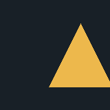
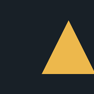

# M3G Scenes and Animation: 2026-10-11

Branch-only synthetic research, not an AbyssME release or game compatibility
claim. The existing mainline engine and root licensing are unchanged. All scene
assets here are generated by our tiny test fixtures, not extracted from games.

## Results

| Engine / target | Before loader fix | Final checks | Evidence |
| --- | --- | --- | --- |
| FreeJ2ME-Plus / Retroid Pocket Classic, Android 14 arm64 | 16/18 | 18/18 | [Before](retroid-candidate-before.json), [after](retroid-candidate.json) |
| FreeJ2ME-Plus / Android 15 x86_64 emulator | 16/18 | 18/18 | [Before](emulator-candidate-before.json), [after](emulator-candidate.json) |
| Existing EPL M3G / Retroid Pocket Classic | Not applicable | 10/10 shared cases | [Report](retroid-baseline.json) |
| Existing EPL M3G / Android 15 x86_64 emulator | Not applicable | No completed report | Emulator stalls/exits; unresolved |

The candidate runs the original eight checks plus ten shared cases. The baseline
runs only those ten identical shared cases. Separate application IDs/data and
independent engine sources prevent updating or modifying either AbyssME app.

## What Changed

Original fixtures cover raw and zlib `.m3g` scenes with one or multiple object
sections, a byte offset with trailing container data, and truncated input.
Successful loads must return the expected scene graph and match an API-created
scene's pixels within the same engine. Animation checks exercise translation,
quaternion rotation, vertex morphing and a single moving bone; they assert both
state and rendered movement. They do not yet load animation tracks from files.

Both multi-section cases initially failed in the candidate on both devices:
`World root missing; returned 1 objects`. Its loader compared consumed bytes
with a shrinking `available()` count and stopped before later sections. The
guarded generated-source patch compares consumed bytes with the file header's
total size instead. The offset test checks that trailing bytes remain outside
the scene. The pinned upstream checkout itself is not edited.

## Pixel Comparison

[Retroid comparison JSON](retroid-comparison.json) records 17 common frame pairs
and both tested APK hashes. Across these 160x160 frames:

- Different pixels: 178-221 of 25,600 (about 0.70-0.86%).
- Mean absolute RGB channel error: 0.931719-1.156797 on a 0-255 scale.
- Yellow-geometry intersection over union: 0.949254-0.959127.

These describe simple triangles on large uniform backgrounds, not a passing
threshold or a general compatibility percentage. Edge placement differs; exact
pixel parity is not claimed. Recorded elapsed times are cold test timings, not
sustained frame-rate measurements.

| Candidate | Existing engine |
| --- | --- |
|  |  |
|  |  |
|  |  |

[Actual Retroid baseline screen](retroid-baseline-screen.png). This diagnostic
screen is not a new AbyssME interface. Candidate emulator frames are in
[`emulator-candidate`](emulator-candidate).

## Reproducibility

Use the [probe build, verify and comparison instructions](../../experiments/m3g-probe/README.md).
Suite version is 2. Candidate source revision:
`baca76a4dda6f30abac67fb4a3db009eed05f91c`.
Baseline source tree guards:

- Java M3G: `af43b288fbf407f15cb50bb94ee2a405f2376109`.
- Native M3G: `2a7723dffafbb4699f8da6ab0f675b17a9d3c69f`.

Tested final APK SHA-256 (binaries remain local, not published):

```text
116cc24fbe662fcee433a4733f62c7794b88637e59f6e1c47765e6c0c9942389  candidate
f5343b49116c11fb71847b6b95f9b931f634c53a68b2d4a658747984658c2a71  baseline
```

Both APKs build with JDK 21 / SDK 34. Baseline builds `javam3g` using NDK
22.1.7171670; 63 inherited native warnings per ABI were not changed. Android
lint completed with 0 errors: candidate 5 warnings, baseline 23 warnings.
APK inspection confirmed no native libraries in the candidate, and only the
arm64/x86_64 `libjavam3g.so` libraries in the baseline. License assets are kept
separate; this test setup does not settle combined-product licensing.

Two baseline launches with `swiftshader_indirect` stalled the emulator/ADB shell.
After recovery with `-gpu software`, the candidate passed 18/18, but a baseline
launch again failed and the emulator process exited without a report. No root
cause is established. The AVD was subsequently restored with its original GPU
setting and boot completion verified. No user data was wiped; no AbyssME game
data was touched. Raw host logs are not published because they include local
machine details. The verifier now bounds ADB operations with timeouts.

Still unverified: real MIDP integration, representative games, loaded animation
tracks, external resource references, complex skinning, lighting/fog, picking,
transparency, 2D/3D composition, lifecycle interruptions, memory and sustained
performance. Keep these separate from the passing synthetic device checks.
