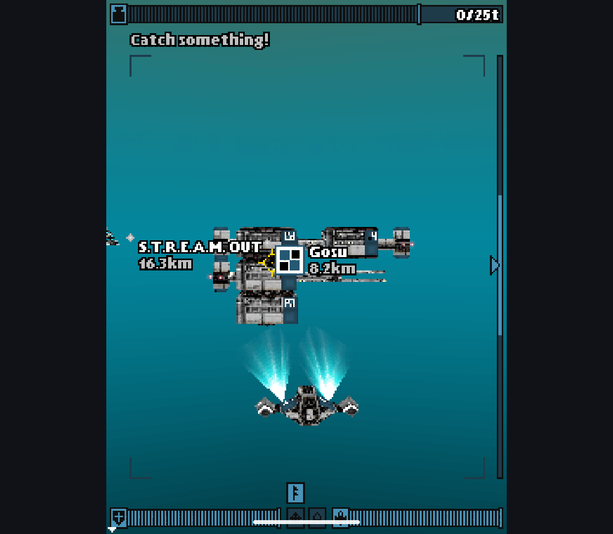
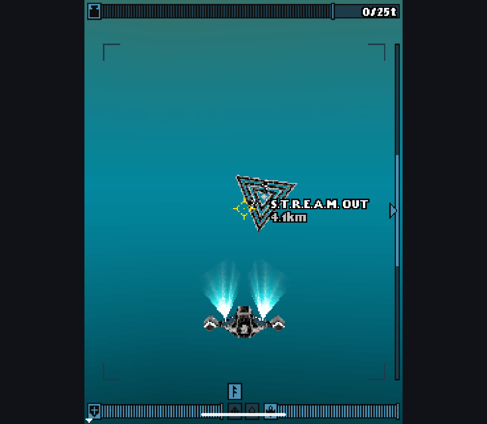
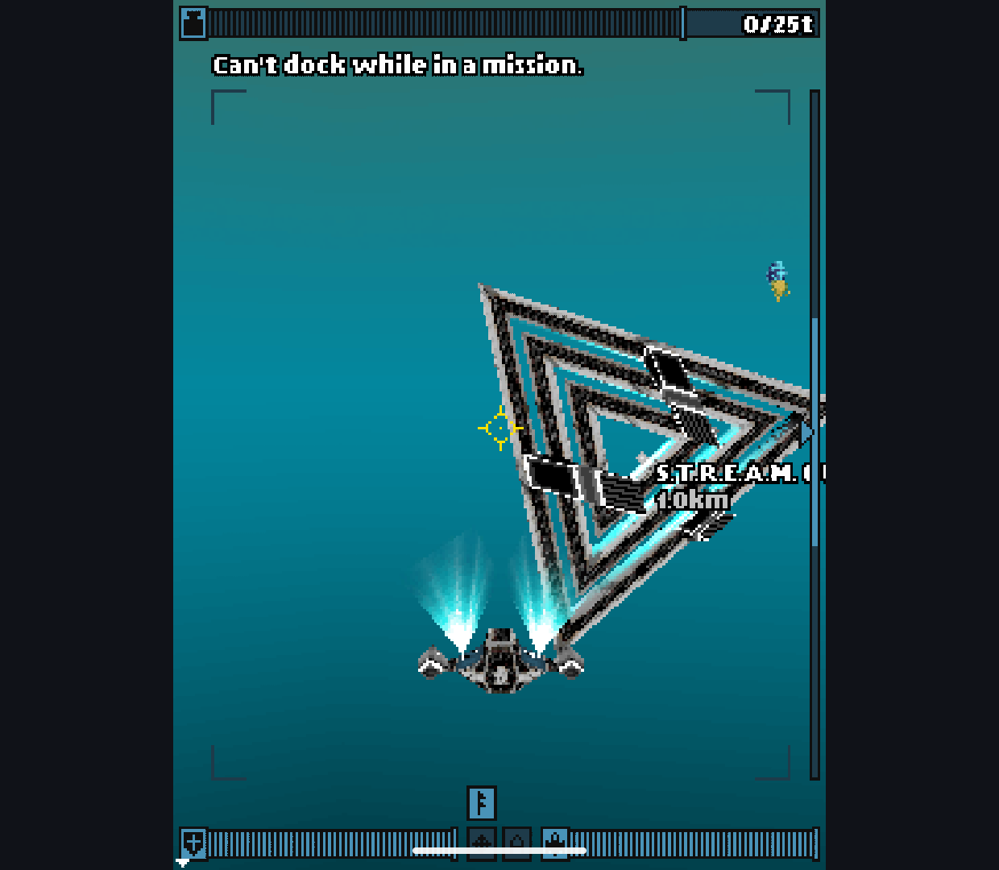
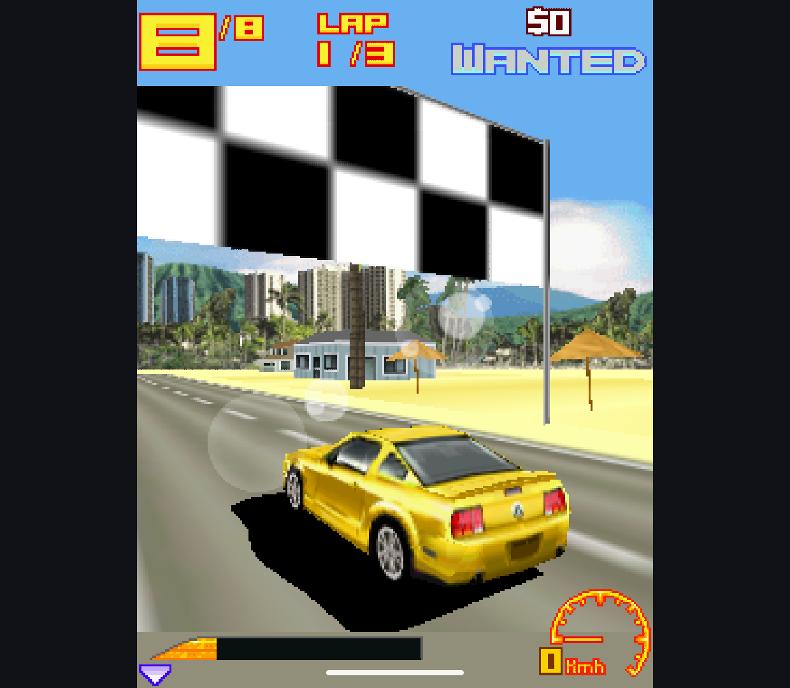
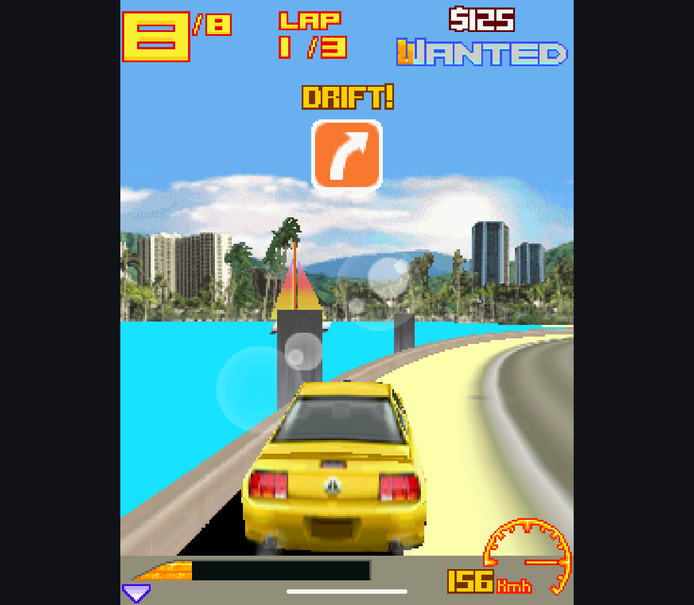

# M3G Material, Fog and Target Timing - 2026-10-11

Separate `codex/m3g-replacement` research. Main's engine, licensing and release
gates are unchanged. No game archives, APKs or upstream engine source are
published here. This follows the [texture-edge investigation](../m3g-filtering-2026-10-11/README.md).

## Reproduced Differences

Eight additional original public-API scenes exposed two candidate failures;
the native baseline passed the same 25 host/raster cases on Retroid:

- A material with diffuse alpha and normals but no lights was ignored. The
  resulting white pixel was 255 instead of the expected blended gray 127.
- Parallel-projection fog used reciprocal clip W as camera distance. Since
  parallel W is constant, the fogged alpha scene returned 126 instead of 191.

The first fix keeps material evaluation enabled with an empty light list, so
emission and diffuse alpha still apply. The second recovers eye depth from
clipped normalized coordinates before viewport/depth-range mapping, then
interpolates that distance across parallel-projection triangles. It leaves
the existing perspective path unchanged. Neither fix changes a game or adds
a per-game switch. Both are exact-match guarded patches to generated sources;
the revision-pinned upstream checkout and production Java/native files remain
unchanged.

The expected behavior follows the original M3G 1.1 API documentation, available
in this mirror: [Material](https://nikita36078.github.io/J2ME_Docs/docs/jsr184/javax/microedition/m3g/Material.html)
enables lighting computation for non-null materials, including emission and
diffuse alpha; [Fog](https://nikita36078.github.io/J2ME_Docs/docs/jsr184/javax/microedition/m3g/Fog.html)
permits using camera-space Z as the distance approximation. These references
do not establish complete conformance of the replacement.

| Fixture | Before candidate | Fixed candidate | Current engine |
| --- | --- | --- | --- |
| Material alpha, no lights |  |  |  |
| Parallel fog and alpha |  |  |  |

Four further regressions cover emission color, sloped parallel fog, disabled
depth testing and collapsed depth range. Together with luminance-alpha textures,
multiply blending and depth-write/alpha-rejection cases, there are now 23 raster
plus six host checks. These are selected cases, not all shading/depth combinations.
Generic projection, broad light/material combinations and Sprite3D fog parity
are not established by this batch.

## Timing the Direct-Flush Path

The earlier Deep observation had zero measured `Canvas.paint` callbacks. New
opt-in hooks in generated Graphics3D copies record wall time from the end of a
successful target binding through release. This includes intervening game code
and release/readback; it excludes binding and is **not isolated renderer cost**.
Both engines use the same measurement boundary. Ordinary app builds are unchanged.

Two-second cadence windows include `targetSessions`, `targetP50Ns` and
`targetP95Ns`. Missing samples remain -1. Three instrumented tests exercise the
real generated hooks: held interval, duplicate release, and rejected null bind.
The verifier detects measurement-enabled builds and requires all 32 checks;
unmeasured builds require 29. No performance conclusion comes from these tests.

## Verification

- Both measured host app/test builds succeeded.
- Retroid Pocket Classic, Android 14: baseline and candidate **32/32** each.
- Android 15 x86_64 emulator: candidate **32/32**.
- Standalone candidate rebuilt and passed **18/18** on the emulator after the
  shared renderer patches. Native baseline was not run on the emulator because
  the earlier stall/exit remains unresolved.
- Six frame-collector parser checks passed again.
- Full application suite and lint were not rerun. Physical input and audio
  acceptance are outside this batch.

Candidate host APK SHA-256:
`8FF5505C67F3B5AFAC9EEC571D75C5AF9BE40D7F1E31E44B9230D8594AD842B7`.
Baseline host APK SHA-256:
`136078D653E034C18B40E448342DD35B5088265E0FEA59F5B05E838A464F92E1`.
Test APK identities and raw results are in [checks](checks/); initial failed
candidate evidence is in [before](before/). Scene PNGs are unmodified 64x64
diagnostic outputs, not magnified promotional screenshots.

## Deep Direct-Flush Observation

The same Deep: Submarine Odyssey 1.0.2 Java variant as the
[host report](../m3g-host-2026-10-11/README.md) was used on Retroid: 240x320,
Graphics mode 1, host filter off, no host FPS cap, music off. This is not
Mophun Deep Abyss. Both engines reached opening gameplay after a new character
and dialogue skip. No input was sent during each approximately 45-second run.

| Observation | Current engine | Candidate |
| --- | --- | --- |
| Complete two-second windows | 21 | 21 |
| Recorded target sessions | 6614 | 3399 |
| Median of window target-p50 | 3.24 ms | 8.46 ms |
| Largest window target-p95 | 4.13 ms | 11.82 ms |
| Recorded Canvas paints | 0 | 0 |
| Surface presentation | 60.00 Hz | 60.00 Hz |
| Sampled PSS first / last | 68.28 / 66.54 MiB | 66.12 / 64.24 MiB |

The target hooks now observe the previously unmeasured path. The candidate's
observed interval is higher, but these figures include game work, exclude bind
cost and come from moving, non-synchronized scenes. They do not establish a
renderer-speed ratio or 60 game-logic FPS. Both collections retained their
process, had no rejected surface gap or cadence overflow, and continued to
show the vehicle, environment/effects and HUD. Different station positions in
the end captures make the non-deterministic comparison boundary visible.

Candidate Home / Recents / return kept PID 19747. Fire opened the game's own
pause menu, then right soft key resumed gameplay. Two later captures show the
same HUD and a changing location marker (4.1 km to 1.0 km), rather than only
a retained pause screen. This is one successful cycle, not process-death or
save/reload acceptance. The game was exited normally afterward.

[Summaries, complete cadence windows and sampled memory](games/) retain the
exact APK identities. The start/end screenshots and resume pair are original
device PNGs; full logs remain local.

## Remaining Boundary

Asphalt 3 reached an Instant Play race after the same corrected candidate was
launched following normal Deep exit. The start and later capture show a car,
track and HUD, but the solid, hard-edged black shadow remains visible. This is
a smoke observation, not a fresh synchronized native/candidate comparison or
a performance run. The game was left in the host pause menu.

These two isolated failures do not prove the cause of Asphalt's darker shadow.
No shadow brightness override or forced smoothing was added. A game-specific
render-state trace or deterministic scene replay is still needed before
claiming that visual difference fixed. Short game observations cannot establish
leak freedom, speed parity, save safety or overall replacement readiness.

The [PNG manifest](png-sha256.json) covers unmodified published captures only;
text logs may undergo Git line-ending normalization.
