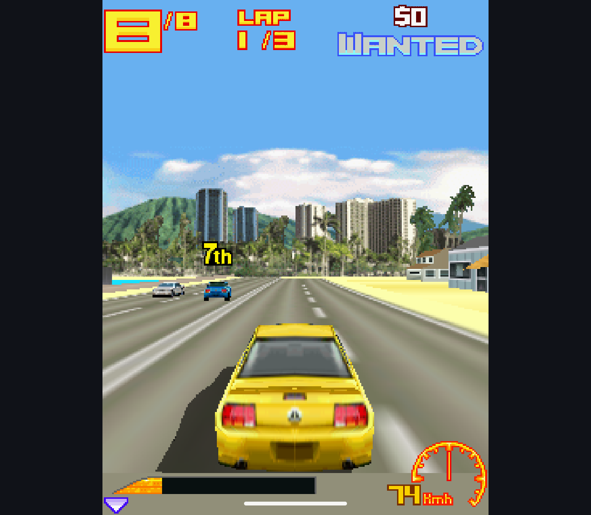
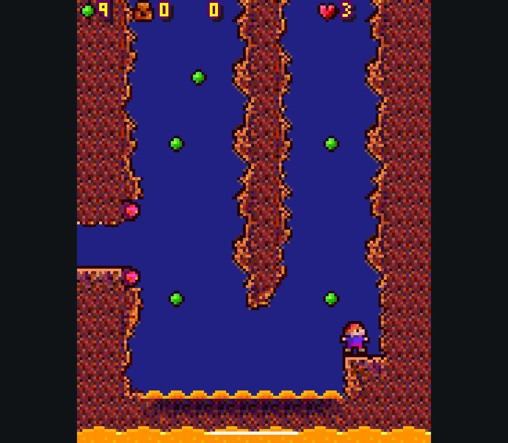
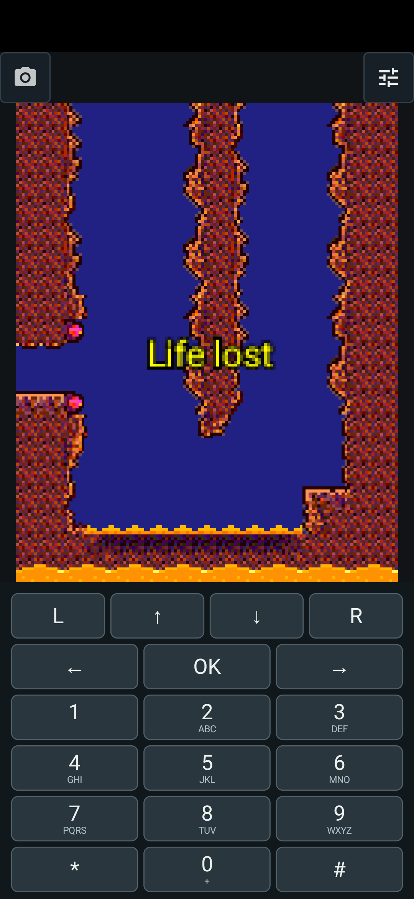

# AbyssME 0.2.0 Beta 1

The first public combined Java + experimental Mophun beta, with the replacement
M3G renderer and the accumulated controls, display and library improvements.
Android 10 or newer is required. Games and firmware are not included.

## Choose a Build

- `AbyssME-0.2.0-beta.1-handheld.apk`: landscape, physical controllers, no touch keypad.
- `AbyssME-0.2.0-beta.1-phone.apk`: portrait/landscape, numeric keypad or virtual Gamepad.

Both variants can coexist and keep separate libraries. Version code is 200.
Package IDs and release signing key are unchanged from beta.2, so update the
matching release app without uninstalling it. Make a backup first. Debug/test
packages remain separate: use Library transfer to move their games and saves.

## Changes Since 0.1.0 Beta 2

- Replaced the old M3G 3D renderer and tone compiler. The old EPL engine is
  removed; Mascot Capsule support remains. GLES acceleration and a software/
  native fallback are included, without a renderer-selection setup step.
- Added experimental Mophun `.mpn` import and play inside the same library.
  Deep Abyss is the main tested title. Shared controller and Phone touch controls,
  game settings, screenshots and library return are available.
- Added a graphical per-game controller mapper, named presets and diagonal
  direction combinations. Phone offers two touch layouts in both orientations.
- Made Display and Controls available while playing, with reversible Try / Keep /
  Undo changes. More includes quick screen-size and phone-profile presets;
  profile changes explicitly restart the game and can lose unsaved progress.
- Improved small-screen menus, library layout, cover/icon display and installers.
  Added screenshots with an optional on-screen button.
- Added menu-based J2ME Loader import and AbyssME library backup/restore, including
  supported profiles and saved data. Folder-access recovery and import errors are
  clearer; Android storage-provider restrictions still apply.
- Tightened automatic size/vendor selection, added resolution-aware default fonts,
  and fixed optimized-build profile persistence/restart and framed-JAR import.
- Published the combined application under GPLv3, preserving component licenses,
  with matching app/dependency source materials. This does not relicense games or
  old releases. GitHub Actions remains disabled.

## Verification and Limits

Both signed variants build and pass release lint and APK composition checks.
The Retroid production debug renderer passes 363 checks; 25 fixture-free Mophun
checks pass on Retroid and Phone emulator. The actual signed Phone beta.2 upgrade
retains an installed MIDlet and reads/writes its previous RMS save.
Signed Retroid gameplay checks reach Asphalt 3 3D racing and Deep Abyss gameplay;
Phone reaches Deep Abyss with touch controls. See the [verification report](v0.2.0-beta.1-checks.md).

This remains a beta. Mophun compatibility and audio are experimental, not universal.
No full-game completion, every controller or sustained thermal performance is
claimed. Some games still need manual settings. External launcher acceptance,
URI-alias duplicate imports and the reported Ghost Recon black screen remain
open. Symbian and N-Gage are not included.

## Files and Sources

The release provides two APKs, `SHA256SUMS.txt`, `AbyssME-0.2.0-beta.1-source.zip`
and `AbyssME-0.2.0-beta.1-dependency-sources.zip`. The dependency bundle contains
source JARs, native source/build materials, provenance and licenses, not another
APK. Read its README and the app's CONTRIBUTING/LICENSING documents to rebuild.
Release code tree: `442134ccfa2ccef7ddc4de4f3f744ff1a47e61d3`.

## Captures

Retroid Pocket Classic, signed Handheld APK, short ADB-driven sessions:

Android 15 Phone emulator, signed Phone APK, numeric touch controls:

