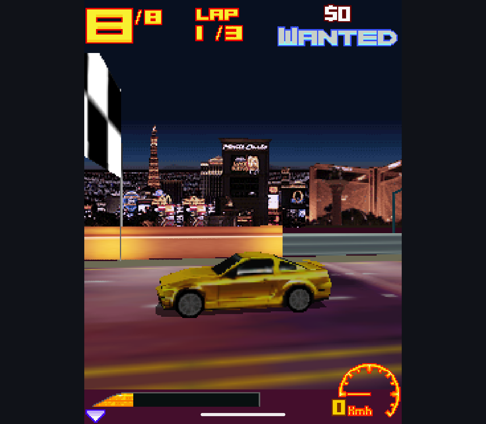
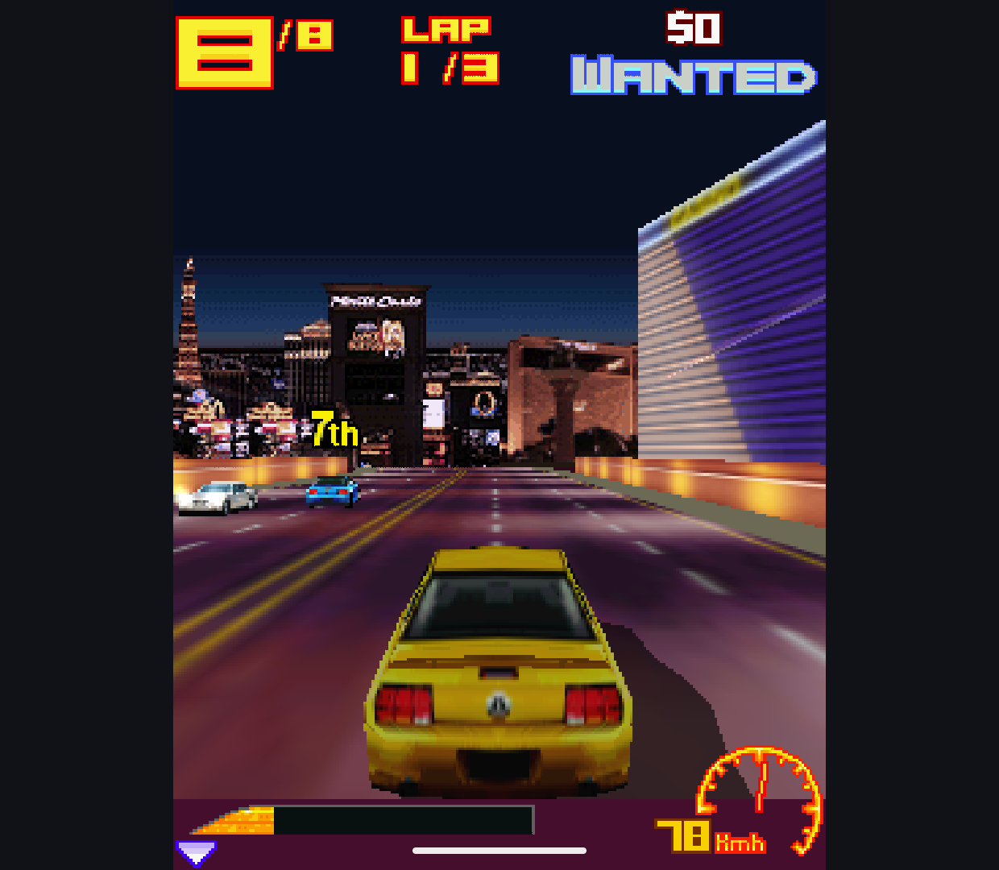

# Animation compatibility, 2026-10-13

Research branch only. These changes fix shared M3G behavior; no game executable,
mainline renderer, root license or public APK was changed.

## Implementation

- Calculate the previously missing SPLINE tangents and SQUAD control rotations,
  including irregular keyframe spacing, constant endpoints and looping curves.
  Invalidate cached curves after edits or repeat-mode changes.
- Interpolate the gap from the last key to the first key of the next loop.
  Support circular valid ranges and coincident-key cuts with random seeking.
  Ignore excluded frames when validating and sampling the active range.
- Preserve quaternion signs in SLERP, including rotations over 180 degrees.
  The new original quaternion helper uses the documented interpolation formulas.
- Blend scalar/vector tracks as weighted sums, not weighted averages. Final
  orientation normalization stays in the existing transform path. Weight-zero
  tracks remain inactive; non-unit positive weights retain their meaning.
- Apply samples with zero validity. Use conservative scheduling for moving,
  reverse and fractional-speed tracks instead of sleeping past a visible change.
  Stop integer overflow in controller position and activation intervals.
- Validate duration and active-key ordering when applying animation. The loader
  also rejects invalid sequence files before returning their objects. Correct
  invalid-range exceptions while accepting circular ranges.

Implementation consists of guarded preparation patches against the pinned
FreeJ2ME-Plus source, an original sampling include and quaternion helper. The
original upstream archive and native baseline are untouched; no EPL code was
copied. Contracts and math are from the JSR-184 API documentation for
[KeyframeSequence](https://nikita36078.github.io/J2ME_Docs/docs/jsr184/javax/microedition/m3g/KeyframeSequence.html),
[AnimationController](https://nikita36078.github.io/J2ME_Docs/docs/jsr184/javax/microedition/m3g/AnimationController.html)
and [Object3D](https://nikita36078.github.io/J2ME_Docs/docs/jsr184/javax/microedition/m3g/Object3D.html).

## Verification

The initial 19 public-API cases reproduced 16 failures on the old candidate.
The final suite has 23 cases, including original generated M3G files, weighted
tracks, controller time overflow and composed rotation/scale/translation.

- Final Handheld candidate on Retroid Pocket Classic / Android 14: **163/163**,
  no skips. This includes all 23 new cases and the existing renderer checks.
- Final Phone candidate on Android 15 x86_64 emulator: **85/85**, no skips.
  This is the 62 shared host/API/raster cases plus all 23 new cases. The 78
  unchanged implementation/GPU cases were not repeated on this Phone APK.
- Unchanged native baseline on Retroid: **19/23** in the new comparison suite.
  Differences are unset-duration rejection, invalid-file rejection, reverse
  playback validity and repeat-mode tangent invalidation. These failures remain
  visible in the saved report; this is not a baseline pass or a baseline fix.
  The first weighted-blending test draft assumed normalization incorrectly;
  native comparison and the documented weighted sum corrected that expectation
  and exposed the candidate's unwanted normalization.

The new suite is part of the candidate verifier. It can be run independently
on either engine through `M3gAnimationTest`; known native differences are not
silently skipped or added to the existing baseline pass gate.

Build flags: `-Pm3gExperiment=candidate -Pm3gNonDebuggable=true --offline`.
Both debug variants and their Android test APKs were assembled. Device checks
use `verify.ps1`; Phone uses the five public host/raster/scene/copy/animation
classes directly. [Raw results and artifact metadata](animation-20261013/).

## Game Check

A separate GPU-enabled Handheld build (`-Pm3gGpu=true`) reached a fresh Asphalt
3 3D Street Rules race on Retroid. The two unedited captures show the starting
camera and later moving race, including the car, opponents, track and HUD.
This is the existing private Java test input, not the supplied N-Gage archive.
Sound was disabled. No audio, physical-button, full-race or performance claim
is made. GPU is still opt-in, and a GPU-enabled APK alone is not proof of every
draw using the GPU. Ordinary user packages and saves were not replaced/cleared.

## Artifact SHA-256

The final API-test APKs were snapshotted before the game build. Baseline hashes
were read from installed APKs because switching variants replaces build outputs.
APKs and private game inputs are not committed or distributed with this report.

| Artifact | SHA-256 |
| --- | --- |
| Candidate Handheld | `502FF0881E4C742B99499A642EA0DB8BB4A4EB74DF375B879D82D8F0B704109A` |
| Candidate Handheld tests | `EC5483B3DF41AC02669F2FAAEBC4BAE50694279935C0E2C91F3C0C1576E024BE` |
| Candidate Phone | `4723E52D8A4C5889FCBCF705E83099A250477AC59E21122BBC8B272295DDCE91` |
| Candidate Phone tests | `EB963573B0C3F9FD4E621DB2BEE09F4495C4EFA905C6BCBD0641C0C65D0FE87C` |
| Native baseline | `E26701B551297790584ED62FD7DEB046311FC80C4FFD12751A716F27302E6D3E` |
| Native baseline tests | `E4B69E97F2903E8C749B472A438BEAAC480BE57D8A63DAE2E59C2698C86D0593` |
| Candidate Handheld, GPU-enabled game check | `F1088932B3B1215DB7AF792B904FD3424C0C5EF560D4C28CB716CDA131CC7A26` |

## Remaining Work

Broader animated hierarchy/deformation coverage, remaining loader contracts and
real-game parity still need implementation-led work. Conservative zero-validity
scheduling favors correctness; it is not a performance improvement claim.
Production migration, dependency/license notices, upgrades and save acceptance
remain separate release gates. This batch does not declare replacement readiness.
