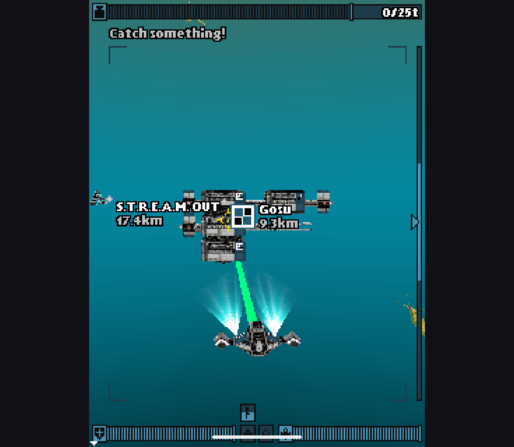
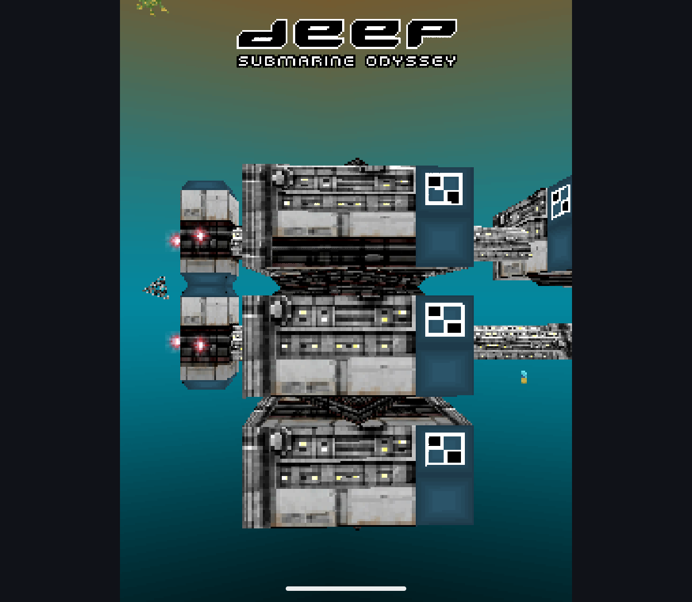

# Mutable Geometry and Skeletal Deformation - 2026-10-13

Research branch only. Main's renderer, license and public APKs are unchanged.
Original guarded preparation patches target FreeJ2ME-Plus revision
`baca76a4dda6f30abac67fb4a3db009eed05f91c`. No native baseline implementation
was copied. Binary fixtures are original and contain no game resources.

## Implemented

- Morph poses now follow changes to referenced vertex arrays, colors, base
  scale/bias and attribute layouts without requiring another `setWeights`.
  Revision snapshots avoid scanning unchanged vertex contents. Changed layouts
  are revalidated and recover after the caller repairs them.
- Skinned output refreshes when the base geometry or colors change, including
  replaced storage and vertex counts. Existing animation/ancestor traversal is
  covered together with attached meshes and independently posed duplicates.
- Bone queries combine overlapping ranges, return each vertex once and report
  normalized accumulated weights. A null output array requests a count without
  modifying the other array. Repeated ranges share one reported bind pose.
- Bone range validation rejects integer overflow before changing the mesh.
- Skin normals use inverse-transpose matrices under nonuniform bone scaling.
  The previous position matrix visibly darkened the reference lit triangle.
- Original binary fixtures check loaded morph weights, mutable targets, bind
  transforms and duplicates. No additional Loader implementation change was
  needed for those cases.

Contract references: [MorphingMesh](https://nikita36078.github.io/J2ME_Docs/docs/jsr184/javax/microedition/m3g/MorphingMesh.html),
[SkinnedMesh](https://nikita36078.github.io/J2ME_Docs/docs/jsr184/javax/microedition/m3g/SkinnedMesh.html)
and [M3G package rules](https://nikita36078.github.io/J2ME_Docs/docs/jsr184/javax/microedition/m3g/package-summary.html).
Normal handling was also checked against an ordinary lit mesh and the unchanged
native engine through the public API.

## Evidence

| Run | Result | Boundary |
| --- | --- | --- |
| Candidate before fixes | 16 cases, 14 failures | Initial targeted regression set |
| Candidate before normal fix | 19 cases, 1 failure | Lit channel 113 instead of reference 227 |
| Native initial comparison | Process crash at overflowing range case | Interrupted run, not a completed suite |
| Native bounded comparison | 15 cases, 9 pass / 6 fail | Overflow case explicitly excluded |
| Native normal comparison | 1 pass | Separate focused run |
| Final candidate / Retroid Pocket Classic, Android 14 | 184 pass, 0 skips | 62 shared + 23 animation + 21 deformation + 78 implementation/GPU |
| Final candidate Phone / Android 15 x86_64 emulator | 106 pass, 0 skips | Shared, animation and deformation; remaining implementation/GPU suite not rerun here |

The six bounded native differences concern mutable morph base/target data,
base scale, resized layouts, invalid target layout and ancestor/attachment
picking. They are recorded rather than treated as a requirement to reproduce
stale output. This is not a claim that the entire candidate is more compatible.
The unsafe native range case was not repeated. Main's native engine was not
modified in this research batch.

Raw runs and artifact metadata: [evidence directory](deformation-20261013/).
`verify.ps1` requires 184 candidate checks, or 191 with measurement enabled;
this checkpoint did not rerun measurement or performance comparisons.

Both variants built with JDK 21, offline, using `-Pm3gExperiment=candidate`
and `-Pm3gNonDebuggable=true`. A separate Handheld build adds `-Pm3gGpu=true`.

## Game Smoke Check

On the final GPU-enabled research build, **Deep: Submarine Odyssey (Java)**
reached its animated introduction and actual submarine gameplay, including the
station and "Catch something!" HUD. This is not Mophun Deep Abyss or N-Gage.
Music was disabled; no audio quality, mission completion, sustained FPS or
physical-controller acceptance is claimed. GPU-enabled build does not prove
every game draw used the GPU path. Research apps were stopped afterward without
clearing saves; ordinary installed app packages were left untouched.





## Artifact Identity

SHA-256; APKs remain local, not public release assets:

```text
6918E894DAB265972AB45E392916FF80D1618E5DFE11160CFACE24A1C695956B  Handheld candidate
3C5543BBAF620C4119F615D476FBEADD7FADF88DC594614A4A22AACAE6C0AAF8  Handheld tests
3030463435567C54B9B0DE082F6E1E5E7C78CBCD9314E8759D2FCF103DABCEC2  Phone candidate
0B6646726E80FC005CD40B63841B0ED6EC052B318867A87E1BCB19401747BA27  Phone tests
58E46ECA16E0E9338B7FBC94A2851876F3065777F31936D4F367C3E84120FD34  GPU-enabled Handheld game smoke
```

## Remaining Work

The next substantial scene-compatibility pass should cover lights, cameras,
culling and complex loaded models together, repairing shared causes as they
are found. These deformation fixtures do not establish complete-game parity or
readiness to merge the renderer, change the root license or release a beta.
