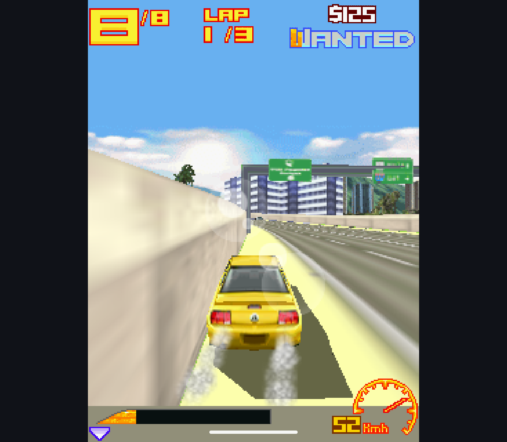
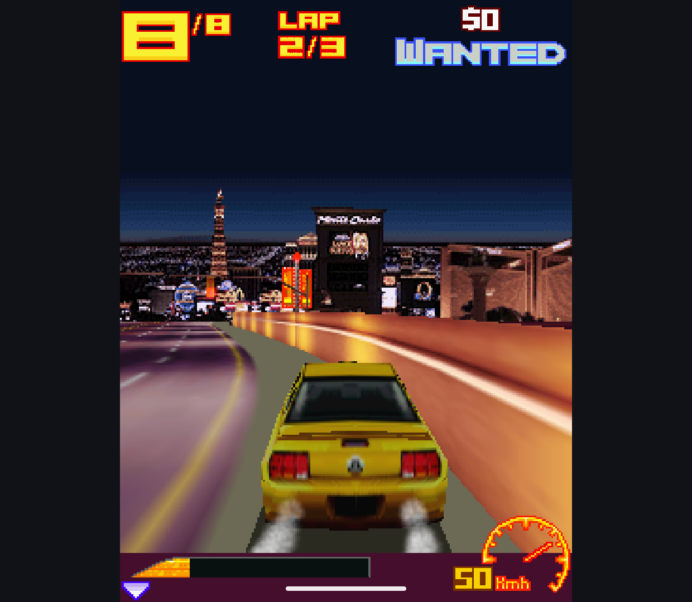
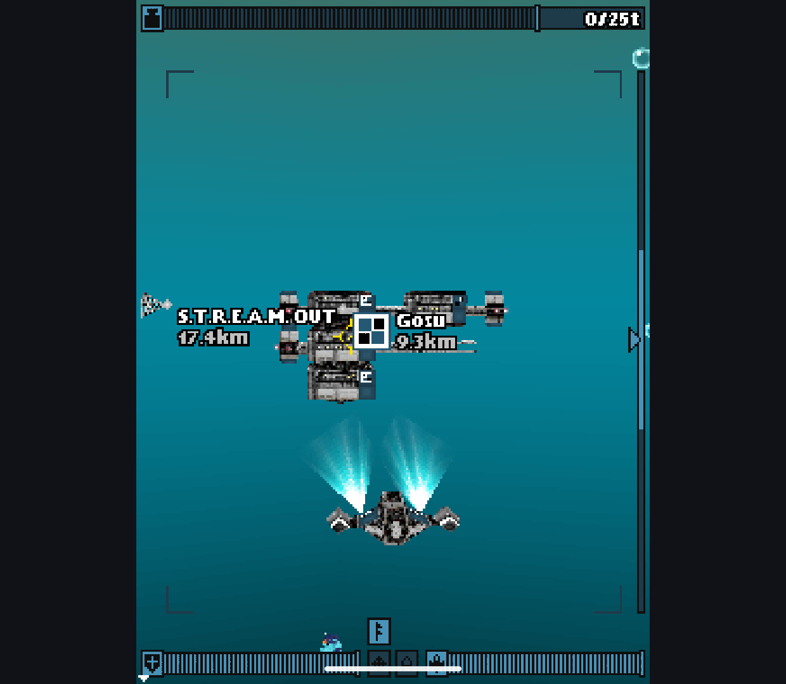
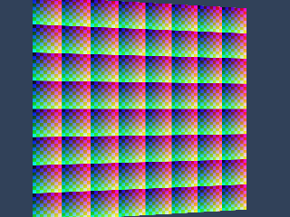
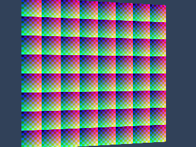

# Experimental GLES3 Rasterization

Research branch only, **off by default**, not a production engine switch.
The candidate's normal native-CPU/Java paths remain available. No game-specific
patches, legacy EPL renderer source or new public release binaries are included.

## Implemented Scope

`GpuRasterizer.java` consumes the candidate's already transformed, clipped,
culled and lit triangles. GLES3 rasterizes one complete submesh per draw. It
supports untextured color/lighting and up to four RGB/RGBA textures with
REPLACE, MODULATE, ADD, BLEND or DECAL, nearest/bilinear filtering, independent repeat/clamp,
perspective-correct coordinates, alpha rejection, color/alpha masks, viewport
clipping and depth test/write. It also supports all five framebuffer blend modes,
bounded depth offsets and linear/exponential fog with parallel or perspective eye depth. Base-level,
nearest-mip and trilinear sampling use the candidate's existing mip chains,
including rectangular, NPOT and one-pixel-wide images. Per-unit uploads are
cached by image identity and revision, including individual mip revisions;
switching images may still upload their levels again. This is a bounded slot
cache, not a persistent cache of every texture used by a game.

Non-RGB/RGBA textures, out-of-range/nonfinite depth offsets, AA,
dithering, wireframe, half-resolution mode and sprites retain CPU execution.
Oversized or nonfinite geometry and target/texture aliases are rejected before
GPU execution. Degenerate/nonfinite fog settings also retain CPU execution.

Consecutive supported submeshes bound to a Graphics target retain color/depth
on the GPU. Barriers before CPU mesh/sprite rendering, clear, bind, release or
renderer reset read both buffers, check GL status and restore the caller's EGL
context before committing CPU arrays. Depth dirtiness accumulates across draws,
including draws with depth writes disabled. Image2D targets commit immediately
so image sampling and mutation do not observe stale pixels. Context switches and
geometry uploads still occur per draw; this is not GPU scene preparation.

Unsupported states flush pending work before CPU fallback. GPU startup failure
before a resident target exists can fall back. An execution/readback/context
failure with resident work raises an explicit exception and disables the backend
until reset: there is no command replay yet, and silently continuing from stale
CPU arrays would lose already drawn geometry. Context-loss recovery is not
claimed. The private pbuffer context is detached between calls and destroyed on
reset. Android's shared EGL display is not terminated.

ARGB data uses bulk buffer copies and shader channel swizzles, not a Java
per-pixel conversion loop. Depth is uploaded as 16-bit data and packed two samples
per RGBA pixel by a second shader, including odd target dimensions. ES3 does not
provide portable direct depth readback via `glReadPixels`; the RGBA readback path
follows the [Khronos ES3 reference](https://registry.khronos.org/OpenGL-Refpages/es3.0/html/glReadPixels.xhtml).
Framebuffer and depth-texture setup use the
[ES3 texture API](https://registry.khronos.org/OpenGL-Refpages/es3.0/html/glTexImage2D.xhtml).
The shader/bridge is new GPL-3.0-or-later code for the FreeJ2ME-Plus-derived
candidate. The existing upstream license asset and notices remain in the APK.
Framebuffer alpha uses [separate RGB/alpha blend factors](https://registry.khronos.org/OpenGL-Refpages/es3.0/html/glBlendFuncSeparate.xhtml),
not destination sampling or a per-triangle readback. Normalized hardware blending
has rounding differences from the software integer pipeline.

## Depth Offsets and Framebuffer Multiplication: 2026-10-12

Added framebuffer MODULATE and MODULATE_X2 using separate RGB/alpha blend factors,
including saturated double multiplication. No destination texture copy or
per-triangle readback is needed. Alpha threshold, node alpha, fog and channel
masks retain the candidate's existing semantics. Hardware normalized blending
still differs from integer CPU rounding; fixed interior checks allow up to two
channel levels for multiplication and three with fog, not general pixel parity.

Depth bias uses the CPU candidate's slope norm and `units * 1e-7` convention,
before depth quantization. This deliberately does not substitute driver-defined
polygon-offset units. Disabled depth ignores bias; disabled depth writes do not
modify the shared buffer. Adjusted vertices outside the supported 0..32200 depth
range or nonfinite bias retain CPU execution, without silently clamping them.

Fixed two shared-path defects found during implementation:

- Fully clipped meshes no longer force GPU readback or access the first triangle
  when none is renderable. Six visible draws separated by clipped meshes and
  different blend modes retain one upload/readback pair.
- Extreme CPU depth bias can write negative signed shorts. Uploading those bits
  as unsigned GL depth made later objects appear in front incorrectly. The
  failing Retroid regression was reproduced, then fixed by tracking potentially
  affected buffers with weak references. GPU use resumes after their depth is
  nonnegative again (including after clear). Only flagged buffers are scanned;
  ordinary buffers do not incur that scan. Unsupported signed depth stays on CPU.

Final non-debuggable research builds pass **104 checks, zero skips** on Retroid
Pocket Classic arm64/Android 14 and Phone emulator x86_64/Android 15. Six new GPU
checks cover positive/negative units and slopes, depth enable/write behavior,
known multiplication colors including saturation/zero alpha, empty-mesh
residency, extreme-bias fallback and signed-depth recovery. Existing fog/alpha/
mask checks now exercise both multiplication modes as well.

Same-APK Retroid measurements, Adreno A12, thermal status 0 before/after:

| Scene | Native CPU ms/frame | GLES3 ms/frame |
| --- | ---: | ---: |
| MODULATE 240x320 | 2.228 | 2.102 |
| MODULATE 320x240 | 1.889 | 2.051 |
| MODULATE_X2 240x320 | 2.229 | 2.118 |
| MODULATE_X2 320x240 | 1.875 | 2.090 |
| Depth offset 240x320 | 2.018 | 2.139 |
| Depth offset 320x240 | 1.734 | 2.026 |

26 of 28 workloads execute GPU draws; the two sprite fallback images exactly
match native CPU. All 22 preceding GPU-run scene images retain their CRCs.
These effects are not uniformly faster than CPU in isolation. Avoiding mixed
backend round trips is the motivation; no measured whole-game FPS gain is
claimed. Each case has 64 warm-up frames and five 32-frame batches. Timing runs
preceded the signed-depth guard; final correctness checks include that fix.

Local evidence: `build/benchmarks/gpu-depth-blends` and
`gpu-depth-blends-native-reference`, plus `build/evidence/{device}-candidate[-phone]`.
Timing Handheld/test SHA-256:

```text
1D12873ED57CE85F280545C45BE37441C6FB403D35847F635C8B9F87F199CD42
9142CA22B2690C1E0E76F39096E7292C3B5C2D2654F3C608684DA655C7492A83
```

Final correctness APK SHA-256 (ordinary GPU-off builds, tests explicitly enable it):

```text
8ABE152BA3F83BDF3A387979F7DE44D86775EFC511966649773A8EB96CA52021 Handheld
472EAB0962FB931C1368D9E06B521892E462557B041F6205F81D646860B449B2 Handheld tests
1EB1EA8E1D467AA7A4FD791EE449897F2EF6538C275F4974A887CB50FD76D03D Phone
57BC6BFDE1E5041E49770B40BC5BA11B365FA76F5763D6396A1EE2F093E96925 Phone tests
```

A fresh GPU-enabled Retroid build reaches a moving Asphalt 3 race. Diagnostics
record 64,513 GPU draws, including 5,740 biased draws, and 56,101 empty meshes
skipped without a CPU barrier. Remaining CPU fallbacks have no GPU failure string.
The capture shows the track, car, shadow and HUD; this is not a pixel-matched
legacy comparison or full-game/controller/audio acceptance. Sound was disabled,
controls injected through ADB. The debug log is capped, so these are session
checkpoints, not totals or FPS. Multiplication is verified in fixtures, not
claimed as exercised by this particular race.
The game log also reports FFmpeg errors for RTX media data; audio compatibility
was not investigated or accepted in this renderer-only checkpoint.



Manual-game APK SHA-256:
`5F724F166833026A6B16B1E056A6329509E07BA94D6356C2989EB02E02CABFC8`.
Local evidence: `build/gpu-depth-asphalt-{1,2}.png`,
`build/gpu-depth-asphalt-session.txt`; final verified APK snapshot:
`build/gpu-depth-blends-verified`. No APKs or game files are published.

GPU stays off by default. Next: remaining texture formats and Sprite3D to reduce
mixed-backend barriers, followed by context-loss recovery and broader game/
performance acceptance before any production-engine switch.

## Four Texture Layers and Mipmaps: 2026-10-12 (Historical)

Final non-debuggable Handheld/Phone research builds pass **98 checks, zero skips**
on Retroid Pocket Classic arm64/Android 14 and x86_64/Android 15 emulator.
Seventeen GPU checks require real GPU draws. Six new checks cover all five
texture combiners with RGB/RGBA, four layers and sparse original slots, mip-level
selection, trilinear color/alpha, mutable images, filtering/size changes and
revision-aware upload reuse. Constant UVs select the base level without an
undefined logarithm. Fixed interior trilinear comparisons allow two channel
levels of CPU/GPU rounding difference; this is not a general image error bound.

Explicit [ES3 texture LOD](https://registry.khronos.org/OpenGL-Refpages/es3.0/html/textureLod.xhtml)
uses perspective-coordinate derivatives and the software pipeline's Q8 level
rounding. Mips are not regenerated by the driver. Samplers are statically
selected in the shader to avoid mobile-driver dynamic sampler-index issues.

Retroid same-APK measurements, Adreno A12, thermal status 0 before/after:

| Scene | Native CPU ms/frame | GLES3 ms/frame |
| --- | ---: | ---: |
| Four textures 240x320 | 4.993 | 2.505 |
| Four textures 320x240 | 3.967 | 2.390 |
| Nearest mip 240x320 | 4.981 | 2.129 |
| Nearest mip 320x240 | 4.000 | 2.047 |
| Trilinear mip 240x320 | 6.276 | 2.161 |
| Trilinear mip 320x240 | 4.997 | 2.006 |
| RGB nearest 240x320 | 2.343 | 2.647 |
| RGB nearest 320x240 | 1.697 | 2.010 |
| Lit grid 240x320 | 5.351 | 5.437 |
| Lit grid 320x240 | 6.017 | 6.242 |
| 16 meshes 240x320 | 5.877 | 5.490 |
| 16 meshes 320x240 | 5.850 | 5.611 |

Twenty of 22 scenes now execute GPU draws. The two sprite fallback scenes retain
exact native-CPU images. Upload/uniform caching reduced this implementation's
16-mesh cost from 6.644/6.932 to 5.490/5.611 ms, with all 22 GPU-run image CRCs
unchanged. Heavy texture cases improve, but simple nearest and lit-grid cases
still lose to CPU. This is not overall game-FPS gain or legacy-renderer parity.

Benchmark evidence is local/ignored: `build/benchmarks/gpu-four-layers-first`,
`gpu-four-layers-cached` and `gpu-four-layers-native-reference`. Each case uses
64 warm-up frames plus five 32-frame batches. Those same-APK timing runs precede
the constant-UV guard and diagnostic-only additions; final correctness checks
include both. Benchmark Handheld/test SHA-256:

```text
0BA562EC9D0BCB956D3D9FE8BB86086CAC166201EB586A1ECB762FFA89A82FBC
A127DF880608B5F132FF340535E4D391129748CD4C3B4E55CE3F664045CF65E6
```

The separate `-Pm3gGpu=true` manual-game build writes at most 128 diagnostic lines
to its own external-files `m3g-gpu-session.txt`, recording GPU counts, texture
uploads and deduplicated CPU-fallback state. It is not enabled in ordinary
builds. This provides evidence even on devices that discard INFO logcat lines.
Zero-triangle and other rejected draws can also enter the fallback path; its
state flags alone do not identify the full rejection reason.

On Retroid, that manual-game build reaches a moving Asphalt 3 3D Street Rules
race (lap 2/3 in the capture) and Deep: Submarine Odyssey's first playable area
after character setup and the introduction. Consecutive Deep captures show
changed heading/scene placement after injected input. Session diagnostics record
more than 125,000 GPU draws in each game, with no GPU failure string. CPU fallback
also occurs: these are mixed-backend sessions, not proof that every effect or
the entire game is GPU-rendered. Audio was disabled, input was injected through
ADB, and neither a complete playthrough nor physical-button ergonomics was
tested. Deep here is the Java 3D game, not the Mophun Deep Abyss game.

Unedited Retroid captures (game files are not bundled):





Manual-game APK SHA-256, before the constant-UV guard:
`21D28548DEA0821113A8175500CF70B94A7FE78994F62D047EBAA741C6341F19`.
Local evidence: `build/gpu-asphalt-race-{1,2}.png`,
`build/gpu-deep-gameplay-{1,2}.png`, `build/gpu-{asphalt,deep}-session.txt`.
Final automated-check APK SHA-256 (GPU off by default, tests explicitly enable it):

```text
B1A741E49CE57B6F6BAF6E2F4D8317C2CBFFDC4A7FD14092138B07532849E89C Handheld
F38EC7744C4C8B1CB9B84480C3336D703620CDB529F07D6B40C9D2409F203D23 Handheld tests
F45505203D3DC83ABCE3FFC21DC4F1252C58F830CFAA4C0442A44E504B9EB6EC Phone
623201BCC10EE49CCDF5965209356FAD7DD53A4270CA591AB6D7CF2F1850973C Phone tests
```

GPU remains off by default. Depth offsets, framebuffer multiplication, sprites,
context-loss recovery, broader game/device acceptance and legacy-engine
performance comparisons remain before an engine-switch decision. No production
engine, root license or public APK has changed.

## Resident Frames and Effects: 2026-10-12 (Historical)

Non-debuggable Handheld/Phone research APKs pass **92 checks, zero skips** on
Retroid Pocket Classic arm64/Android 14 and x86_64/Android 15 emulator. Eleven
GPU checks require actual GPU draws. Added coverage includes shared transfers,
accumulated depth dirtiness, GPU/CPU/GPU and sprite transitions, clear barriers,
immediate Image2D visibility and later texture use, both fog modes/projections,
ALPHA/ALPHA_ADD, node alpha, channel masks and zero/partial/full fragment alpha.
The fixed interior effect comparison permits up to three channel levels of
CPU/GPU difference; it is not a bound for arbitrary scenes or repeated layering.

Same-APK Retroid measurements (Adreno A12, thermal status 0 before/after each run):

| Scene | Native CPU ms | GPU per-mesh transfer ms | GPU resident ms |
| --- | ---: | ---: | ---: |
| 16 meshes 240x320 | 5.930 | 21.622 | 5.421 |
| 16 meshes 320x240 | 5.930 | 21.354 | 5.692 |
| RGBA alpha 240x320 | 2.228 | 2.155 | 2.106 |
| RGBA alpha 320x240 | 1.810 | 1.965 | 1.971 |
| Linear fog 240x320 | 2.551 | 2.216 | 2.219 |
| Linear fog 320x240 | 2.056 | 2.039 | 2.013 |
| Exponential fog 240x320 | 2.544 | 2.154 | 2.148 |
| Exponential fog 320x240 | 2.092 | 2.058 | 2.013 |

All 22 resident/nonresident image CRCs match. Fourteen scenes use GPU; eight
fallback scenes exactly match native CPU images. Each 16-mesh workload records
3,584 draws over 224 frames but only 224 color/depth uploads and readback pairs,
versus 3,584 pairs with residence disabled. This removes the observed per-mesh
transfer cost, not all GPU overhead: nearest filtering and landscape alpha still
lose to CPU in these samples. No overall game-FPS gain, legacy renderer parity,
real-game GPU acceptance, production switch or release is established.

Local ignored evidence: `build/benchmarks/gpu-resident-on`, `gpu-resident-off`,
`gpu-resident-native-reference` and `build/evidence/{device}-candidate[-phone]`.
Each performance case has 64 warm-up frames and five 32-frame batches.
Checkpoint APK hashes (historical; no release artifacts published):

```text
139824C0E54974F1749B8BE5C55AE6B17BB2EC9D5E64F728A872446C6ACB4908 Handheld
5FBA59103734E1630079AAC7CE8B2F890DA667E40F8F2253D2A70FFBB615D218 Handheld tests
8D587B34D21A52B5FD7F94309AB98322565F65512F28034E9EAE8AB28399AEE1 Phone
02AB6E4933A2E7695F6E09A6FD272B9E9430A12B1DF2BCFA8A05B8802E6F2F76 Phone tests
```

## Initial GPU Checkpoint: 2026-10-12 (Historical)

Final non-debuggable Java-only research builds pass **87 checks, zero skips**
on Retroid Pocket Classic arm64/Android 14 and Phone emulator x86_64/Android 15.
The 81 previous checks run with the default CPU backend. Six GPU checks explicitly
require successful GPU draws and cover mixed depth ordering, odd-size transfers,
resize, write masks, disabled depth, texture orientation/mutation, alpha-cutout
depth, fog fallback, perspective images and caller-EGL-state preservation.
No skip or successful CPU fallback is counted as a GPU pass.

The perspective fixture's interior RGB mean/max differences against CPU are
2.077/4 byte levels on Retroid and 2.034/4 on the emulator. The regression requires
mean <3 and max <=12 in that fixed interior; it excludes triangle coverage edges.
Hardware interpolation, sampling and edge coverage are not bit-identical to the
software scanline implementation. These bounds are not general conformance proof.
No real-game GPU session, audio or physical-controller acceptance is added here.

Same-APK Retroid measurements identify **Adreno (TM) A12**, with thermal status
0 at both ends. Each scene has 64 warm-up frames and five 32-frame samples:

| Scene | Native CPU ms/frame | GLES3 ms/frame |
| --- | ---: | ---: |
| RGB nearest 240x320 | 2.314 | 3.009 |
| RGB linear 240x320 | 2.802 | 2.107 |
| Lit grid 240x320 | 5.322 | 5.122 |
| RGB nearest 320x240 | 1.717 | 1.987 |
| RGB linear 320x240 | 2.241 | 2.052 |
| Lit grid 320x240 | 5.932 | 5.642 |

These six scenes each record 224 GPU draws and zero native raster draws. The
other fourteen workloads remain on CPU, with exactly matching CPU-reference
CRCs. GPU images differ from CPU as noted above. No overall speedup, game-FPS
gain or parity with legacy GLES is established.

The initial GPU version spent 4.935/4.718 ms in the two linear scenes; replacing
Java per-pixel conversion with bulk copies and packed depth reduced that to
2.107/2.052 ms. All twenty scene CRCs stayed unchanged between those GPU versions.
This fixes an observed implementation bottleneck but does not remove the
remaining per-submesh transfers. The resident-frame checkpoint above supersedes
that limitation for consecutive supported Graphics-target draws.

Retroid captures from the same final APK, with unchanged dimensions:

CPU reference:



GLES3:



## Reproduce

Use the normal candidate build command from the host README. Both backends are
in the **same** research APK; the bounded benchmark selects one explicitly:

```powershell
./experiments/m3g-host/benchmark.ps1 -Serial YOUR_DEVICE -Run gpu-a -Raster gpu
./experiments/m3g-host/benchmark.ps1 -Serial YOUR_DEVICE -Run gpu-b -Raster gpu -GpuResident off
./experiments/m3g-host/benchmark.ps1 -Serial YOUR_DEVICE -Run cpu-a -Raster native
```

`-Raster gpu` allows unsupported draws to fall back, but requires real GPU
draws for the twenty-six supported workloads (of 28). Reports include GPU/native
counts, upload/readback counts and driver identity. Residence is on by default
when GPU is explicitly selected; `-GpuResident off` compares the same APK using
the original per-mesh transfer strategy. For a separate manual game experiment, add
`-Pm3gGpu=true` to a candidate build. Automated verification and benchmark APKs
leave this disabled; tests/benchmarks explicitly toggle GPU within their own process.

Maintainer-local ignored evidence: `build/benchmarks/gpu-first-mesh`,
`gpu-bulk-mesh`, `gpu-bulk-native-reference`, and
`build/evidence/{device}-candidate[-phone]` under `experiments/m3g-host`.
Initial checkpoint APK SHA-256 (historical, not the current build):

```text
2DF16717FF8B79ABD3D62222CF45043AB29EA29B22F83BBB54130E78D80AB2E6 Handheld
FC619A0E5189F0243B09F95DB70A68E6C5808E0648694EB796A1FAEAAAD94071 Handheld tests
3BAF28D50BB996C8C86D5D67CEB1A53DD34CC03E46D5F4C5FA2C0ED53F56C609 Phone
706BDAE062D4B64565F0B714EACF6769DEE88EEEC170B5623E5BACA2F853D4A4 Phone tests
```
