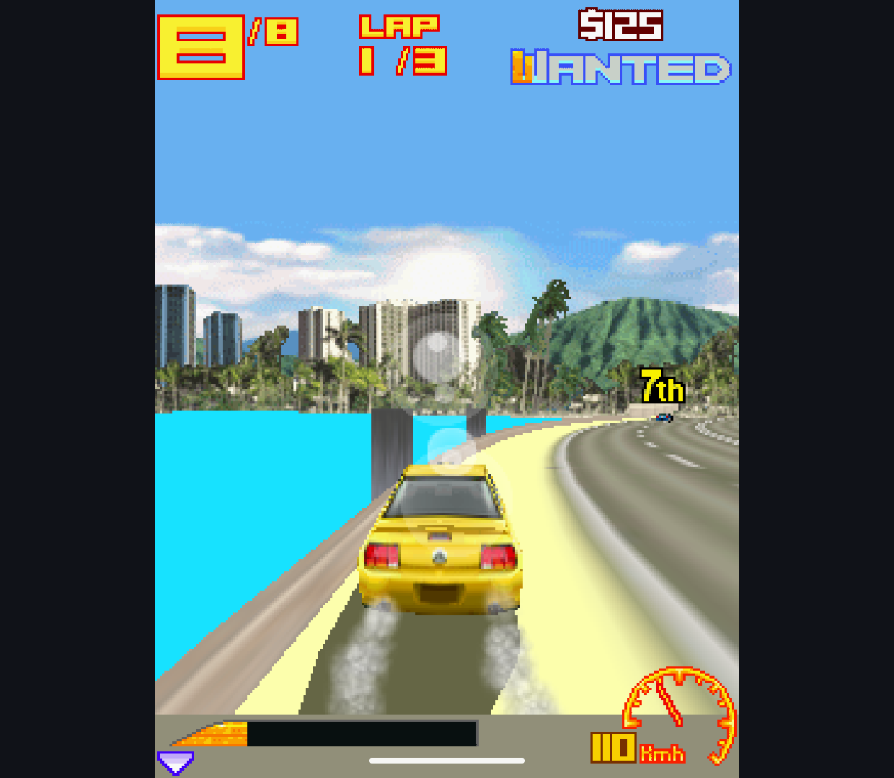
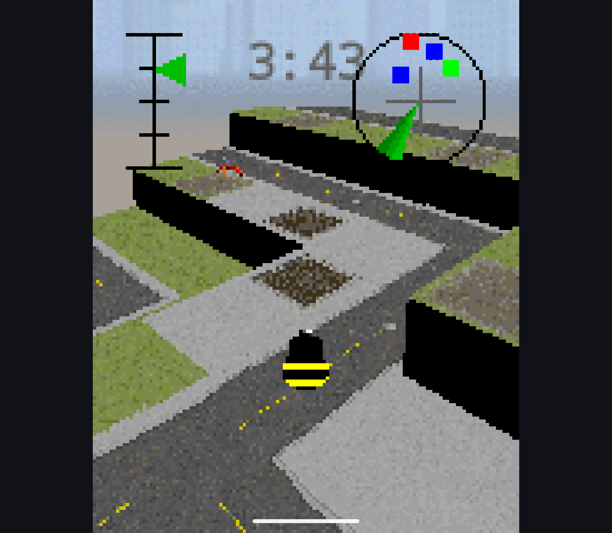

# Hardware geometry and target-lifetime work, 2026-10-13

Research branch only. No production engine switch, root-license change, combined
source publication or public APK release. The original engine remains on main.

## Architectural comparison

The original EPL source was read as an architectural/behavioral reference, not
copied into the candidate. Relevant reference points:

- `app/src/main/cpp/m3g/src/m3g_vertexbuffer.c`, `m3gApplyScaleAndBias` and
  `m3gLockVertexBuffer`: submit vertex/normal/color arrays and matrix state.
- `m3g_vertexarray.c`, array lock helpers: positions, normals and texture
  coordinates go to GLES client arrays instead of pre-transformed triangles.
- `m3g_indexbuffer.c`, `m3gSendIndexBuffer`: indexed strip drawing.
- `m3g_light.c`, `m3gApplyLight`: fixed-function GLES handles transformed lights,
  attenuation and material lighting.
- `m3g_rendercontext.c`, `m3gReleaseTarget`, and `m3g_rendercontext.inl`,
  `m3gUpdateTargetBuffer`: target-dependent synchronization. The original DOES
  use readback for memory/bitmap targets, with a possible bitmap fast-copy path.
  It is incorrect to describe it as universally readback-free.

Our former GPU hook was after CPU transforms, per-vertex lighting, clipping and
Triangle construction. Bulk submission alone could not remove that CPU cost.
The new implementation uses original GLES3 shaders and the GPL-compatible
candidate's object data. It does not import the original fixed-function code.

## Implemented

- Early hook before candidate vertex/texture transforms and Triangle assembly.
  GPU handles model/camera/projection, viewport mapping, clipping, winding and
  culling; smooth material lighting with up to eight active scoped lights;
  ambient/directional/omni/spot lights, attenuation, specular, color tracking and
  local viewer. Normals use an inverse-transpose transform.
- Up to three dense texture units, coordinate transforms, perspective or affine
  mapping, existing fragment combiners, mip sampling and linear/exponential fog.
  Skinning/morphing still run on the existing CPU pose path; the resulting
  vertex buffers can enter this hardware stage.
- Frame commands snapshot matrices, lights, materials and vertex data.
  Context recreation replays those snapshots, not subsequently edited objects.
- Bounded immutable packed-geometry cache: at most 32 entries / 4 MiB, plus
  existing bounded in-flight journal. Array identity/revision, default colors,
  enabled attributes and exposed mutable index contents are checked. No whole
  game is expanded into RAM. Reset releases cached references.
- Release commits color but discards GPU depth readback. Candidate bind already
  clears depth unconditionally; CPU fallback and continuing target operations
  still perform full barriers. Context-loss and mixed CPU/GPU tests cover this.
  The [Graphics3D API documentation](https://nikita36078.github.io/J2ME_Docs/docs/jsr184/javax/microedition/m3g/Graphics3D.html#releaseTarget())
  describes target release as flushing the rendered image. This optimization
  relies additionally on the verified candidate bind implementation, not on an
  assumption about persistent depth between bindings.
- Benchmark switches expose hardware geometry and released-depth policies
  independently. Reports count actual hardware draws, CPU shaded vertices and
  depth readbacks. Artifact hashes are captured before installation and checked
  after it, so a later rebuild cannot mislabel a completed benchmark.

## Limits

Hardware geometry is a second opt-in, off by default even with ordinary GPU
rasterization enabled. Flat shading, two-sided lighting, four simultaneous
textures, more than eight active lights and depth offsets retain the existing
prepared path. AA, dithering, half-resolution and wireframe retain their former
fallbacks. The vertex cache is not a persistent indexed GPU buffer cache;
submission still uses expanded triangles and per-command uniforms.

Color readback and the Android bitmap bridge remain. No zero-copy display or
full rendering-parity claim is made. The next substantial optimization should
target indexed/reused GPU buffers and broader hardware state coverage, not
unbounded preloading of game archives.

## Verification

- Local Handheld and Phone research builds completed, offline, non-debuggable.
  After final whitespace cleanup, both rebuilt app APKs and both test APKs
  match the accepted artifacts byte-for-byte.
- Retroid Pocket Classic / Android 14: **301 passed, zero skipped**.
- Phone emulator / Android 15 x86_64: **301 passed, zero skipped**.
- Added 39 checks: eight hardware/cache checks, the 27 inherited scene-contract
  checks with hardware preparation enabled, and four release/depth checks.
  Existing 262 checks remain. Queued mutation, actual hardware use, reset,
  camera clipping, culling/mirroring and recovery are covered.
- [Retroid artifact and test evidence](hardware-20261013/retroid/).
- [Phone artifact and test evidence](hardware-20261013/phone/).

## Repeated Retroid measurements

One non-debuggable APK, geometry and released-depth switches off/on, 30 scenes,
two complete runs per setting. Each scene uses 64 warm-up frames followed by
five batches of 32 frames. Android thermal status was zero at both ends of all
four runs. Values are mean synthetic frame wall time, **not game FPS**.

| Scene | Control, ms | Hardware + depth policy, ms | Reduction |
| --- | ---: | ---: | ---: |
| Lighting grid, 240x320 | 4.739 | 1.918 | 59.5% |
| Lighting grid, 320x240 | 5.333 | 1.837 | 65.6% |
| 16 meshes, 240x320 | 3.826 | 2.790 | 27.1% |
| 16 meshes, 320x240 | 3.770 | 2.691 | 28.6% |
| Material churn, 240x320 | 3.720 | 2.855 | 23.2% |
| Material churn, 320x240 | 3.734 | 2.707 | 27.5% |
| Sprites, 240x320 | 2.978 | 2.572 | 13.7% |
| Sprites, 320x240 | 2.600 | 2.165 | 16.7% |

All 30 fixtures improve in these repeated samples, by 5.7-65.6%. Unsupported
four-texture/depth-offset meshes benefit only from the release-depth change;
sprites do not enter hardware geometry either. GPU depth readbacks fall from
224 to zero per fixture. Supported mesh fixtures report actual hardware draws
and zero CPU shaded vertices, rather than just a build flag being enabled.

The earlier portrait sprite regression is no longer present in this fixture:
2.572 ms is also below the recorded pre-submission-optimization 2.740 ms.
This is not universal speed parity: the previous native reference remains about
0.85 ms for the lighting grid and 0.95 ms for portrait sprites. No fresh native
rerun or synchronized full-game FPS comparison is claimed at this checkpoint.

Raw reports and hashes:
[control A](hardware-20261013/hardware-final-control-a/),
[control B](hardware-20261013/hardware-final-control-b/),
[optimized A](hardware-20261013/hardware-final-on-a/),
[optimized B](hardware-20261013/hardware-final-on-b/).

## Pixel comparison

[Full 30-scene comparison](hardware-20261013/pixel-comparison.json), using the
same APK with switches off/on: 19 images are byte-identical. Nine images differ
only in a handful of pixels, by at most two channel levels. Both dense-lighting
images differ more broadly, by at most four levels out of 255. Hardware lighting
uses GPU normalization/division instead of the CPU candidate's approximate
inverse-square-root/reciprocal routines; exact lighting CRC equality is not
claimed. The inherited scene checks, including exact sample assertions, pass.
`compare-geometry.ps1` reproduces the pixel error counts without resampling.

## Interactive Retroid checks

The separately built game APK enables both GPU flags by default; it is not the
default-off verification APK above. SHA-256:
`B2503D70FEE3ED7839704B52847AABB2DCBB1DA4E1AA12882D6FAF39082E34B0`.

- Asphalt 3: reached Instant Play, completed the start countdown and drove in
  the race. Fresh [capture](hardware-20261013/asphalt-hardware.png) and
  [session counters](hardware-20261013/asphalt-gpu.txt) show the hardware stage
  doing geometry, with the prepared path still handling offset draws.
- Constructo Combat: entered Single Player, passed tutorial screens and reached
  a running round with changing timer, radar and objects. Fresh
  [capture](hardware-20261013/constructo-hardware.png) and
  [session counters](hardware-20261013/constructo-gpu.txt) cover hardware meshes
  mixed with sprites. The previously recorded dark side faces and oversized
  tutorial fonts are not claimed fixed by this renderer work.
- Tower Bloxx: entered Quick Game, dropped the first floor, received occupants
  and advanced to the next suspended block. Fresh
  [capture](hardware-20261013/tower-hardware.png) and
  [session counters](hardware-20261013/tower-gpu.txt) confirm hardware draws.

These are interactive ADB-driven checks on the physical Retroid, not manual
controller acceptance, audio listening, a full playthrough or deterministic
before/after game-performance comparisons.

## Availability

Only research source, reports and screenshots are intended for the branch.
Commercial test games and APKs remain ignored local artifacts. This work does
not finish dependency/license compliance or authorize a public combined release.
