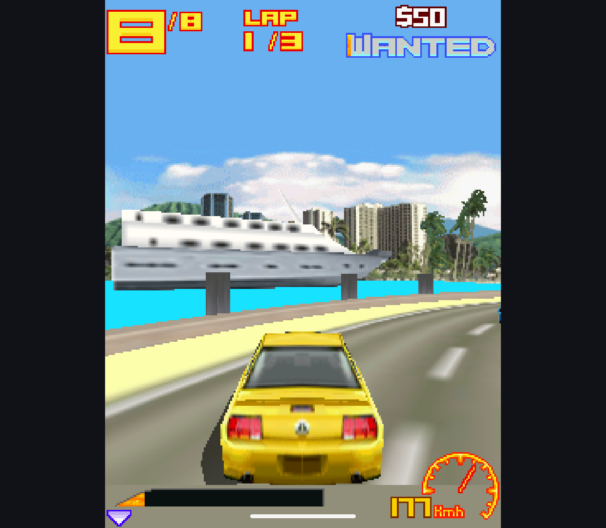
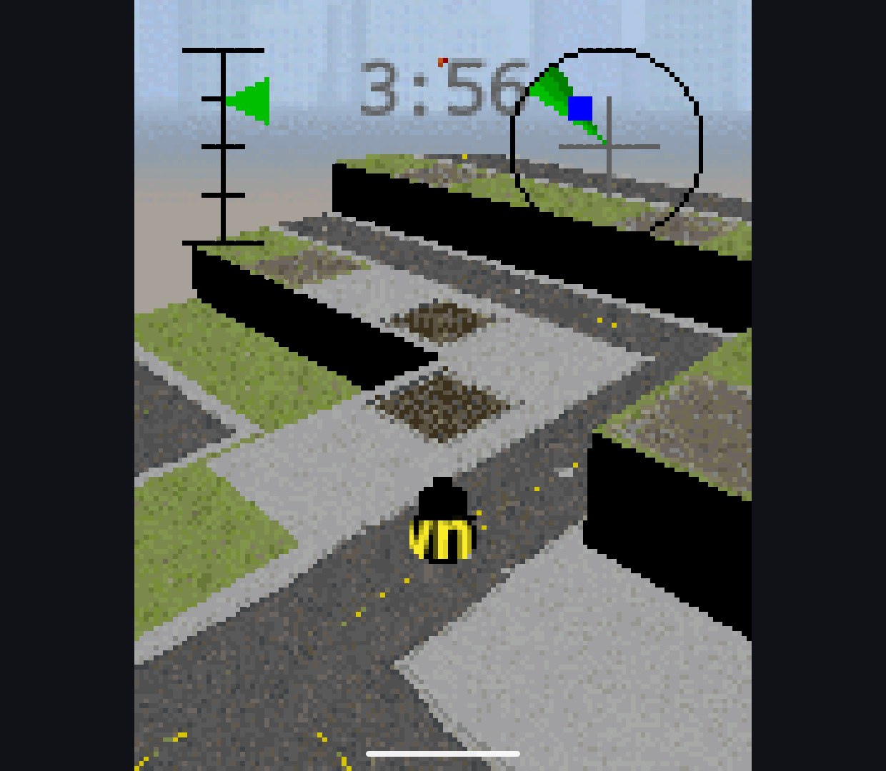
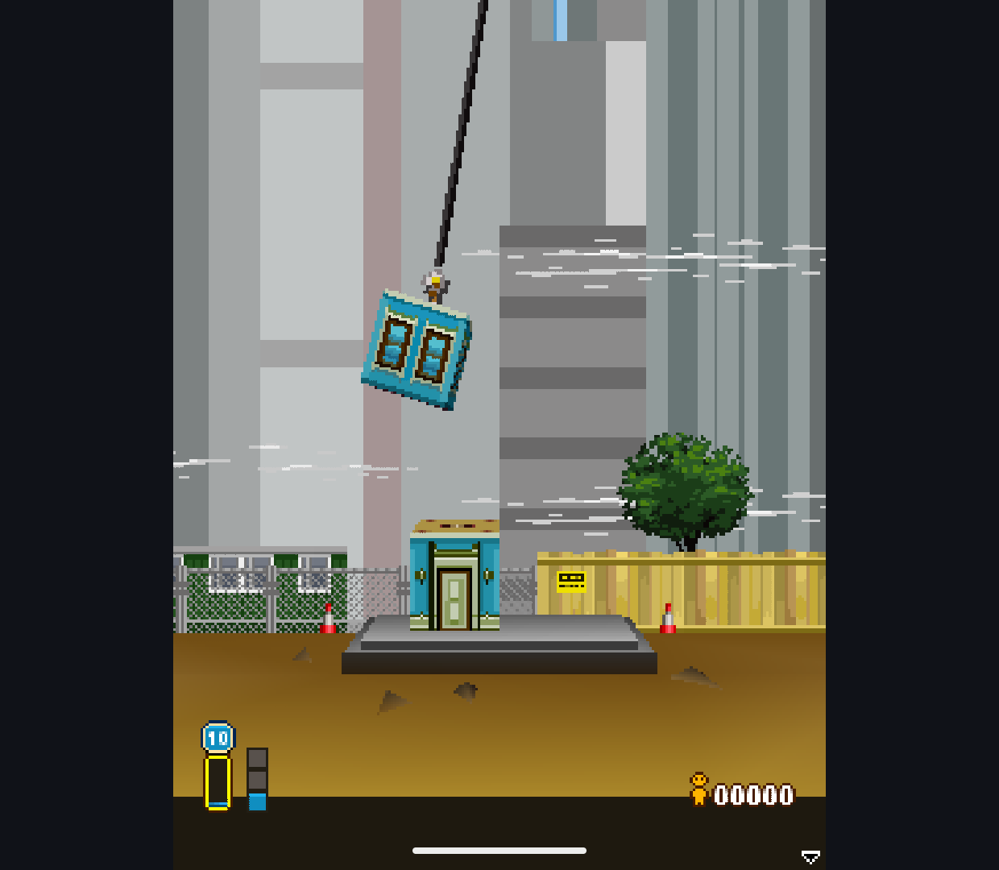

# Indexed resident geometry, 2026-10-13

Research branch only. The production renderer and root license are unchanged.
No public APK, combined private engine source or game files are published here.

## Implementation

- Compact each immutable mesh revision into unique referenced vertices and
  unsigned 16-bit triangle indices. The candidate's expanded triangle order is
  preserved, including strip winding, degenerates and exposed index mutations.
- Store VBO/EBO/VAO entries in the renderer's owned GL context. Repeated draws
  reuse those entries across target releases and frames instead of uploading
  expanded triangles again. The cache is LRU, bounded to 64 entries / 4 MiB of
  vertex/index storage; oversized entries are transient. This excludes driver
  overhead, framebuffer storage and the bounded CPU snapshots held for replay.
- CPU geometry-cache invalidation still checks vertex attribute identity,
  revision, default color and index contents. Uniform state is captured per
  draw, independently of cached vertices. Revisions never overwrite an in-flight
  snapshot. GPU cache keys can retain up to another 4 MiB of CPU mesh snapshots
  beyond the CPU cache, with overlap when both own the same mesh.
- Context loss destroys the owning cache and replays from immutable CPU data,
  creating fresh GL objects. Permanent recovery failure never commits a partial
  frame. Renderer reset releases both caches.
- Prepared triangles and Sprite3D keep their stream buffer. Mixed submissions
  count only prepared vertices for stream offsets and restore the matching VAO
  on every switch. Existing color-mask reassertion remains intact.
- Hardware geometry now supports all four texture units. Normals have their own
  vertex attribute rather than occupying the fourth texture-coordinate slot.
  Sparse texture-unit assignments are packed consistently with the old path.
- Replay-journal accounting uses actual compact vertex/index snapshot sizes.
  No whole-game preload or unbounded RAM expansion was added.

The original EPL `m3g_indexbuffer.c:m3gSendIndexBuffer` was inspected again as an
architectural reference: it submits stored indices using `glDrawElements`.
Our implementation keeps the GPL candidate's triangle ordering, GLES3 shaders,
immutable snapshots and independent bounded resource ownership. No original EPL
implementation was copied into this path.

## Verification

Ten new regression cases cover cross-frame reuse, compact upload size,
cache-disabled equivalence, byte/count eviction, transient meshes, queued
mutation plus actual context loss, alternating prepared/indexed commands,
four/sparse texture units with normals, UV/normal revisions, permanent recovery
failure, and unsigned indices above 32767.

The benchmark exposes `-GpuMeshCache on/off`, upload bytes, uploads and cache
hits. `-Warmup 64..4096` records the chosen warmup and adjusts work-count
assertions. The final harness can run the prior hardware-geometry APK as well
as the new one: missing mesh-cache instrumentation must not skip the older
hardware-stage/depth-policy configuration.

Retroid Pocket Classic (Android 14, Adreno A12) and the Android 15 x86_64 Phone
emulator each passed **311 tests, zero failures/skips**. These include the
existing renderer, scene, recovery and tone checks, not only the ten new cases.

- [Retroid tests](indexed-20261013/retroid-tests.txt) and
  [artifact hashes](indexed-20261013/retroid-artifact.json).
- [Phone emulator tests](indexed-20261013/phone-tests.txt) and
  [artifact hashes](indexed-20261013/phone-artifact.json).
- The later benchmark-only warmup change did not change either application APK
  or the 311 checked test methods. Retroid was rerun with that final harness;
  Phone used the preceding harness. Their separate test APK hashes are retained.
- Local nondebuggable builds used JDK 21, Gradle 8.7, `-Pm3gExperiment=candidate`
  and `-Pm3gNonDebuggable=true`, with all four Handheld/Phone app/test assemble
  tasks. `verify.ps1` used the isolated research IDs and a 1200-second timeout.
- Initial added tests had two fixture mistakes (assuming a pending clear had
  already updated the Android bitmap; replacing a four-vertex buffer with a
  differently sized array). Those fixtures were corrected before the clean runs.

## Performance And Image Checks

Two alternating before/after pairs used the preceding hardware-geometry APK and
the new indexed APK on the same Retroid, with hardware geometry and released-depth
discard enabled in both. Each scene had 64 warmup frames and five 32-frame samples.
All 30 scene images were **byte-identical** in both comparisons.

Mean wall milliseconds/frame across the two runs (synthetic scenes, not game FPS):

| Scene | Size | Before | Indexed | Reduction |
| --- | --- | ---: | ---: | ---: |
| Dense lighting | 240x320 | 1.985 | 1.714 | 13.7% |
| Dense lighting | 320x240 | 1.836 | 1.568 | 14.6% |
| 16 objects | 240x320 | 2.877 | 2.688 | 6.5% |
| 16 objects | 320x240 | 2.746 | 2.522 | 8.2% |
| Alternating materials | 240x320 | 2.927 | 2.706 | 7.5% |
| Alternating materials | 320x240 | 2.794 | 2.565 | 8.2% |
| Four textures | 240x320 | 2.417 | 2.246 | 7.1% |
| Four textures | 320x240 | 2.099 | 1.932 | 8.0% |

In the 16-object fixtures there was **one mesh upload for 3584 submitted draws**,
3583 cache hits, and no prepared-geometry upload. Dense lighting uploaded one
112,476-byte mesh over 224 draws. A cache-disabled diagnostic run passed the same
submission assertions while uploading once per indexed draw. This mode creates
transient GL objects; it is not a substitute for comparison with the old stream
implementation.

Not every case improved. With 64 warmup frames, portrait depth-offset fallback
cost increased from 1.819 to 1.971 ms (8.4%); its batches were visibly still
settling. The harness was extended to run **the same final benchmark test APK**
against both application versions with 512 warmup frames. The stable repeat gave
1.668 versus 1.688 ms for that case and 1.578 versus 1.612 ms in landscape. This
supports a warmup contribution, not proof that the fallback is universally faster.
Dense lighting still improved 11.7-14.6% in that longer-warmup comparison.

The first long-warmup indexed run had large timing excursions across several
unrelated scenes despite thermal status 0. It is preserved alongside the repeat;
its cause was not established, and no aggregate speedup is claimed from those
long runs. All their 30 image comparisons remained exact. The Android bitmap
bridge, CPU fallback startup and device scheduling still need separate profiling.

Raw reports, per-batch timings, APK hashes and counter assertions are retained:
[before 1](indexed-20261013/indexed-before1/report.json),
[before 2](indexed-20261013/indexed-before2/report.json),
[after 1](indexed-20261013/indexed-after1/report.json),
[after 2](indexed-20261013/indexed-after2/report.json),
[cache disabled](indexed-20261013/indexed-cacheoff/report.json),
[long warmup control](indexed-20261013/indexed-warm-before/report.json),
[long warmup excursion](indexed-20261013/indexed-warm-after/report.json),
[long warmup repeat](indexed-20261013/indexed-warm-after2/report.json).
The adjacent artifact/test files identify each run. Pixel-comparison records are
[pair 1](indexed-20261013/indexed-comparison1.json),
[pair 2](indexed-20261013/indexed-comparison2.json),
[long 1](indexed-20261013/indexed-comparison-warm.json),
[long 2](indexed-20261013/indexed-comparison-warm2.json).

## Retroid Gameplay

The local gameplay APK enables both GPU flags at build time; instrumentation
verification APKs leave them off by default and enable the stages in tests.
Gameplay APK SHA-256:
`8735ED44283F4452654488738EB5E2AB0B22F1B4337BA800082E5FEAF491D21C`.
It was installed only to the isolated candidate package. No user library was
cleared and no public build was distributed.

Asphalt 3 reached the race, advanced along the road and displayed the car,
environment and HUD at 100 km/h. Constructo reached gameplay after its tutorial;
the timer advanced and movement changed the scene. Existing oversized tutorial
text and black side faces are not claimed fixed by this renderer change.
Tower Bloxx advanced from the city/tutorial screens into construction, animated
the suspended 3D block over the 2D background and reacted to drop commands,
including updating the missed-drop indicator. No completed tower is claimed.

These are real device captures with ADB-injected input, not physical-controller,
audio or complete-game acceptance. The bounded session logs
([Asphalt](indexed-20261013/asphalt-gpu.txt),
[Constructo](indexed-20261013/constructo-gpu.txt),
[Tower Bloxx](indexed-20261013/tower-gpu.txt)) record actual hardware-stage
execution on Adreno A12; they are not full-session frame-time traces.

## Remaining Scope

This is not acceptance of a full replacement engine. Hardware geometry remains
opt-in. Flat shading, two-sided lighting, excessive light counts and depth
offsets still use existing fallbacks. Posed vertices are still generated on CPU.
Color readback and the Android bitmap/LCDUI bridge remain; games do not become
zero-copy. Native-renderer performance parity, physical-controller/audio checks,
complete-game compatibility and release/license preparation remain separate.
