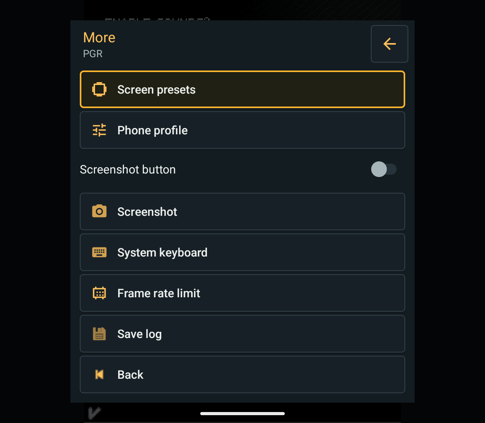
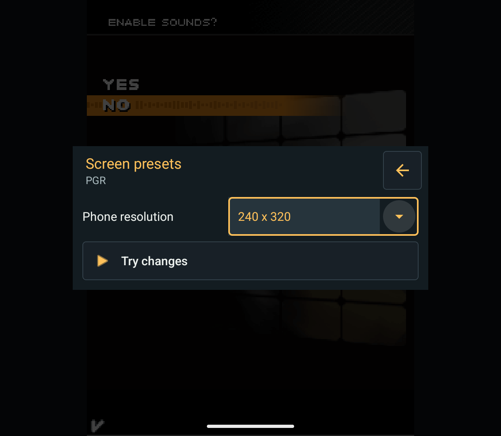
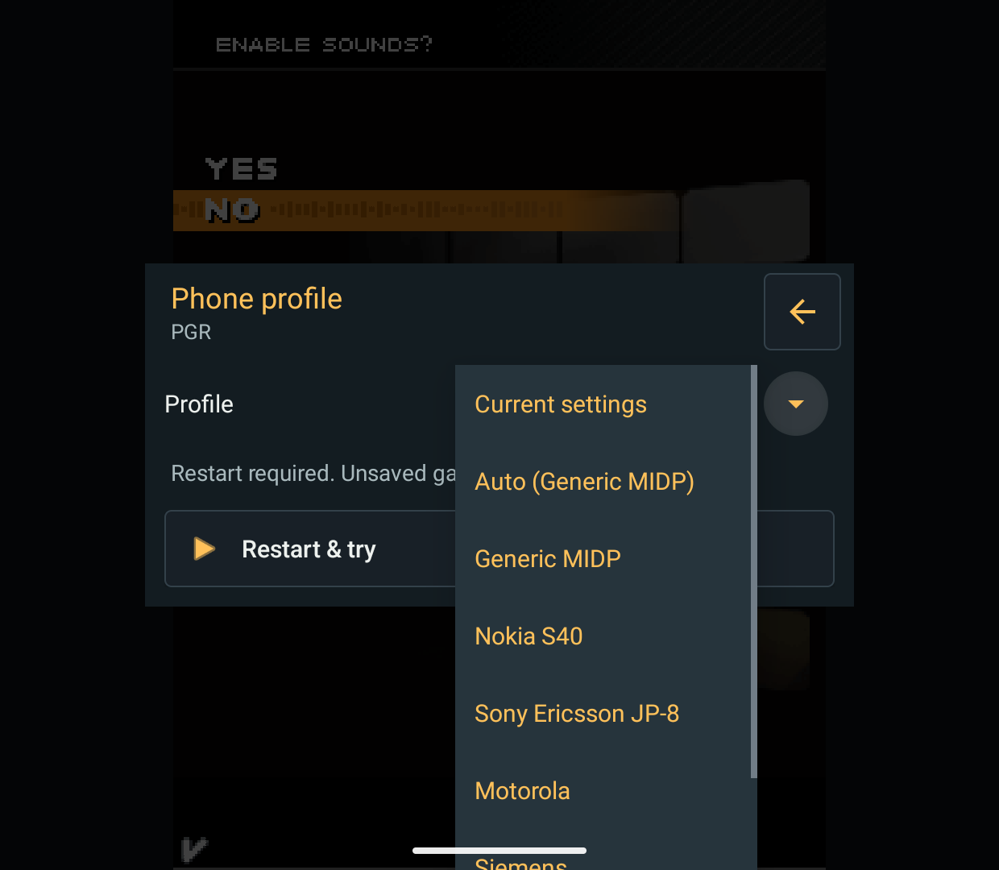
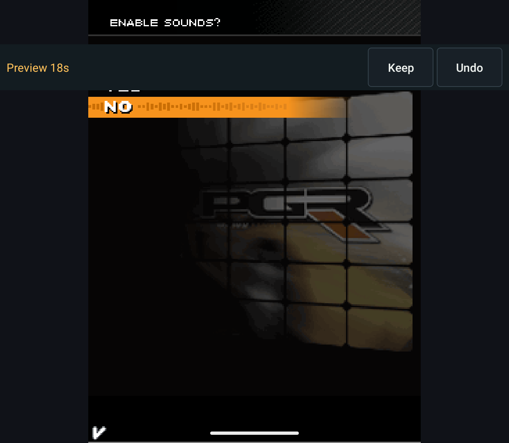
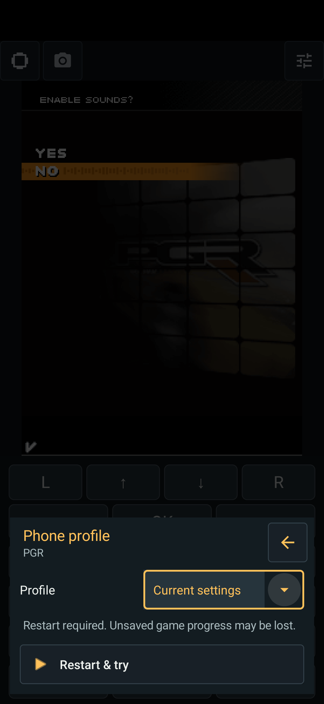

# Quick presets and compact GPU submission, 2026-10-13

Common app changes are also on main; the renderer stays on the separate
`codex/m3g-replacement` branch. No production-engine switch, license change,
release or test-APK distribution was made. Games/APKs/private engines are not
included. Public release state was not rechecked in this batch.

## App changes

More provides Screen presets (live Try / Keep / Undo) and Phone profile
(explicit Restart & try). Auto shows the suggested resolution or 240 x 320
fallback. Compatibility presets include Generic, Nokia, Sony Ericsson,
Motorola, Siemens and Samsung; Current settings preserves custom properties.
Phone-profile changes keep MIDP/CLDC, unrelated properties, controls and size.

A separate restart-process Activity waits for the old VM to exit, then starts
the one-launch draft. Cancel/failure discards it. Undo/timeout restarts with the
confirmed profile. This loses unsaved gameplay progress, not a save-state
restore. During testing the original main-process handoff died with the debug
game process; moving it to `:restart` and using `pingBinder()` fixed that path.

Preparation now rejects weak phone hints and anonymous dimension-only images.
An API mention or publisher name alone cannot select a vendor. Explicit target
metadata and unambiguous named screen assets still work. Existing/imported
settings are preserved; static preparation is not running games on many models.

## Shared renderer work

- Reuse texture bindings by cache-entry identity, not recycled GL texture IDs.
  Keep active-unit tracking correct for mutable image uploads and sampler changes.
- Skip unchanged owned-target setup. Reset state knowledge at submission/program
  boundaries; preserve color-mask reassertions, error checks and recovery.
- Compare exposed mutable index arrays once. Reuse range validation only when
  indices and position-array identity match; still validate attribute revisions.
- Add a reference-versus-optimized resident-frame regression covering mutable
  textures, sampler changes, texture counts and program switches.

This does not assume immutable game resources or preload a whole game into RAM.
Cache budgets are unchanged. No quality reduction or new user-facing toggle.

## Evidence

Physical Retroid Pocket Classic, Android 14 / Adreno A12:

- [Final renderer suite](presets-20261013/renderer-retroid.txt): **371 passed,
  0 skipped**. [Artifact identity](presets-20261013/renderer-artifact.json).
- [Settings/UI](presets-20261013/settings-retroid.txt): **43 passed** (27
  compatibility, 13 settings-trial and 3 preset UI cases).
- Android 15 Phone emulator: [44 passed](presets-20261013/settings-phone.txt),
  the same 43 app checks plus the new resident-frame GPU regression. Not a full
  Phone renderer run. [Local APK hashes](presets-20261013/apk-hashes.json).
- Both ordinary main debug variants build; [JVM results](presets-20261013/main-unit-tests/)
  contain 14 passing cases per variant. Research APKs use isolated package IDs,
  non-debuggable measured builds and the opt-in candidate engine.

Manual ADB-driven Retroid checks cover live size trial/Undo, Sony Ericsson
restart/Undo, and readable More/preset pages. Phone portrait checks cover the
profile sheet, restart and timeout rollback. These are not physical-button,
audio, full-game or universal-device acceptance.

## Same-APK GPU comparison

One OFF/ON pair on the Retroid, 128 warm-up frames per case and five timed
batches. Both runs use APK SHA-256
`5adc96a70a90e048ee5f47c9b40b181a4da486382ae878944424ecb37c44222d`.
Use `-Raster gpu -GpuGeometry on -GpuCompact off|on`; the harness now rejects
GpuCompact without an explicit GPU candidate run. Earlier accidental CPU runs
are not part of this evidence.

[OFF report](presets-20261013/gpu-off/report.json) /
[ON report](presets-20261013/gpu-on/report.json): all **34 pixel CRCs match**.
Representative median wall cost in milliseconds per frame:

| Case | Before | After | Reduction |
| --- | ---: | ---: | ---: |
| Sprites, 240 x 320 | 1.406 | 1.343 | 4.5% |
| Sprites, 320 x 240 | 1.388 | 1.333 | 4.0% |
| Cache churn, 240 x 320 | 1.838 | 1.746 | 5.0% |
| Cache churn, 320 x 240 | 1.740 | 1.645 | 5.5% |

Many other cases change less than 3%; one exponential-fog case is about 3.7%
slower in wall time. This is one paired run, not a claim of a universal 5% FPS
gain or statistically established gains in every case. Hardware geometry and
pixel checks ran on both sides; no change of render backend between samples.

## Real gameplay smoke check

PGR 1.0.2, London Street Race, Honda NSX, Medium, virtual 240 x 320, same final
candidate APK. The capture begins around the transition from the loading tip
to the race; 22 Up long-presses drive the car through ADB. Visible road geometry,
car, HUD and collision sparks remain intact. [Moving race](presets-20261013/presets-pgr-moving.png).

[35-second capture](presets-20261013/pgr/summary.json) records about 13.25 surface
buffers/s, P95 83.34 ms and maximum 100.001 ms. This agrees with the previous
short [original/candidate sample](racing-20261013.md), not a fresh original-engine
A/B or independently verified unique game FPS. No universal speed parity claim.
Mophun uses another renderer and was deliberately excluded.

## Screenshots

Retroid More and resolution page:

Phone choices and restart trial on Retroid:

Portrait Phone emulator:

