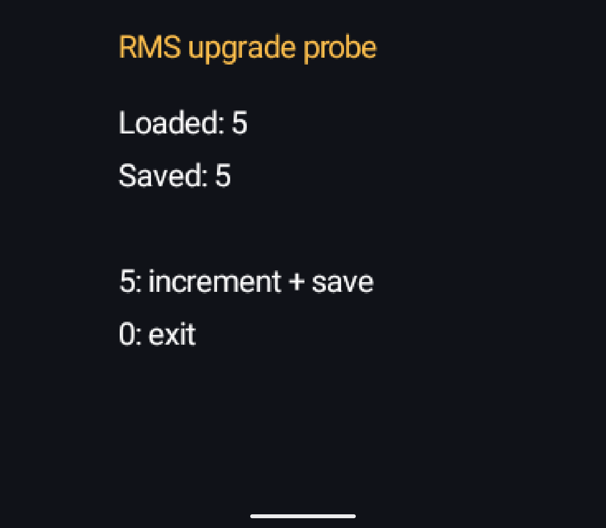
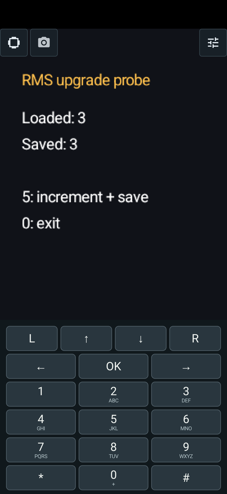
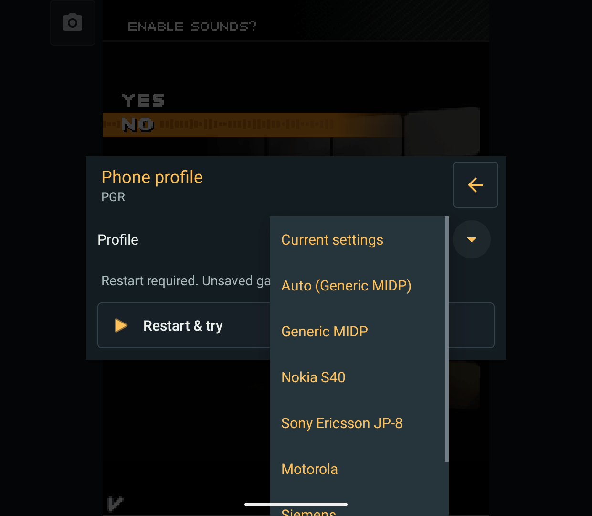
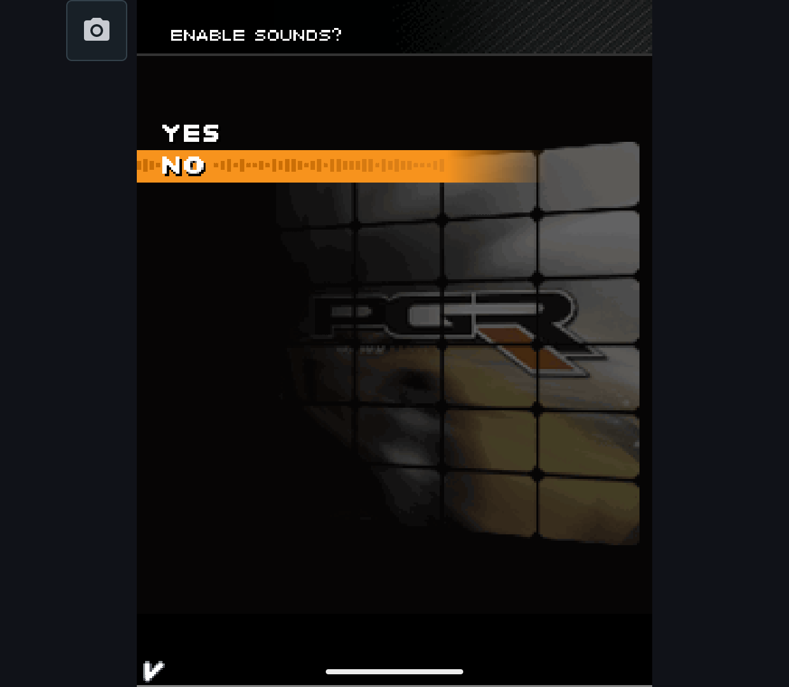

# Optimized Build and Upgrade Check - 2026-10-13

Research only. The normal engine, root license, public release APKs and private
Mophun distribution are unchanged. These are Java-only, debug-signed rehearsal
packages, not release approval or production-key upgrade acceptance.

## Bugs Fixed

- Ten ProfileModel fields lacked stable JSON names. In an R8 build, fields
  were renamed/removed and `touchOpacity` became final. On Retroid, Phone
  profile > Restart & try then crashed in `ProfilesManager.copyInto` with
  `IllegalAccessException: Cannot set public final field int ...ProfileModel...`.
  [Crash log](release-20261013/initial-profile-crash.txt) and
  [initial APK identity](release-20261013/initial-profile-crash-artifact.json).
  Added `SerializedName` using the existing JSON spellings. The ordinary Gson
  keep rule now protects these fields without disabling app optimization.
- PNGJ's POM brought JUnit into the app runtime. R8 removed its unused APIs,
  while the test APK assumed that the app supplied them. Excluded only this
  transitive JUnit dependency; it remains a proper test dependency. PNGJ bytecode
  dependency inspection found no production JUnit/Hamcrest calls.
- Importing the original RMS probe exposed `Dexing error` / `stack: overflow`
  in a valid Java 8 exception handler. AndroidProducer discarded stack-map frames
  before ASM's `COMPUTE_MAXS`, which needs those frames for Java 7+ bytecode.
  Preserve frames during instrumentation; no host-class loading or speculative
  full-frame reconstruction is introduced. Three JVM cases cover Java 5 without
  frames and Java 7/8 catch blocks with an injected encoding argument. The same
  probe now converts on the JVM and imports on Retroid and Phone.
  Recompiling the pre-fix AndroidProducer from `428a3ad2` makes the two framed
  cases fail with max stack 1 instead of 2; the legacy case still passes.
  [Before](release-20261013/importer-before.txt) / [after](release-20261013/importer-after.txt)
  use the same tests and ASM 9.8, changing only the producer implementation.

These fixes also exist in the ordinary source tree; none is a per-game override.
Names already lost in a previously obfuscated profile cannot be reconstructed by
adding annotations. Existing plain JSON keys remain compatible, version 4 unchanged.
Background: [ASM ClassWriter](https://asm.ow2.io/javadoc/org/objectweb/asm/ClassWriter.html),
[R8 Gson guidance](https://r8.googlesource.com/r8/+/refs/heads/main/compatibility-faq.md).

## Build Boundary

The [rehearsal mode](README.md#optimized-upgrade-rehearsal) enables R8/resource
shrinking, a non-debuggable app and the real `:midlet` process. GPU and hardware
geometry are enabled for the candidate. The shared rehearsal package IDs and
debug key allow `adb install -r` between original and replacement engines without
overwriting normal AbyssME. Measurement, tracing and private Mophun are rejected.
[Four negative configuration checks](release-20261013/build-guards.json) confirm
that rehearsal cannot be enabled without an isolated engine or combined with
measurement, tracing or a private-engine input.

The external AndroidJUnitRunner requires shared Trace/Kotlin APIs that R8 would
otherwise inline or remove. Rehearsal-only keep rules preserve that runner
boundary; there are no extra keeps for profile fields or renderer diagnostics.
The test APK itself is not optimized. Record that difference from a final APK.

## Checks

| Target | Result | Scope |
| --- | --- | --- |
| Optimized candidate, Retroid Pocket Classic / Android 14 | 324 passed, no skips | Release-compatible renderer suite |
| Optimized profiles, Retroid | 5 passed | Stable JSON, writable fields, file round-trip, mapping types and detached copying |
| Optimized profiles, Android 15 Phone emulator | 5 passed | Same checks, x86_64 Phone |
| Full optimized Phone renderer attempt | Incomplete: 900-second timeout | Software SwiftShader, not an accepted full-suite result |
| Debug candidate, Retroid | 363 passed, no skips | Full unmeasured renderer suite, including diagnostic paths |
| Debug settings, Retroid | 48 passed | 27 preparation, 13 trial, 3 preset UI and 5 serialization cases |
| Ordinary main Handheld / Phone | Both build; 14 JVM tests each | Shared app source; not a main release APK |
| Importer JVM regressions | 3 passed | Framed/unframed handler stack accounting |

[Release renderer](release-20261013/renderer-retroid.txt),
[release artifact](release-20261013/renderer-retroid-artifact.json),
[debug renderer](release-20261013/renderer-debug-retroid.txt),
[debug artifact](release-20261013/renderer-debug-artifact.json),
[settings](release-20261013/settings-debug-retroid.txt),
[Retroid profiles](release-20261013/profiles-retroid.txt),
[Phone profiles](release-20261013/profiles-phone.txt),
[JVM summary](release-20261013/jvm.json),
[upgrade/profile APK identities](release-20261013/apk-hashes.json).

An initial attempt to run all 363 checks on the optimized app failed because
28 GpuThroughputTest and 11 NativeRasterizerTest cases use diagnostic fields or
host stubs deliberately eliminated by R8. The [original failure output](release-20261013/initial-whitebox-failure.txt)
is retained, not rewritten as a pass. Release verification explicitly excludes
those 39 cases; the full 363 debug run covers them. Eight optional frame-meter
checks are not built in either unmeasured APK. The Retroid renderer report uses
the preceding test-APK hash; final profile checks use the rebuilt test APK in
apk-hashes.json. The app APK is identical.

The Phone emulator reports Google SwiftShader rather than a physical GPU.
The full renderer attempt exceeded its 900-second waiting limit; its
[retained tail](release-20261013/phone-timeout-tail.txt) is diagnostic only.
No full Phone renderer pass is inferred from it. The focused profile tests and
manual RMS checks above completed independently. The timeout also exposed that
killing a local adb client can leave instrumentation running on the device.
The verifier now saves partial output and force-stops only its isolated test
package on timeout; ordinary AbyssME and other applications are untouched.
A separate intentional [30-second timeout check](release-20261013/timeout-cleanup.json)
confirmed that partial output is saved and the isolated package is no longer
running. This is a harness-cleanup check, not another renderer pass.

## Real Upgrade and Save Readback

Both baseline and candidate APKs have the shared import/profile fixes; their
rendering engines differ. Import the [original RMS MIDlet fixture](upgrade-probe/README.md)
on the baseline, write a value, exit, install the candidate over it, then launch
the existing library item without reimporting it.

| Target | Baseline saved | Candidate loaded | After saving again and reopening |
| --- | ---: | ---: | ---: |
| Physical Retroid | 5 | 5 | 6 |
| Phone emulator, touch keypad input | 3 | 3 | 4 |

All **11 inspected RMS/config files** matched SHA-256 before/after the in-place
update, before first candidate launch. [Hashes only](release-20261013/upgrade-hashes.json);
private payloads are not published. PGR and Sudoku library entries were retained.
The fixture confirms the real MIDlet/RMS read-write path, not arbitrary game
progress. PGR's inspected store contained only a header, so no purchased-car
save claim is made. SudokuJ2ME 0.1 resets its puzzle on construction and has an
unfinished loadMoves implementation; its file preservation is not gameplay
restoration evidence. This is why the independent fixture was added.

## Profile Restart on Retroid

The initial optimized APK reproduced the profile-restart crash. With the fix,
Sony Ericsson JP-8 could be selected, restarted and kept. On the final candidate
APK, a Nokia S40 trial restarted PGR and Undo returned to the confirmed Sony
Ericsson profile and sound prompt. This is ADB-driven UI/device observation,
not physical-controller, audio or full-game acceptance.

## Still Before Release

The actual production source/build switch, complete dependency notices and
corresponding-source package, private Mophun publication preparation, and final
production-signed upgrade checks remain. See the [dependency inventory](dependencies-20261013.md)
and [licensing status](../../docs/LICENSING.md). No new FPS/parity claim, engine
merge, root-license change, public APK upload or GitHub Actions change here.
Live GitHub release state was not rechecked for this report.
