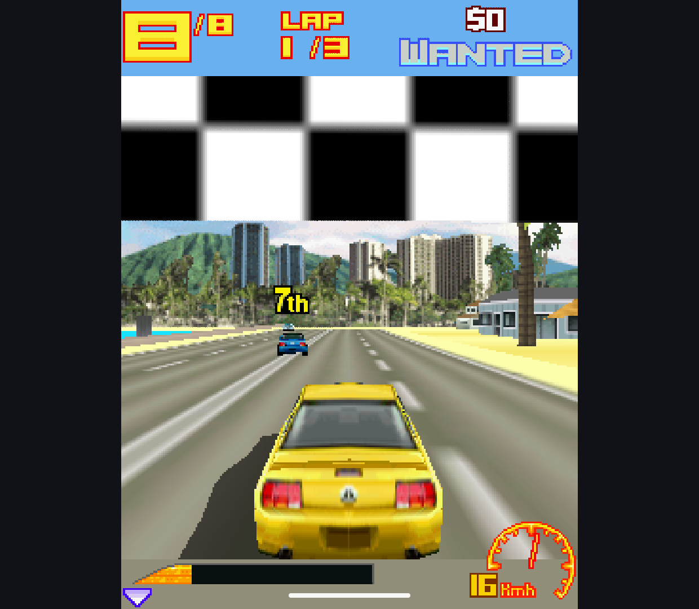
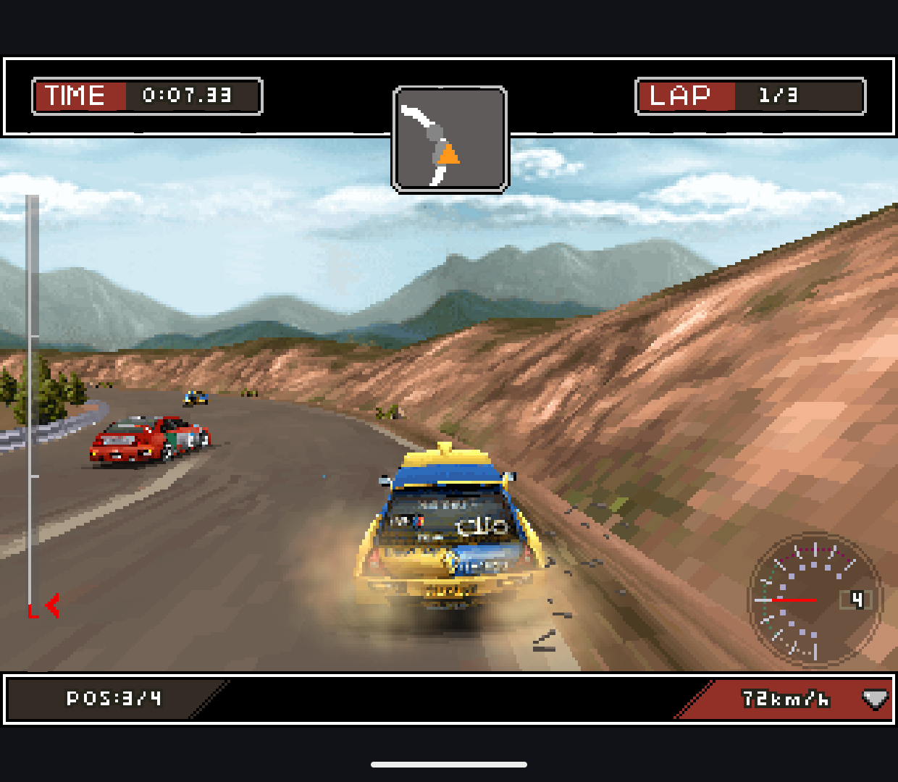
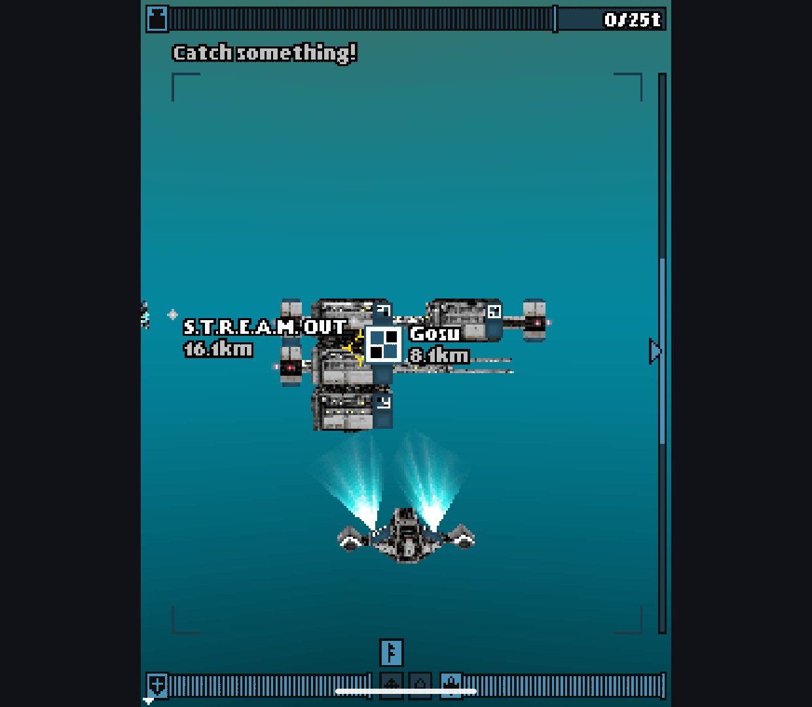

# Scene, Loader and Raster Compatibility - 2026-10-13

Research branch only. Main's renderer, root license and public APKs are unchanged.
Guarded preparation patches target FreeJ2ME-Plus revision
`baca76a4dda6f30abac67fb4a3db009eed05f91c`. The unchanged native implementation
was compared through its public API, not copied. Fixtures are original;
commercial game archives and assets remain local.

## Implemented

- Preserve all queued objects when retained scenes grow past the initial
  capacity. The previous resize discarded existing render entries.
- Preserve caller-supplied camera ranges. Empty parallel/perspective volumes
  render nothing, while querying their matrix retains the API exception.
- Correct default and animated spotlight cones, disabled light ancestors,
  copied light transforms and null light slots. Disabled lights no longer leak
  into a world; removing a slot no longer crashes triangle lighting.
- Clamp and round normalized animated colors consistently in lights, fog,
  materials and texture blend colors.
- Sample triangles at pixel centers in Java and native rasterization, including
  color, depth, fog and texture interpolation. Exact span reciprocals remove
  native/Java fog rounding drift. Near-plane clipped geometry now agrees with
  the GPU fixture without broadening the comparison tolerance or hiding edges.
- Preserve effective fragment alpha for mesh and sprite composition in all
  three paths. Remove the upstream zero-alpha-to-opaque override, including
  its game-specific justification; node alpha factors remain effective.
- Isolate nested resource-loading context, normalize relative paths before
  cycle checks and close source streams. Read signed appearance layers and
  reject invalid vertex encodings, booleans and unsupported object records.
- Validate section lengths, checksums, compressed output/trailers, record
  boundaries and declared file boundaries before interpreting payloads. A
  header-only file no longer treats the container's unrelated tail as a huge
  section allocation. Encoded and decoded sections have a 64 MiB ceiling each;
  this is not a total-scene cap or a complete hostile-input security audit.

Contract references: [Camera](https://nikita36078.github.io/J2ME_Docs/docs/jsr184/javax/microedition/m3g/Camera.html),
[Light](https://nikita36078.github.io/J2ME_Docs/docs/jsr184/javax/microedition/m3g/Light.html),
[AnimationTrack](https://nikita36078.github.io/J2ME_Docs/docs/jsr184/javax/microedition/m3g/AnimationTrack.html),
[Graphics3D](https://nikita36078.github.io/J2ME_Docs/docs/jsr184/javax/microedition/m3g/Graphics3D.html),
[Loader](https://nikita36078.github.io/J2ME_Docs/docs/jsr184/javax/microedition/m3g/Loader.html)
and [binary format](https://nikita36078.github.io/J2ME_Docs/docs/jsr184/file-format.html).

## Verification

| Run | Result | Scope |
| --- | --- | --- |
| Before fixes | 44 cases, 26 failures | Initial scene and loader regressions |
| Native comparison | 47 cases, 40 pass / 7 fail | New shared API fixtures, not the candidate GPU suite |
| Final candidate, Retroid Pocket Classic / Android 14 | 260 pass, no skips | Full unmeasured verifier |
| Final candidate Phone, Android 15 x86_64 emulator | 260 pass, no skips | Same full verifier, including software-emulated GPU |
| Private game corpus / Retroid | 70 resources, zero load failures | Eight supplied JARs; loading only |

The 76 additions comprise 26 scene checks, 21 loader checks, those 26 scene
checks repeated with GPU enabled, one eight-scene full-frame CPU/GPU matrix,
and two alpha checks across Java/native/GPU. Earlier animation, deformation,
cache, lifecycle and rendering checks remain in the full verifier. The matrix
checks every channel of every pixel with tolerance 3 and requires actual GPU
draws. [Final pixel pairs](scene-contracts-20261013/pixel-comparison/) are retained
alongside [pre-fix clipping, raw logs and artifact metadata](scene-contracts-20261013/).

During development the expanded suite also exposed sprite-alpha packing and
one-channel native fog differences; both were fixed before the final full runs.
Afterward, the nested-resource assertion was made independent of unspecified
root-array ordering. Only the test changed; the loader suite was rerun on both
targets. Its final logs are separate from the full-run artifact records.

The seven native differences are deliberately not described as seven visual
bugs or a universal compatibility advantage:

- Two color getters return `0xffff0080` rather than `0x00ff0080` after animation.
  RGB is identical; the documented zero high byte differs, not rounding.
  See [Texture2D](https://nikita36078.github.io/J2ME_Docs/docs/jsr184/javax/microedition/m3g/Texture2D.html).
- The header-only fixture returns null rather than an empty root array.
- Parent-relative and nested sibling references fail in the original host loader.
- Invalid vertex encoding and trailing compressed bytes are accepted.

## Real Games

The corpus probe scans M3G magic rather than trusting file extensions. It loads
standalone resources through the real host class loader, but does not execute
the game or discover resources inside game-specific packed containers.

| Archive | Loaded resources |
| --- | ---: |
| 3DGoldenWarrior.jar | 14 |
| 3D_Racing_Fever_GT_103.jar | 5 |
| Airburster3D.jar | 9 |
| BeachPingPong3D.jar | 6 |
| BimmerStreetRacing3D.jar | 11 |
| ColinMcRaeDiRT3D.jar | 16 |
| Deep3D.jar | 2 |
| Ducati3DExtreme.jar | 7 |

The opt-in test is `javax.microedition.shell.M3gGameResourceProbe`; supply
`-e m3gCorpus <app-accessible-folder>` to the instrumentation runner. Its JSON
contains names, root types and results, never resource contents. It is not part
of the normal verifier and no games are embedded in test APKs.

Fresh Retroid checks reached Asphalt races on CPU and GPU-enabled builds,
and a DiRT race on the final GPU-enabled build. The Asphalt captures are
different runs/tracks, not pixel or FPS comparisons. DiRT's diagnostic log
records over 4,000 GPU submissions and a CPU fallback state: GPU-enabled does
not mean every draw uses that path. Music was disabled; no listening test,
complete race, sustained FPS or physical-button acceptance is claimed.
Deep: Submarine Odyssey also reached its actual 3D submarine/station gameplay
and HUD after character setup and dialogue. This is the Java game, not Mophun
Deep Abyss. Research apps were stopped without clearing their data; ordinary
installed apps were untouched.







## Artifact Identity

Both variants built offline with JDK 21, `-Pm3gExperiment=candidate` and
`-Pm3gNonDebuggable=true`. Game GPU build additionally used `-Pm3gGpu=true`.
SHA-256 for local artifacts; these are not new public release assets:

```text
E6263F3B74812A760424D54FB96A60DFEB0D849BC1623EC2A06BF1C29D6F0DCA  Handheld full-run app
CA9EC84397391391706E32183750408A371F005090A5BA86C09E6664E374CF23  Handheld full-run tests
111730A9B21D510FEC6D41362A0D158B6E0DD7F57BD2999BE7B832ECC1405BB3  Phone full-run app
25E9F1CC9A56836D7F262FDFEECD03989DB21459E1C55A7FC64EB65D7A2BD2B2  Phone full-run tests
A1345571DFC8F76206974AC857030E54925CE8EB24B76B84D2839F1D90E8C59A  GPU-enabled Handheld game run
A9C4D53E8D402FF3A08BAFBE7A3F059355A268A621A7807224C1E9113D5128E5  Final Handheld loader tests
BE4E776191700F047E403735BC26EC919296CEE03E14D93E8BE3C754A615D8D3  Final Phone loader tests
```

## Remaining Acceptance

GPU stays opt-in. This batch does not remeasure performance after the sampling
changes or prove that titles relying on the removed alpha override still work.
Constructo Combat / Tower Bloxx variants specifically remain a useful check.
Next: a combined production-readiness pass covering representative game draw
paths and performance against the original engine, repairing regressions in
that same pass, followed by the pinned dependency/notice/source inventory.
Merge, root-license transition and beta publication still require those gates;
do not substitute the synthetic pass count for game or release acceptance.
