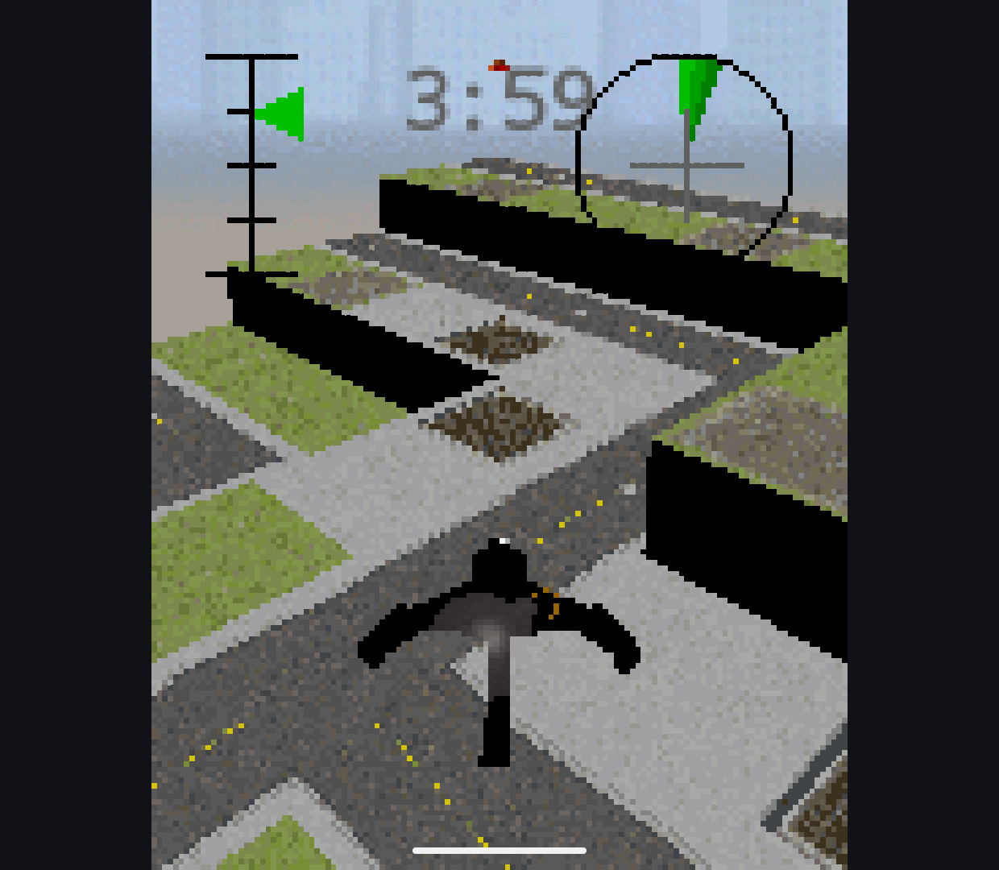
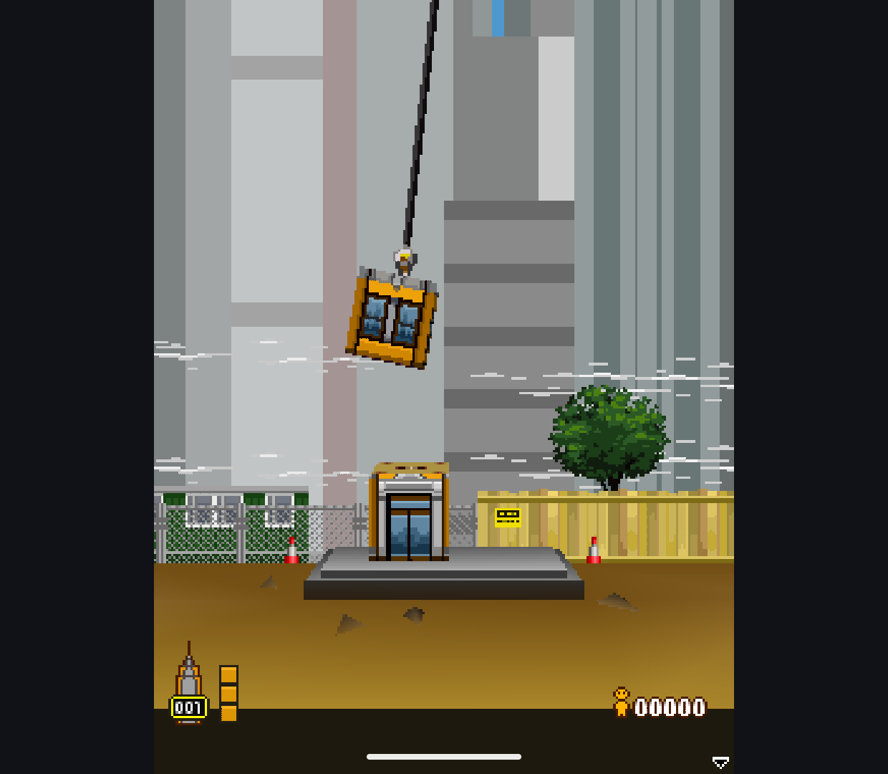

# GPU Submission and Game Checks - 2026-10-13

Research branch only. Production engine, root license and public APKs are
unchanged. This follows the [scene compatibility checkpoint](scene-contracts-20261013.md).

## Implementation

- Pack vertex components into a reusable bounded Java array and copy them into
  each command's direct buffer in one bulk transfer. Previously each component
  used a separate checked direct-buffer write. Queued commands still own their
  immutable geometry snapshots; closing the renderer releases the staging array.
- Reuse unchanged framebuffer, program, viewport, blend, scissor, depth and
  shader state inside one uninterrupted submission. Every new EGL scope or
  context replay starts from a full setup. Texture revisions/bindings remain
  checked per draw; this does not bypass mutable-image handling.
- Keep color-mask application explicit on every draw. The first optimization
  skipped unchanged masks and failed a mixed-material sequence on Retroid's
  Adreno A12, although it passed on the software-rendered Phone emulator and
  retained all 30 benchmark image CRCs. Bisecting state groups isolated the
  difference to color-mask reapplication. The final implementation fixes that
  regression; this is empirical device evidence, not a general driver diagnosis.
- Add two regression cases combining 0-4 textures, RGB/RGBA, mip/filter changes,
  all blend modes, color/alpha/depth write masks, fog, sprites, viewport changes
  and replay after injected context loss. Compare immediate and queued images
  exactly at the previously failing prefix and at the end of the sequence.

No per-title rendering patch or alpha override was added.

## Verification

Final Retroid Pocket Classic / Android 14 and Phone Android 15 x86_64 emulator:
**262 passed, zero skipped on each**. Raw output and artifact hashes are in
[checks/retroid](submission-20261013/checks/retroid) and
[checks/phone](submission-20261013/checks/phone). The Phone rerun used an explicit
900-second limit and completed normally.

An earlier exhaustive 20-prefix Phone run exceeded its 600-second limit during
the new mixed-state test; it is not a pass. The final regression keeps the
first failing prefix (11) and full sequence (20), avoiding redundant shader
compilation for every intermediate frame. The verifier now accepts an explicit
timeout up to 1,200 seconds; its default remains 300 seconds. No test failure
is treated as a skip.

## Performance

Retroid, non-debuggable isolated research APKs, no phase tracing. Each of 30
fixtures has 64 warm-up frames and five batches of 32 frames. Before/after GPU
figures below average two complete runs; the original native engine has one
comparison run. Thermal status starts/ends at zero in the recorded runs.
The native engine skips two four-texture fixtures. These are synthetic frame
costs including readback, **not game FPS**.

| Fixture | GPU before, ms | GPU after, ms | Change | Original native, ms |
| --- | ---: | ---: | ---: | ---: |
| Lighting grid 240x320 | 5.490 | 4.643 | -15.4% | 0.867 |
| Lighting grid 320x240 | 6.163 | 5.325 | -13.6% | 0.848 |
| Many draws 240x320 | 4.353 | 3.618 | -16.9% | 1.276 |
| Many draws 320x240 | 4.474 | 3.644 | -18.6% | 1.229 |
| Material churn 240x320 | 4.193 | 3.624 | -13.6% | 1.294 |
| Material churn 320x240 | 4.542 | 3.578 | -21.2% | 1.248 |
| RGB linear 240x320 | 2.203 | 2.197 | -0.3% | 0.860 |
| RGB linear 320x240 | 1.992 | 1.966 | -1.3% | 0.858 |
| Sprites 240x320 | 2.740 | 2.916 | +6.4% | 0.956 |
| Sprites 320x240 | 2.493 | 2.487 | -0.3% | 0.940 |

The improvement is concentrated in geometry/many-draw scenes. Portrait sprites
are slower in these samples, so this is not a universal speedup. The original
engine remains substantially faster. GPU remains opt-in; production parity is
not claimed. All 30 final comparison image CRCs match the pre-change GPU run.

[Machine-readable reports](submission-20261013/benchmarks) include both before
and final runs, an isolated bulk-packing run, candidate CPU and original native
comparisons. `artifact.json` identifies each exact APK/test APK. The benchmark
test APK predates the regression test's prefix-loop reduction; application
code is unchanged by that reduction. Intermediate unsafe state-cache timings
are intentionally not presented as accepted final results.

Two further attempts to repair the sprite slowdown were measured and rejected:
direct sprite-buffer writes (2.993 ms portrait), then full state setup for every
sprite (3.075 ms). Neither improved on the accepted implementation. Their
`readiness-sprite-*` reports are retained as rejected experiments, not fixes.
Both changes were removed; rebuilding the restored code produced byte-identical
Handheld and Phone APK hashes to those used by the final full verifier runs.

## Real Games

Fresh Retroid runs with the user's private archives reached:

- `ConstructoCombat3D.jar`: actual single-player match, changing timer, opponents,
  scene and sprites on candidate GPU-enabled and CPU builds. Its detected
  128x160 profile uses oversized system fonts in tutorial messages; this is
  not claimed fixed by the renderer patch.
- `Tower Bloxx N6270.jar`: Quick Game on both candidate paths. On GPU, a block
  landed, occupants were counted and the next floor appeared. The session log
  confirms actual GPU draws, not just a GPU build flag.

These are separate interactive runs, not deterministic pixel/FPS comparisons.
No sound listening, full playthrough or physical-controller acceptance is
claimed. Constructo also uses CPU fallback for a recorded draw state. Neither
game requires restoring the removed zero-alpha-to-opaque override.
The original native engine also reached Constructo gameplay; its separate-run
capture is included for visual reference, not as a synchronized pixel oracle.

CPU captures and bounded GPU logs are adjacent to these files. The GPU-enabled
game APK SHA-256 is
`37610DB046F06D76B7CE020E942DC96321EE9E20B5A6F7CC1C09E098CBB10EE1`.
Games and APKs are not included in the commit.

## Next Gate

Reduce remaining scene/geometry and readback cost without losing fragment,
depth or mutable-resource behavior; address the portrait sprite regression.
The [dependency checkpoint](dependencies-20261013.md) identifies the inherited
compact audio binary against pinned source but does not complete release
compliance. Production integration, all notices/source delivery, signed upgrade
tests and the beta are still pending.
