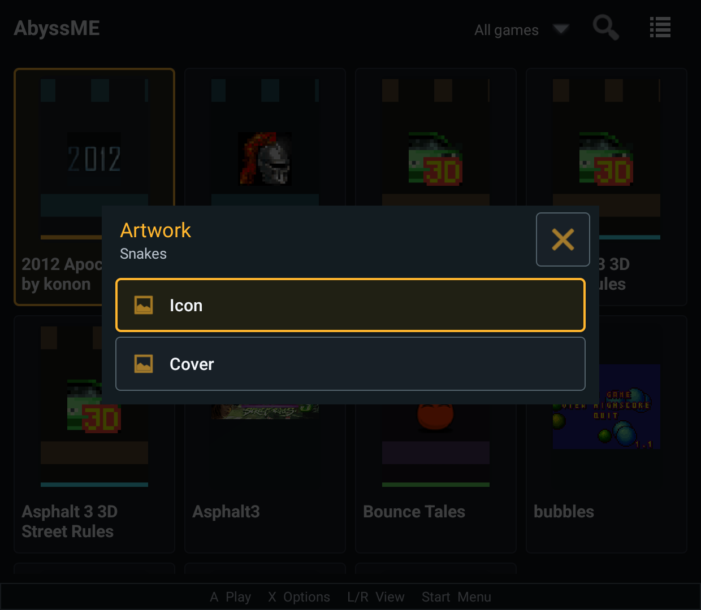

# Native game artwork menu

Unedited Retroid Pocket Classic screenshot from the local Symbian-enabled debug
build, 2026-10-18. The Snakes card now uses the common Artwork menu. This is not
a screenshot of a new public release.

[Implementation and verification](../../../docs/checks/2026-10-18-symbian-artwork.md).
