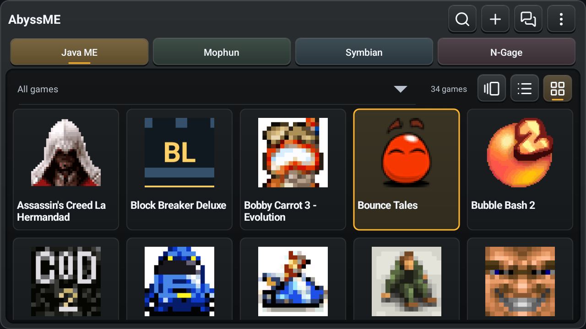
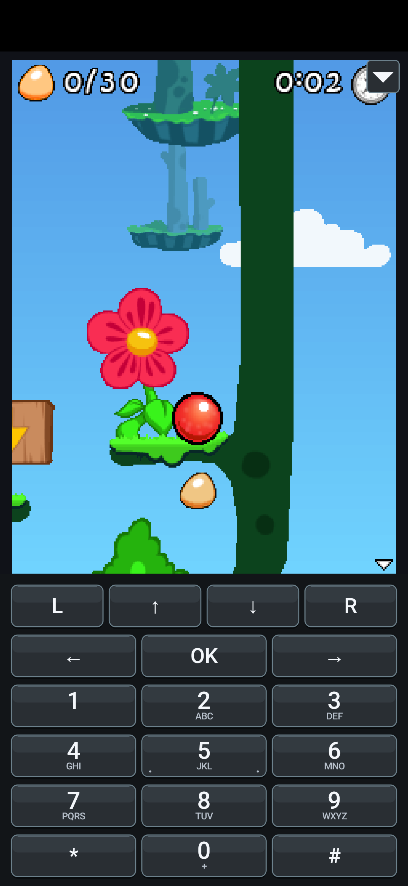
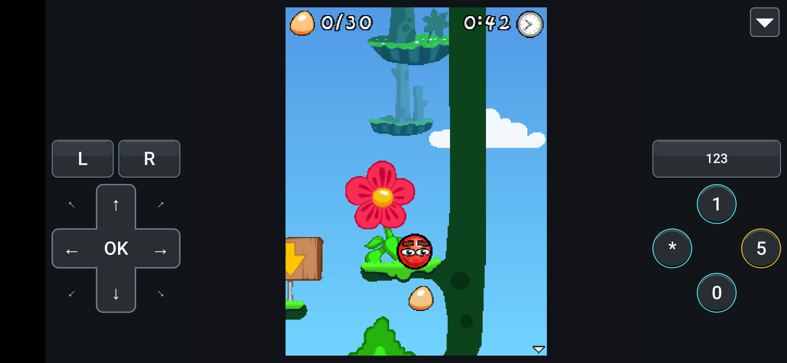
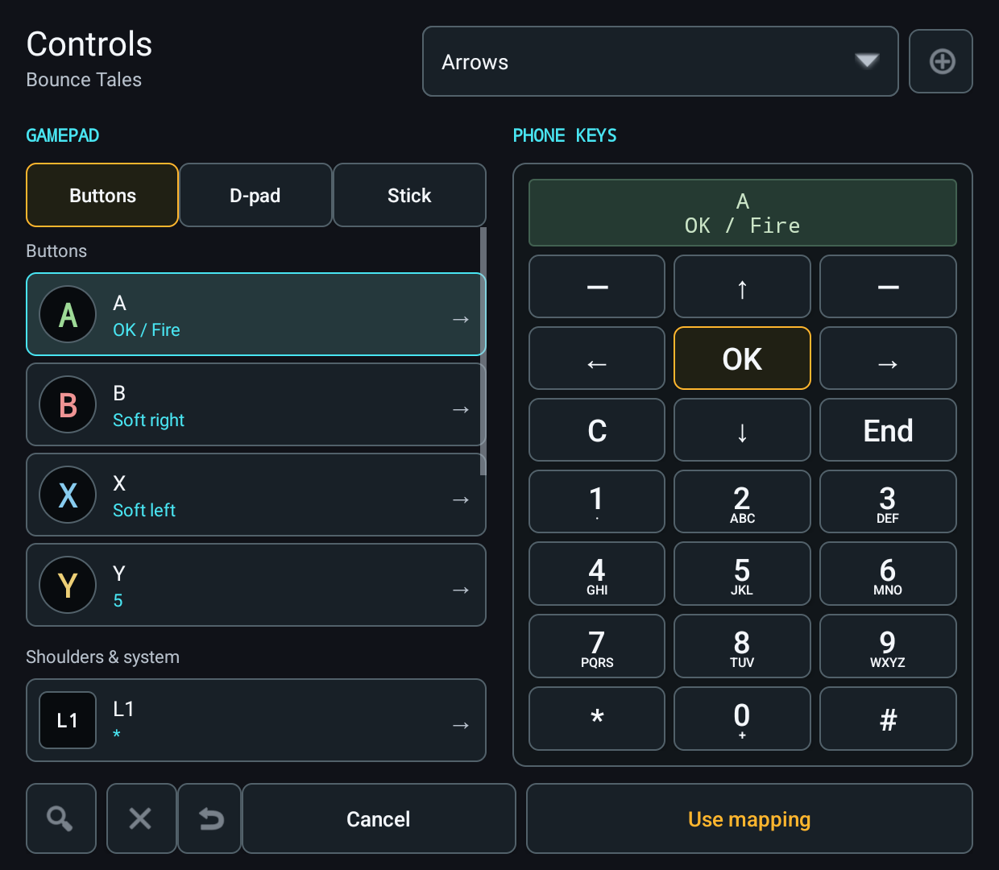
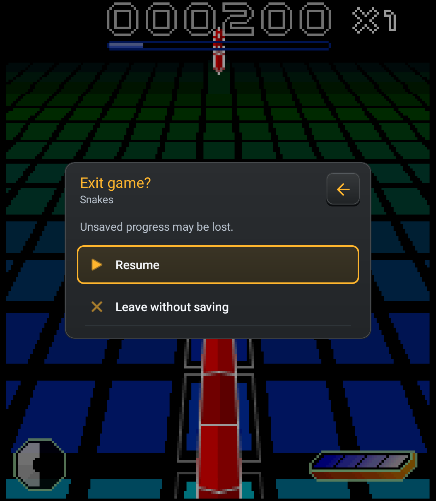

# AbyssME Beta 1 Revision 1 - Dark Screenshot Gallery

Captured **2026-10-26**. Original ADB PNGs, no mockups, retouching, composites or
artwork added for the photos. Every app surface uses the dark theme. Game art
retains its original colors. Open an image for full resolution.

## Suggested Post Images

**Wide handheld library, Grid:**

**Phone gameplay with the numeric keypad:**

**Gamepad layout on a landscape phone:**

**Controller mapping on Retroid:**

**Centered confirmation on the native Retroid display:**

## Library Across Display Sizes

All three browsing modes are shown at each size. Different installed collections,
selected games and retained scroll positions are real, not a composed comparison.
Gallery uses existing covers when available and the app's native icon/fallback
art otherwise; no claim of universal automatic cover extraction is intended.

| Environment | Grid | List | Gallery |
| --- | --- | --- | --- |
| Retroid native, 1080x1240, 27:31, 540x620dp | [Grid](06-retroid-library-grid.png) | [List](08-retroid-library-list.png) | [Gallery](07-retroid-library-gallery.png) |
| Phone emulator, 1080x2340, 6:13, about 393x851dp | [Grid](20-phone-library-grid.png) | [List](28-phone-library-list.png) | [Gallery](29-phone-library-gallery.png) |
| Retroid resized viewport, 1280x720, 16:9, about 853x480dp | [Grid](30-handheld-16x9-grid.png) | [List](31-handheld-16x9-list.png) | [Gallery](32-handheld-16x9-gallery.png) |
| Retroid resized viewport, 960x720, 4:3, 640x480dp | [Grid](35-handheld-4x3-grid.png) | [List](34-handheld-4x3-list.png) | [Gallery](33-handheld-4x3-gallery.png) |

## Gameplay and Features

| Image | Content and environment |
| --- | --- |
| [01](01-retroid-library-menu.png) | Retroid: centered library actions |
| [03](03-retroid-snakes-menu.png) | Retroid: common menu over Snakes gameplay |
| [04](04-retroid-exit-centered.png) | Retroid: centered native-game Exit confirmation |
| [05](05-retroid-snakes-gameplay.png) | Retroid: Snakes first-level gameplay, N-Gage |
| [09](09-retroid-bounce-gameplay.png) | Retroid rotated to 1240x1080: Bounce Tales gameplay, Java |
| [10](10-retroid-java-menu.png) | Same Retroid: common game menu centered on the near-square screen |
| [11](11-retroid-display.png) | Same Retroid: picture presets with Keep/Undo |
| [12](12-retroid-controller-mapping.png) | Same Retroid: controller inputs and graphical phone keypad |
| [13](13-retroid-settings.png) | Retroid: main settings |
| [14](14-retroid-library-transfer.png) | Retroid: backup, restore and J2ME Loader migration entry points |
| [21](21-phone-keypad-gameplay.png) | Portrait phone emulator: Bounce Tales and numeric keypad |
| [22](22-phone-game-menu.png) | Portrait phone emulator: ordinary game menu remains a bottom panel |
| [23](23-phone-gamepad-gameplay.png) | Portrait phone emulator: alternate touch gamepad |
| [24](24-phone-landscape-gameplay.png) | Landscape phone emulator, 2340x1080: gamepad at the sides |
| [25](25-wide-game-menu.png) | Same wide phone: ordinary menu aligned right |
| [26](26-wide-display-preview.png) | Same wide phone: narrower picture preview leaves gameplay visible |
| [27](27-wide-exit-centered.png) | Same wide phone: confirmation centered rather than right-aligned |

## Provenance and Limits

Retroid Pocket Classic / Android 14 uses the **signed release APK**
`0.6.0-beta.1-r1`, code 312, SHA-256
`17dc8d8f4b0472d2958ca0543ed072cde6ba903ee75ab37a16baa476c3043944`.
Its normal density is 320dpi; the two temporary viewport sizes use 240dpi.
Those are layout simulations on the same hardware, not photos of other devices.
Original resolution/density/rotation were restored after capture.

Phone images use the matching **Debug build on an Android 35 emulator**, 440dpi.
They verify phone UI, not a physical phone or signed-Release installation on one.
The temporary Gamepad/landscape selections belong to its isolated test profile.
No Retroid controller mapping or saved display profile was changed for the shots.

Game files and firmware are user-provided, not distributed with these pictures
or the app. Short gameplay captures do not establish full-game compatibility,
audio, sustained performance or online acceptance. No account secrets or private
conversations are shown. [Checks and release status](../../../docs/releases/v0.6.0-beta.1-r1-checks.md).
