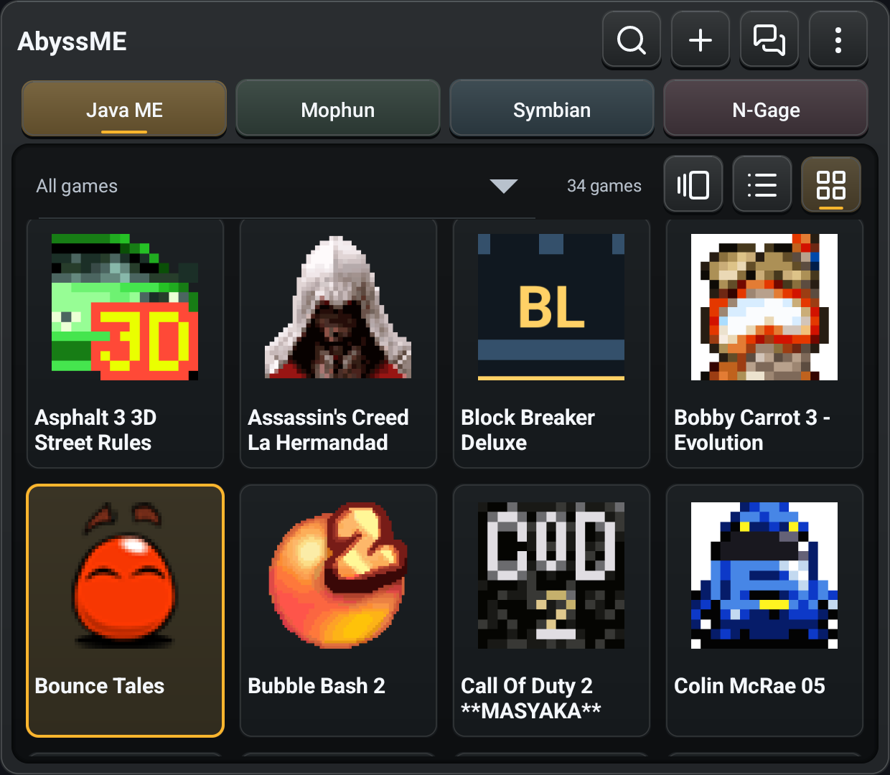
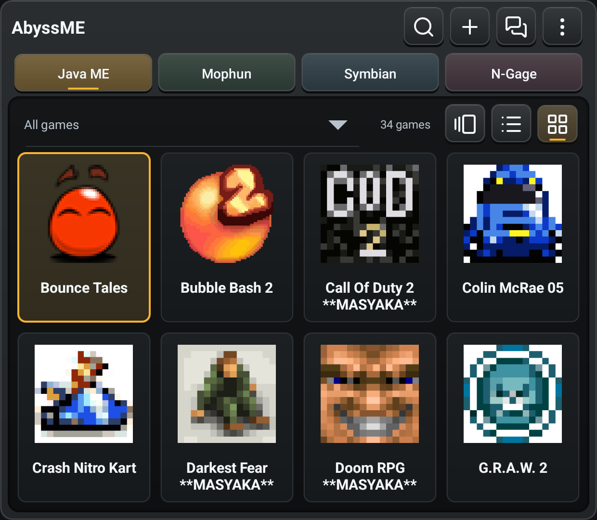
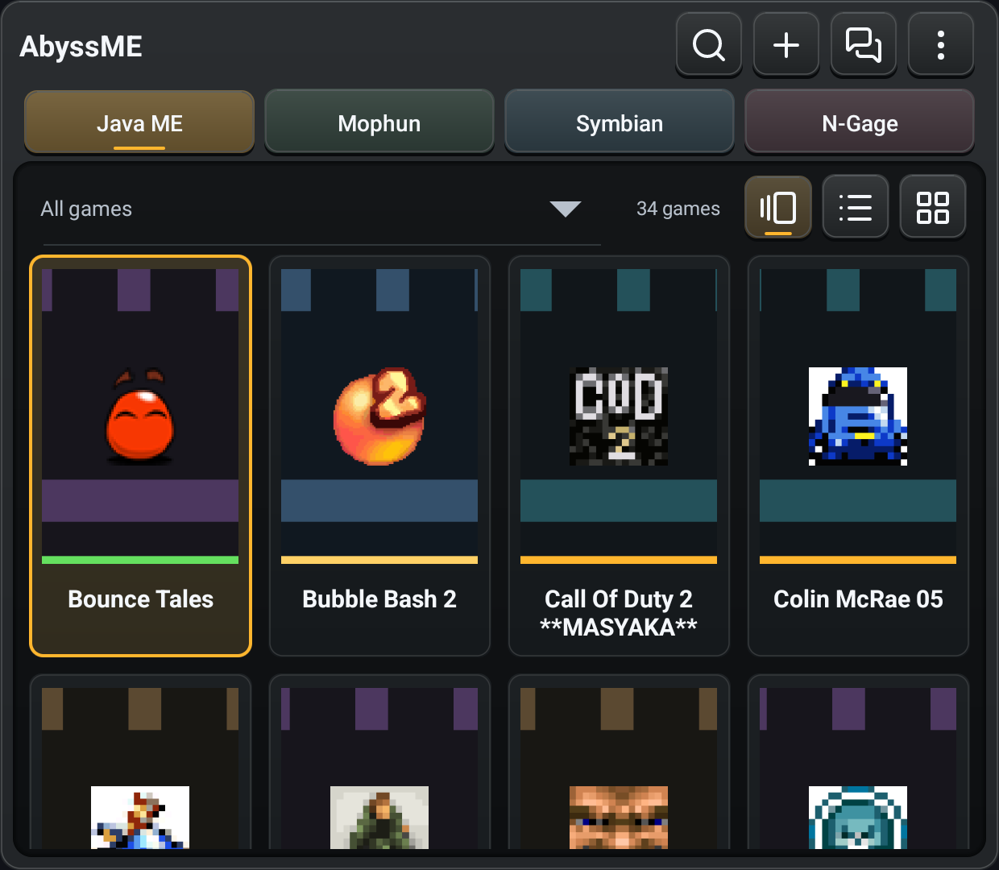
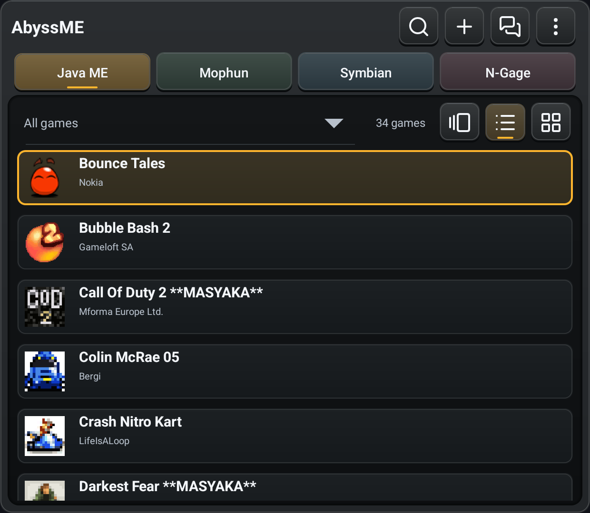

# Library Title Alignment

2026-10-28. Retroid Pocket Classic, Android 14, physical 1240x1080 landscape
viewport, dark theme. Direct ADB captures of the official signed app, no image
retouching or simulated phone viewport. The game collection is user supplied,
not bundled with AbyssME.

| Before: code 313 | After: code 314 |
| --- | --- |
|  |  |

The selected game remains Bounce Tales. The restored scroll position differs;
this is an alignment comparison, not a pixel-matched screenshot diff.

| Gallery: centered | List: start-aligned |
| --- | --- |
|  |  |

Same signed `0.7.0-beta.1-r1` APK in all three after captures. Long Grid titles
use two centered lines; List retains its single-line title and leading metadata.
No new phone/other-viewport or complete-game acceptance is claimed.
